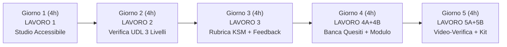

# Slide per la Visualizzazione in Aula — Incontro 1 di 5 (4 ore)

## VALUTARE PER CRESCERE
### *I nuovi modelli di Gemini e NotebookLM per l'accessibilità e l'autonomia nello studio degli studenti (4/20 del corso)*

> [!TIP]
> **Guida per il Formatore in Laboratorio (Scansione 4 ore = 240 min)**  
> * Con la nuova struttura in **5 incontri da 4 ore**, l'**Incontro 1 (4h)** è interamente dedicato al modulo **"Accessibilità, autonomia e studio degli studenti" (4/20 del corso)**, senza dover comprimere nel finale l'avvio delle verifiche (che apre invece in modo organico l'Incontro 2).  
> * **Scansione ergonomica delle 4 ore**:
>   * `00:00 – 01:50` **Blocco 1 (110 min · 2h nominali)**: Nuovi modelli di Gemini, barriere allo studio 11–14 anni, Prompt di studio `R-C-N-A-F`, Privacy/GDPR e Demo Live 1 su Gemini Multimodale + Canvas.
>   * `01:50 – 02:10` ☕ **PAUSA CENTRALE (20 min)**.
>   * `02:10 – 04:00` **Blocco 2 (110 min · 2h nominali)**: Google NotebookLM (*Grounding*, Mappe Mentali, Audio Overview), **Lavoro Pratico 1 (50')** e Galleria/Debriefing finale (30').  
> * Per la proiezione interattiva a schermo intero nel browser, apri [Incontro_1_Presentazione_Aula.html](file:///c:/Users/amart/Desktop/Corsi%20per%20docenti/Intelligenza%20Artificiale%20nella%20didattica%20e%20nella%20valutazione/Incontro_1/Incontro_1_Presentazione_Aula.html).

---

## 🟢 BLOCCO 1 (`00:00 – 01:50` · 110 min / 2h nominali)
### *I nuovi modelli di Google Gemini, le barriere allo studio, la Privacy GDPR e l'adattamento Easy-to-Read*

---

### SLIDE 1 — Benvenuti a "VALUTARE PER CRESCERE"
* **Sottotitolo**: *Valutare con l'IA: verifiche accessibili e personalizzate nella Secondaria di I Grado*
* **Struttura del corso**: **20 ore in 5 incontri da 4 ore**
* **Incontro 1 di 5 (4 ore)**: *Accessibilità, autonomia e studio degli studenti con Google Gemini e NotebookLM*
* **Il nostro ritmo di oggi (4 ore)**:
  * `00:00 – 01:50` **Blocco 1 (110')**: Nuovi modelli di Gemini, barriere allo studio, Prompt `R-C-N-A-F`, Privacy/GDPR e Demo Gemini Multimodale
  * `01:50 – 02:10` ☕ **PAUSA CENTRALE (20 min)**
  * `02:10 – 04:00` **Blocco 2 (110')**: Google NotebookLM (Mappe Mentali + Audio Overview), **Lavoro Pratico 1 (50')** e Condivisione tra pari

---

### SLIDE 2 — Setup Operativo in 3 Minuti (PC di Laboratorio)
1. Apri Chrome e accedi al tuo account **Google Workspace for Education**.
2. Vai su **Google Drive** e crea la cartella principale:  
   📁 `Corso_Valutare_Per_Crescere`
3. Dentro la cartella crea le **5 sottocartelle** (una per ciascuna giornata del corso):
   * `01_Giorno1_Studio_Accessibile` *(Oggi!)*
   * `02_Giorno2_Verifica_Multilivello_UDL`
   * `03_Giorno3_Rubrica_KSM_e_Feedback`
   * `04_Giorno4_Banca_Quesiti_e_Quiz_Digitale`
   * `05_Giorno5_Verifica_Multimodale_e_Kit_Finale`
4. Apri in due schede affiancate: **Google Gemini** (`gemini.google.com`) e **Google NotebookLM** (`notebooklm.google`).

> ⚠️ **Promemoria in laboratorio**: siamo su PC condivisi della scuola → salvate tutto su Drive e ricordate il **Logout** a fine pomeriggio!

---

### SLIDE 3 — Il Filo Rosso dei 5 Giorni: 5 Lavori → 1 Kit Pronto per la Classe
Nessun esame teorico finale. Scegli **un argomento reale** che insegnerai nelle prossime settimane e costruisci in 5 tappe il tuo **Kit Valutativo Inclusivo**:

---

### SLIDE 4 — Cosa Cambia con i Nuovi Modelli di Google Gemini?
Non siamo più davanti a una semplice "chat testuale". Ecco le **4 leve nuove** dell'ecosistema Google gratuito che useremo:

| Nuova Capacità | Cosa fa concretamente per il docente di Scuola Media |
| :--- | :--- |
| 📸 **1. Multimodalità Nativa** | Carichi la **foto della pagina del libro cartaceo**, una mappa, un grafico o un PDF: Gemini legge testo + immagini insieme senza ricopiare nulla. |
| 🧠 **2. Modello Rapido (*Flash*) vs Ragionamento (*Thinking*)** | *Flash* per adattare testi e creare glossari in 3 secondi; *Thinking* (ragionamento passo-passo) per problemi STEM, domande HOTS e *"Caccia all'errore"*. |
| ✍️ **3. Gemini Canvas & Gem** | In **Canvas** modifichi o semplifichi una sola frase selezionandola col mouse; con i **Gem** salvi il tuo assistente disciplinare permanente. |
| 📄 **4. Esportazione in 1 Clic** | Pulsante diretto **"Esporta in Documenti"** o **"Esporta in Fogli"** direttamente nel tuo Google Drive. |

---

### SLIDE 5 — Le Barriere Invisibili nello Studio (11–14 anni)
Quando uno studente di 1ª, 2ª o 3ª media apre una pagina di sussidiario a casa, cosa può bloccarlo?

* **DSA (L. 170/2010)**: fatica nella decodifica grafemico-fonologica, lentezza di lettura, memoria di lavoro verbale che si satura su frasi lunghe.
* **NAI / Italiano L2**: possiede il concetto nella lingua madre, ma è bloccato dalla *lingua dello studio* (forme passive, subordinate, lessico astratto).
* **Disabilità (L. 104/92) e FIL**: necessità di concetti essenziali concreti, esempi visivi e passaggi guidati.
* **ADHD / Fragilità Esecutive**: pagina "muro di testo" senza punti di ancoraggio visivo → perdita immediata del filo attentivo.

> 💡 **Principio UDL**: *Abbassare la barriera strumentale (grafica e linguistica) NON significa abbassare la dignità cognitiva del compito!*

---

### SLIDE 6 — Perché "Studiare solo a Memoria" (`LOTS 1`) Penalizza i Più Fragili
La scala cognitiva di **Anderson & Krathwohl (2001)** applicata ai materiali di studio:

| Fascia | Livello Cognitivo | Risultato se usiamo male l'IA | Come useremo invece Gemini e NotebookLM |
| :--- | :--- | :--- | :--- |
| **LOTS** | **1. Ricordare** | ❌ Liste di date e definizioni a memoria (il punto più debole per DSA/BES!) | ✅ Banche di parole, glossari visivi, mappe con ganci mnemonici |
| **LOTS** | **2. Comprendere** | ❌ Riassunti troppo astratti o tagliati male | ✅ Testi *Easy-to-Read*, metafore concrete, Audio Overview |
| **Ponte** | **3. Applicare** | ❌ Esercizi senza guida | ✅ Procedure *step-by-step* con il 1° esercizio già svolto come modello |
| **HOTS** | **4. Analizzare · 5. Valutare · 6. Creare** | ❌ Esclusi dai materiali facilitati! | ✅ Tabelle comparative semicompilate e domande-sfida guidate |

---

### SLIDE 7 — Governare Gemini fin dal Giorno 1: Il Prompt in 5 Punti (`R-C-N-A-F`)
Per evitare che Gemini produca riassunti generici o impoverisca la disciplina, strutturiamo ogni richiesta con **5 coordinate**:

| Lettera | Elemento del Prompt | Cosa comunichiamo a Gemini |
| :---: | :--- | :--- |
| **1. R** | **RUOLO** | *"Agisci come docente esperto di [Materia] alla Secondaria di I grado e specialista in didattica inclusiva UDL..."* |
| **2. C** | **CLASSE E CONTESTO** | *"Classe [1ª/2ª/3ª] media, studenti di [11/12/13] anni..."* |
| **3. N** | **NUCLEI E SCALA COGNITIVA** | *"Conserva questi nuclei fondanti [...] e accompagna lo studente dal Ricordare (`LOTS 1`) al Comprendere e Applicare (`LOTS 2–3`)..."* |
| **4. A** | **ACCESSIBILITÀ E PROFILO** | *"Profilo funzionale anonimizzato + regole Easy-to-Read (frasi max 15-18 parole, forma attiva, parole chiave in grassetto)..."* |
| **5. F** | **FORMATO DI OUTPUT** | *"Restituisci: 1) Testo adattato in paragrafi titolati; 2) Tabella Glossario; 3) 3 domande-guida con suggerimento [Aiuto: ...]..."* |

---

### SLIDE 8 — Privacy, GDPR e IA: La Regola d'Oro e il Profilo Funzionale Anonimizzato
> [!CAUTION]
> **DIVIETO ASSOLUTO (GDPR Art. 9 + Linee Guida MIM / Garante Privacy)**  
> Non inserire **MAI** in Gemini o in qualsiasi servizio online: nomi, cognomi, iniziali riconoscibili, codici fiscali, codici diagnostici (`ICD-10`, es. `F81.0`) o file PDF/foto di **PEI e PDP**.

A Gemini **non serve l'etichetta medica**: lavora molto meglio con il **Profilo Funzionale Anonimizzato**:

| ❌ Prompt VIETATO (Viola il GDPR) | ✅ Prompt CORRETTO (Profilo Funzionale Anonimizzato) |
| :--- | :--- |
| *"Adatta questo brano di storia per Luca Rossi della 1ª B che ha dislessia F81.0 e ADHD, ti incollo il suo PDP..."* | *"Adatta questo brano di storia per una 1ª media includendo supporti per studenti con affaticamento nella lettura di testi lunghi e tempi brevi di attenzione: usa paragrafi di max 4 righe, frasi attive sotto le 16 parole, parole chiave in grassetto e un glossario finale."* |
| *"Prepara una scheda di scienze per Fatima, alunna NAI arrivata un mese fa..."* | *"Riscrivi questa scheda di scienze per studenti di 2ª media con Italiano L2 a livello A1/A2: usa verbi al presente, lessico ad alta frequenza e spiega i 5 termini scientifici obbligatori con esempi concreti quotidiani."* |

*(Scheda completa in [03_Kit_Privacy_GDPR_e_Strumenti_Locali.md](file:///c:/Users/amart/Desktop/Corsi%20per%20docenti/Intelligenza%20Artificiale%20nella%20didattica%20e%20nella%20valutazione/Materiali_Trasversali/03_Kit_Privacy_GDPR_e_Strumenti_Locali.md))*

---

### SLIDE 9 — Demo Live: 4 Strumenti Locali Gratuiti per il PC Personale
*(Dimostrazione di 10 minuti sul PC del formatore — nessuna installazione richiesta sui PC della scuola)*

1. 🛡️ **PDF24 Creator** *(Windows, 100% offline)*: funzione **"Oscura PDF"** per eliminare in modo irreversibile nomi e dati sensibili da un PDF prima di usarlo, e **"Estrai pagine"** senza caricare file su siti esterni.
2. 🤖 **LM Studio / GPT4All** *(Windows/Mac, 100% offline)*: far girare un modello IA locale sul proprio PC di casa anche **con il Wi-Fi spento**.
3. 🧩 **Lumi Education (H5P Desktop)** *(offline)*: creare video interattivi e quiz HTML5 sul PC di casa da caricare su Classroom come singolo file `.html`.
4. 📝 **LibreOffice** *(offline)*: pulizia metadati ed esportazione in PDF accessibili (`PDF/UA`).

> 📌 **Nota**: Nella cartella del corso trovate anche il **Modulo Extra A** (*Uso etico e consapevole dell'IA da parte degli alunni a casa*, con Patto di Classe e scheda per le famiglie).

---

### SLIDE 10 — Demo Live 1: Dalla Foto del Libro alla Scheda Easy-to-Read in Gemini Canvas
**Il flusso in 4 passaggi che userete tra poco nel Lavoro 1**:
1. **Input Multimodale**: carico su Gemini la **foto/screenshot** di una pagina del libro di testo (o un PDF).
2. **Attivo Gemini Canvas + Prompt `R-C-N-A-F`**: genero la scheda *Easy-to-Read* con glossario e domande-guida.
3. **Rifinitura chirurgica in Canvas**: seleziono col mouse un solo capoverso e lo semplifico in tempo reale.
4. **Esporta in Documenti**: con 1 clic apro il file in **Google Documenti**, imposto il font **Lexend** (`12 pt`, interlinea `1,5`, allineato a sinistra) e mostro la **Digitazione Vocale**.

---

## ☕ PAUSA CENTRALE (`01:50 – 02:10` · 20 minuti)
*Pausa di 20 minuti esattamente a metà delle 4 ore! Al rientro: Google NotebookLM (Mappe Mentali + Audio Overview) e Lavoro Pratico 1.*

---

## 🔵 BLOCCO 2 (`02:10 – 04:00` · 110 min / 2h nominali)
### *Google NotebookLM, Lavoro Pratico 1 (50') e Condivisione tra Pari*

---

### SLIDE 11 — Google NotebookLM: L'IA a "Zero Allucinazioni" Ancorata alle Tue Fonti
Perché **NotebookLM** (`notebooklm.google`) è uno strumento straordinario per lo studio inclusivo?

* 🔒 **Lavora SOLO sulle fonti che carichi tu**: PDF, tuoi Google Documenti, tue Google Presentazioni, link web o **video YouTube**.
* 🔢 **Citazioni verificabili**: ogni risposta ha un numerino cliccabile che mostra il punto esatto della tua dispensa da cui proviene.
* 🗺️ **Mappe Mentali Interattive Automatiche**: con 1 clic nel pannello *Studio* genera lo schema ad albero navigabile e scaricabile in PNG!
* 🎧 **Audio Overview (Podcast a due voci in italiano)**: genera un dialogo audio di 6–8 minuti che spiega la tua lezione agli alunni che faticano a leggere (personalizzabile per l'età 11–14 anni!).

---

### SLIDE 12 — Demo Live 2 su NotebookLM (Scienze, Storia e Lingue)
1. Creiamo un nuovo taccuino: *"Scienze 1ª Media — La Cellula"* (Esempio `#18` del Ricettario).
2. Carichiamo **1 PDF del docente + 1 video YouTube** sull'argomento.
3. Clicchiamo su **Mappa Mentale** → esploriamo i rami e scarichiamo l'immagine PNG da incollare nella scheda di studio.
4. Clicchiamo su **Audio Overview → Personalizza**:
   > *"Parlate in italiano rivolgendovi a ragazzi di 1ª media (11 anni). Usate un tono chiaro e incoraggiante. Spiegate con la metafora di una fabbrica la differenza tra cellula animale e vegetale."*
5. Chiediamo nella chat del taccuino una **Tabella comparativa** e **3 domande graduali di autoverifica** basate solo sulle fonti caricate.

---

### SLIDE 13 — I 6 Esempi Pronti per l'Incontro 1 nel Ricettario dei 30 Prompt
Nel [01_Ricettario_Prompt_30_Esempi_Scuola_Media.md](file:///c:/Users/amart/Desktop/Corsi%20per%20docenti/Intelligenza%20Artificiale%20nella%20didattica%20e%20nella%20valutazione/Materiali_Trasversali/01_Ricettario_Prompt_30_Esempi_Scuola_Media.md) trovate già pronti i primi **6 esempi specifici per il Giorno 1**:
1. **Esempio `#01` (Italiano 1ª media)**: Foto pagina antologia (*Ulisse e Polifemo*) → *Easy-to-Read* in Gemini Canvas per dislessia.
2. **Esempio `#02` (Italiano 2ª media)**: Testo letterario/storico → Scheda e glossario ad alta frequenza per alunni **NAI (Italiano L2)** + Audio Overview.
3. **Esempio `#07` (Matematica 1ª media)**: Foto esercizi sulle **Frazioni** → Scheda procedurale *Passo 1 / Passo 2* con esempio svolto per discalculia.
4. **Esempio `#11` (Inglese 1ª media)**: Reading graduata su *Daily Routine* con **Word Bank fonetica** per DSA.
5. **Esempio `#16` (Geografia 1ª media)**: **Gemini Multimodale** su carta fisica/climatica → Guida in 3 mosse alla lettura della carta + glossario.
6. **Esempio `#18` (Scienze 1ª media)**: **NotebookLM** su *La Cellula* → Mappa Mentale + Audio Overview + metafora della fabbrica.

---

### SLIDE 14 — 🛠️ LAVORO PRATICO 1 (`02:40 – 03:30` · 50 minuti in Laboratorio)
### *Crea il tuo "Pacchetto di Studio Accessibile" con Gemini e NotebookLM*

Scegli un argomento reale della tua disciplina (su cui lavorerai lungo tutti i 5 incontri) e segui il tuo binario:

* **🟢 BINARIO BASE ("Pronti Via")**:
  1. Prendi un testo/pagina della tua materia (o uno dei 6 esempi del Giorno 1 dal Ricettario).
  2. Usa il **Prompt Template 1 (`R-C-N-A-F`)** su **Google Gemini** per ottenere: *Testo ad alta leggibilità + Tabella Glossario + 3 domande guida progressive con aiuto*.
  3. Verifica l'output (*Human-in-the-Loop*), clicca su **"Esporta in Documenti"**, applica il font **Lexend** (`12 pt`, interlinea `1,5`, allineato a sinistra) e salva in Drive → `01_Giorno1_Studio_Accessibile`.
* **🔵 BINARIO APPROFONDIMENTO**:
  1. Parti da una **foto/PDF** con **Gemini Multimodale in Canvas** e affina i paragrafi selezionandoli col mouse.
  2. Carica lo stesso materiale (+ un video YouTube) in un taccuino **Google NotebookLM**, genera la **Mappa Mentale** (scaricala in PNG e incollala in cima al tuo Documento Google!) e avvia l'**Audio Overview personalizzato** per la tua classe.

*(Guida passo-passo in [02_Schede_Operative_4_Lavori_Pratici.md](file:///c:/Users/amart/Desktop/Corsi%20per%20docenti/Intelligenza%20Artificiale%20nella%20didattica%20e%20nella%20valutazione/Materiali_Trasversali/02_Schede_Operative_4_Lavori_Pratici.md))*

---

### SLIDE 15 — Galleria tra Pari, Debriefing e Chiusura Incontro 1 (`03:30 – 04:00` · 30 min)
* **Condivisione lampo di 3 lavori di dipartimenti diversi (20')**:
  1. Cosa ha funzionato subito bene nell'adattamento *Easy-to-Read* di Gemini?
  2. Dove siete intervenuti voi (*Human-in-the-Loop*) per proteggere il rigore dei nuclei disciplinari?
  3. Come userete la **Mappa Mentale** e l'**Audio Overview** di NotebookLM su Google Classroom?
* **Checklist di fine Giorno 1 (10')**:
  - [x] Scheda di Studio *Easy-to-Read* esportata in Google Documenti nella cartella `01_Giorno1_Studio_Accessibile`;
  - [x] Mappa Mentale PNG (e/o Audio Overview) generata su NotebookLM;
  - [ ] 🔒 **Effettuare il LOGOUT dal proprio account Google sul PC del laboratorio!**

> 🚀 **Nel prossimo incontro (Incontro 2 di 5 — 4 ore)**: entreremo nel cuore di **"VerifichIAmo con l'IA (Parte I)"** usando il modello di **Ragionamento (*Thinking*)**, la **Multimodalità** e **Gemini Canvas/Gem** per progettare sullo stesso argomento la **Verifica UDL Multilivello (Facilitata, Standard, Potenziamento)** bilanciata sulla scala **LOTS → HOTS**!
