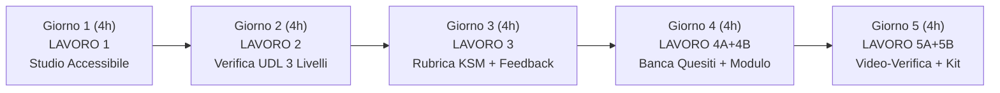

# Slide per la Visualizzazione in Aula — Incontro 1 di 5 (4 ore)

## VALUTARE PER CRESCERE
### *I nuovi modelli di Gemini e NotebookLM per l'accessibilità e l'autonomia nello studio degli studenti (4/20 del corso)*

> [!TIP]
> **Guida per il Formatore in Laboratorio (Scansione 4 ore = 240 min)**  
> * Con la nuova struttura in **5 incontri da 4 ore**, l'**Incontro 1 (4h)** è interamente dedicato al modulo **"Accessibilità, autonomia e studio degli studenti" (4/20 del corso)**, senza dover comprimere nel finale l'avvio delle verifiche (che apre invece in modo organico l'Incontro 2).  
> * **Scansione ergonomica delle 4 ore**:
>   * `00:00 – 01:50` **Blocco 1 (110 min · 2h nominali)**: Nuovi modelli di Gemini, barriere allo studio 11–14 anni, Prompt di studio `R-C-N-A-F`, Privacy/GDPR, Demo Live 1 e **Lavoro Pratico 1 · Fase 1A (30')**.
>   * `01:50 – 02:10` ☕ **PAUSA CENTRALE (20 min)**.
>   * `02:10 – 04:00` **Blocco 2 (110 min · 2h nominali)**: Google NotebookLM (*Grounding*, Mappe Mentali, Audio Overview), **Lavoro Pratico 1 · Fase 1B (45')** e Galleria/Debriefing finale (30').  
> * Per la proiezione interattiva a schermo intero nel browser (completa di **illustrazioni, diagrammi SVG animati e timer interattivi** su Slide 10, 11 e 14), apri [Incontro_1_Presentazione_Aula.html](Incontro_1_Presentazione_Aula.html).

---

## 🟢 BLOCCO 1 (`00:00 – 01:50` · 110 min / 2h nominali)
### *I nuovi modelli di Google Gemini, le barriere allo studio, la Privacy GDPR e l'adattamento Easy-to-Read*

---

### SLIDE 1 — Benvenuti a "VALUTARE PER CRESCERE"
* **Sottotitolo**: *Valutare con l'IA: verifiche accessibili e personalizzate nella Secondaria di I Grado*
* **Struttura del corso**: **20 ore in 5 incontri da 4 ore**
* **Incontro 1 di 5 (4 ore)**: *Accessibilità, autonomia e studio degli studenti con Google Gemini e NotebookLM*
* **Il nostro ritmo di oggi (4 ore)**:
  * `00:00 – 01:50` **Blocco 1 (110')**: Nuovi modelli di Gemini, barriere allo studio, Prompt `R-C-N-A-F`, Privacy/GDPR, Demo Gemini e **Lavoro 1 · Fase 1A (30')**
  * `01:50 – 02:10` ☕ **PAUSA CENTRALE (20 min)**
  * `02:10 – 04:00` **Blocco 2 (110')**: Google NotebookLM (Mappe Mentali + Audio Overview), **Lavoro 1 · Fase 1B (45')** e Condivisione tra pari

---

### SLIDE 2 — Setup Operativo in 3 Minuti (PC di Laboratorio)
1. Apri Chrome e accedi al tuo account **Google Workspace for Education**.
2. Vai su **Google Drive** e crea la cartella principale:  
   📁 `Corso_Valutare_Per_Crescere`
3. Dentro la cartella crea le **5 sottocartelle** (una per ciascuna giornata del corso):
   * `01_Incontro1_Studio_Accessibile` *(Oggi!)*
   * `02_Incontro2_Verifica_UDL_Multilivello`
   * `03_Incontro3_Rubrica_KSM_e_Feedback`
   * `04_Incontro4_Banca_Quesiti_e_Quiz_Digitale`
   * `05_Incontro5_Verifica_Multimodale_e_Kit_Finale`
4. Apri in due schede affiancate: **Google Gemini** (`gemini.google.com`) e **Google NotebookLM** (`notebooklm.google`).

> ⚠️ **Promemoria in laboratorio**: siamo su PC condivisi della scuola → salvate tutto su Drive e ricordate il **Logout** a fine pomeriggio!

---

### SLIDE 3 — Il Filo Rosso dei 5 Giorni: 5 Lavori → 1 Kit Pronto per la Classe
Nessun esame teorico finale. Scegli **un argomento reale** che insegnerai nelle prossime settimane e costruisci in 5 tappe il tuo **Kit Valutativo Inclusivo**:

---

### SLIDE 4 — Cosa Cambia con i Nuovi Modelli di Google Gemini?
Non siamo più davanti a una semplice "chat testuale". Ecco le **4 leve nuove** dell'ecosistema Google gratuito che useremo:

| Nuova Capacità | Cosa fa concretamente per il docente di Scuola Media |
| :--- | :--- |
| 📸 **1. Multimodalità Nativa** | Carichi la **foto della pagina del libro cartaceo**, una mappa, un grafico o un PDF: Gemini legge testo + immagini insieme senza ricopiare nulla. |
| 🧠 **2. Modello Rapido (*Flash*) vs Ragionamento (*Thinking*)** | *Flash* per adattare testi e creare glossari in 3 secondi; *Thinking* (ragionamento passo-passo) per problemi STEM, domande HOTS e *"Caccia all'errore"*. |
| ✍️ **3. Gemini Canvas & Skill** | In **Canvas** modifichi o semplifichi una sola frase selezionandola col mouse; con le **Skill** salvi il tuo assistente disciplinare permanente. |
| 📄 **4. Esportazione in 1 Clic** | Pulsante diretto **"Esporta in Documenti"** o **"Esporta in Fogli"** direttamente nel tuo Google Drive. |

---

### SLIDE 5 — Le Barriere Invisibili nello Studio (11–14 anni)
Quando uno studente di 1ª, 2ª o 3ª media apre una pagina di sussidiario a casa, cosa può bloccarlo?

* **DSA (L. 170/2010)**: fatica nella decodifica grafemico-fonologica, lentezza di lettura, memoria di lavoro verbale che si satura su frasi lunghe.
* **NAI / Italiano L2**: possiede il concetto nella lingua madre, ma è bloccato dalla *lingua dello studio* (forme passive, subordinate, lessico astratto).
* **Disabilità (L. 104/92) e FIL**: necessità di concetti essenziali concreti, esempi visivi e passaggi guidati.
* **ADHD / Fragilità Esecutive**: pagina "muro di testo" senza punti di ancoraggio visivo → perdita immediata del filo attentivo.

> 💡 **Principio UDL**: *Abbassare la barriera strumentale (grafica e linguistica) NON significa abbassare la dignità cognitiva del compito!*  
> 🎨 *Regia in HTML:* usa il **diagramma a barre del Carico Cognitivo** (`Prima: 80% Estraneo` → `Dopo UDL+IA: 85% Pertinente`) per visualizzare la teoria di Sweller in 3 secondi.

---

### SLIDE 6 — Perché "Studiare solo a Memoria" (`LOTS 1`) Penalizza i Più Fragili
La scala cognitiva di **Anderson & Krathwohl (2001)** applicata ai materiali di studio:

| Fascia | Livello Cognitivo | Risultato se usiamo male l'IA | Come useremo invece Gemini e NotebookLM |
| :--- | :--- | :--- | :--- |
| **LOTS** | **1. Ricordare** | ❌ Liste di date e definizioni a memoria (il punto più debole per DSA/BES!) | ✅ Banche di parole, glossari visivi, mappe con ganci mnemonici |
| **LOTS** | **2. Comprendere** | ❌ Riassunti troppo astratti o tagliati male | ✅ Testi *Easy-to-Read*, metafore concrete, Audio Overview |
| **Ponte** | **3. Applicare** | ❌ Esercizi senza guida | ✅ Procedure *step-by-step* con il 1° esercizio già svolto come modello |
| **HOTS** | **4. Analizzare · 5. Valutare · 6. Creare** | ❌ Esclusi dai materiali facilitati! | ✅ Tabelle comparative semicompilate e domande-sfida guidate |

---

### SLIDE 7 — Governare Gemini fin dal Giorno 1: Il Prompt in 5 Punti (`R-C-N-A-F`)
Per evitare che Gemini produca riassunti generici o impoverisca la disciplina, strutturiamo ogni richiesta con **5 coordinate**:

| Lettera | Elemento del Prompt | Cosa comunichiamo a Gemini |
| :---: | :--- | :--- |
| **1. R** | **RUOLO** | *"Agisci come docente esperto di [Materia] alla Secondaria di I grado e specialista in didattica inclusiva UDL..."* |
| **2. C** | **CLASSE E CONTESTO** | *"Classe [1ª/2ª/3ª] media, studenti di [11/12/13] anni..."* |
| **3. N** | **NUCLEI E SCALA COGNITIVA** | *"Conserva questi nuclei fondanti [...] e accompagna lo studente dal Ricordare (`LOTS 1`) al Comprendere e Applicare (`LOTS 2–3`)..."* |
| **4. A** | **ACCESSIBILITÀ E PROFILO** | *"Profilo funzionale anonimizzato + regole Easy-to-Read (frasi max 15-18 parole, forma attiva, parole chiave in grassetto)..."* |
| **5. F** | **FORMATO DI OUTPUT** | *"Restituisci: 1) Testo adattato in paragrafi titolati; 2) Tabella Glossario; 3) 3 domande-guida con suggerimento [Aiuto: ...]..."* |

---

### SLIDE 8 — Privacy, GDPR e IA: La Regola d'Oro e il Profilo Funzionale Anonimizzato
> [!CAUTION]
> **DIVIETO ASSOLUTO (GDPR Art. 9 + Linee Guida MIM / Garante Privacy)**  
> Non inserire **MAI** in Gemini o in qualsiasi servizio online: nomi, cognomi, iniziali riconoscibili, codici fiscali, codici diagnostici (`ICD-10`, es. `F81.0`) o file PDF/foto di **PEI e PDP**.

A Gemini **non serve l'etichetta medica**: lavora molto meglio con il **Profilo Funzionale Anonimizzato**:

| ❌ Prompt VIETATO (Viola il GDPR) | ✅ Prompt CORRETTO (Profilo Funzionale Anonimizzato) |
| :--- | :--- |
| *"Adatta questo brano di storia per Luca Rossi della 1ª B che ha dislessia F81.0 e ADHD, ti incollo il suo PDP..."* | *"Adatta questo brano di storia per una 1ª media includendo supporti per studenti con affaticamento nella lettura di testi lunghi e tempi brevi di attenzione: usa paragrafi di max 4 righe, frasi attive sotto le 16 parole, parole chiave in grassetto e un glossario finale."* |
| *"Prepara una scheda di scienze per Fatima, alunna NAI arrivata un mese fa..."* | *"Riscrivi questa scheda di scienze per studenti di 2ª media con Italiano L2 a livello A1/A2: usa verbi al presente, lessico ad alta frequenza e spiega i 5 termini scientifici obbligatori con esempi concreti quotidiani."* |

*(Scheda completa in [03_Kit_Privacy_GDPR_e_Strumenti_Locali.md](../Materiali_Trasversali/03_Kit_Privacy_GDPR_e_Strumenti_Locali.md))*

---

### SLIDE 9 — Demo Live: 4 Strumenti Locali Gratuiti per il PC Personale
*(Dimostrazione di 10 minuti sul PC del formatore — nessuna installazione richiesta sui PC della scuola)*

1. 🛡️ **PDF24 Creator** *(Windows, 100% offline)*: funzione **"Oscura PDF"** per eliminare in modo irreversibile nomi e dati sensibili da un PDF prima di usarlo, e **"Estrai pagine"** senza caricare file su siti esterni.
   * ⬇️ [Scarica PDF24 Creator](https://tools.pdf24.org/it/creator) · 📖 [Guida ufficiale "Oscura PDF" (IT)](https://tools.pdf24.org/it/oscurare-pdf) · ▶️ [Video tutorial (IT)](https://www.youtube.com/watch?v=a3-NpD6N3QI)
2. 🤖 **LM Studio / GPT4All** *(Windows/Mac, 100% offline)*: far girare un modello IA locale sul proprio PC di casa anche **con il Wi-Fi spento**.
   * ⬇️ [Scarica LM Studio](https://lmstudio.ai/) / [Scarica GPT4All](https://www.nomic.ai/gpt4all) · 📖 [Docs ufficiali LM Studio (EN)](https://lmstudio.ai/docs/app) / [Docs ufficiali GPT4All (EN)](https://docs.gpt4all.io/) · ▶️ [Video tutorial LM Studio (IT)](https://www.youtube.com/watch?v=8B9xdOx_URc) / [Video tutorial GPT4All (IT)](https://www.youtube.com/watch?v=qYltg-GEnuI)
3. 🧩 **Lumi Education (H5P Desktop)** *(offline)*: creare video interattivi e quiz HTML5 sul PC di casa da caricare su Classroom come singolo file `.html`.
   * ⬇️ [Scarica Lumi Desktop](https://app.lumi.education/) · 📖 [Guida ufficiale (EN)](https://docs.lumi.education/) · ▶️ [Video tutorial (IT)](https://www.youtube.com/watch?v=aemAUP1Hjek)
4. 📝 **LibreOffice** *(offline)*: pulizia metadati ed esportazione in PDF accessibili (`PDF/UA`).
   * ⬇️ [Scarica LibreOffice](https://it.libreoffice.org/) · 📖 [Guida ufficiale PDF/UA (IT)](https://help.libreoffice.org/latest/it/text/shared/01/ref_pdf_export_universal_accessibility.html) · ▶️ [Video tutorial PDF accessibili (IT)](https://www.youtube.com/watch?v=TBVsww3QGkU)

> 📌 **Materiale aggiuntivo consigliato**: consulta il [**Modulo Extra A — Uso etico e consapevole dell'IA da parte degli alunni a casa**](../Moduli_Extra/Modulo_Extra_A_Uso_Etico_IA_Alunni_Casa.md) (con Patto di Classe e scheda per le famiglie) e le 4 mini-guide passo-passo in [03_Kit_Privacy_GDPR_e_Strumenti_Locali.md](../Materiali_Trasversali/03_Kit_Privacy_GDPR_e_Strumenti_Locali.md).

---

### SLIDE 10 — Demo Live 1 (10') & 🛠️ LAVORO PRATICO 1 · FASE 1A (30' · 3 Micro-Step)
**Dalla Foto del Libro alla Scheda Easy-to-Read in Gemini Canvas**:
1. **Step 1A.1 — Riscaldamento (`5'`)**: scegli un tuo testo (o uno dei 4 testi pronti nel [Kit Materiali Campione](../Materiali_Trasversali/04_Kit_Materiali_Campione_Pronti_Aula.md)) e lancia un prompt ingenuo di 1 riga per osservare i limiti dell'IA senza guida.
2. **Step 1A.2 — Prompt `R-C-N-A-F` (`15'`)**: inserisci il Profilo Funzionale Anonimizzato + **Prompt Template 1** (Binario Approfondimento: carica la foto/PDF della pagina del libro in **Gemini Canvas** e rifinisci un capoverso col mouse).
3. **Step 1A.3 — Validazione & Esportazione (`10'`)**: controllo *Human-in-the-Loop*, clicca **"Esporta in Documenti"**, imposta **Lexend (`12 pt`, interlinea `1,5`, sinistra)** e salva in `01_Incontro1_Studio_Accessibile`.

> 🎨 *Regia in HTML:* mostra il mockup **"Prima → Dopo Easy-to-Read"** e avvia il **Timer integrato da `30:00`** direttamente sulla Slide 10.

---

## ☕ SLIDE 11 — PAUSA CENTRALE (`01:50 – 02:10` · 20 minuti)
*Pausa di 20 minuti esattamente a metà delle 4 ore! Avvia il **Timer integrato da `20:00`** nella presentazione HTML. Al rientro: Google NotebookLM (Mappe Mentali + Audio Overview) e Lavoro Pratico 1 · Fase 1B (45').*

---

## 🔵 BLOCCO 2 (`02:10 – 04:00` · 110 min / 2h nominali)
### *Google NotebookLM, Lavoro Pratico 1 · Fase 1B (45') e Condivisione tra Pari*

---

### SLIDE 12 — Google NotebookLM: L'IA a "Zero Allucinazioni" Ancorata alle Tue Fonti (con Demo Live 2)
Perché **NotebookLM** (`notebooklm.google`) è uno strumento straordinario per lo studio inclusivo?

* 🔒 **Lavora SOLO sulle fonti che carichi tu**: PDF, tuoi Google Documenti, tue Google Presentazioni, link web o **video YouTube**.
* 🔢 **Citazioni verificabili**: ogni risposta ha un numerino cliccabile che mostra il punto esatto della tua dispensa da cui proviene.
* 🗺️ **Mappe Mentali Interattive Automatiche**: con 1 clic nel pannello *Studio* genera lo schema ad albero navigabile e scaricabile in PNG!
* 🎧 **Audio Overview (Podcast a due voci in italiano)**: genera un dialogo audio di 6–8 minuti che spiega la tua lezione agli alunni che faticano a leggere (personalizzabile per l'età 11–14 anni!).
* **Demo Live 2 (Esempio `#18` — Scienze 1ª Media, *La Cellula*)**: carichiamo 1 PDF + 1 video YouTube, generiamo la **Mappa Mentale PNG** e personalizziamo l'**Audio Overview** con la metafora della fabbrica ecologica.

---

### SLIDE 13 — I 6 Esempi Pronti per l'Incontro 1 nel Ricettario dei 30 Prompt
Nel [Ricettario dei 30 Esempi](../Materiali_Trasversali/01_Ricettario_Prompt_30_Esempi_Scuola_Media.md) trovate già pronti i primi **6 esempi specifici per il Giorno 1** (clicca su ciascun esempio per aprire il prompt completo):
1. **[Esempio #01 (Italiano 1ª media)](../Materiali_Trasversali/01_Ricettario_Prompt_30_Esempi_Scuola_Media.md#esempio-01)**: Foto pagina antologia (*Ulisse e Polifemo*) → *Easy-to-Read* in Gemini Canvas per dislessia.
2. **[Esempio #02 (Italiano 2ª media)](../Materiali_Trasversali/01_Ricettario_Prompt_30_Esempi_Scuola_Media.md#esempio-02)**: Testo letterario/storico → Scheda e glossario ad alta frequenza per alunni **NAI (Italiano L2)** + Audio Overview.
3. **[Esempio #07 (Matematica 1ª media)](../Materiali_Trasversali/01_Ricettario_Prompt_30_Esempi_Scuola_Media.md#esempio-07)**: Foto esercizi sulle **Frazioni** → Scheda procedurale *Passo 1 / Passo 2* con esempio svolto per discalculia.
4. **[Esempio #11 (Inglese 1ª media)](../Materiali_Trasversali/01_Ricettario_Prompt_30_Esempi_Scuola_Media.md#esempio-11)**: Reading graduata su *Daily Routine* con **Word Bank fonetica** per DSA.
5. **[Esempio #16 (Geografia 1ª media)](../Materiali_Trasversali/01_Ricettario_Prompt_30_Esempi_Scuola_Media.md#esempio-16)**: **Gemini Multimodale** su carta fisica/climatica → Guida in 3 mosse alla lettura della carta + glossario.
6. **[Esempio #18 (Scienze 1ª media)](../Materiali_Trasversali/01_Ricettario_Prompt_30_Esempi_Scuola_Media.md#esempio-18)**: **NotebookLM** su *La Cellula* → Mappa Mentale + Audio Overview + metafora della fabbrica.

---

### SLIDE 14 — 🛠️ LAVORO PRATICO 1 · FASE 1B (`02:45 – 03:30` · 45 min · Ordine Anti-Attesa)
### *Completa il tuo "Pacchetto di Studio Accessibile" con Google NotebookLM*

Segui i **4 micro-step** per azzerare i tempi di attesa della generazione audio:
1. **Step 1B.1 (`5'`) — Avvia subito l'Audio Overview in background**: apri `notebooklm.google`, carica il tuo Documento Google della Fase 1A (+ un video YouTube per Approfondimento) e lancia subito **"Audio Overview → Personalizza"** (lascialo elaborare!).
2. **Step 1B.2 (`15'`) — Mappa Mentale PNG**: mentre l'audio elabora, clicca su **"Mappa mentale"**, verifica i rami principali, scarica il **PNG** e incollalo in cima al Documento Google in `01_Incontro1_Studio_Accessibile`.
3. **Step 1B.3 (`15'`) — Chat con Citazioni Verificabili**: chiedi una tabella comparativa basata solo sulle fonti e clicca su almeno **2 citazioni numerate** (*Grounding*).
4. **Step 1B.4 (`10'`) — Ascolto e Salvataggio Audio**: ascolta i primi 60 secondi dell'Audio Overview ormai pronto e salvalo nella cartella Drive `01_Incontro1_Studio_Accessibile`.

> 🎨 *Regia in HTML:* mostra il **diagramma parallelo a 2 corsie** (Audio in background vs lavoro attivo su Mappa + Chat) e avvia il **Timer integrato da `45:00`**.

*(Guida passo-passo in [02_Schede_Operative_5_Lavori_Pratici.md](../Materiali_Trasversali/02_Schede_Operative_5_Lavori_Pratici.md))*

---

### SLIDE 15 — Galleria tra Pari e Debriefing (`03:30 – 03:50` · 20 min)
* **Condivisione lampo di 3 lavori di dipartimenti diversi**:
  1. Cosa ha funzionato subito bene nell'adattamento *Easy-to-Read* di Gemini?
  2. Dove siete intervenuti voi (*Human-in-the-Loop*) per proteggere il rigore dei nuclei disciplinari?
  3. Come userete la **Mappa Mentale** e l'**Audio Overview** di NotebookLM su Google Classroom?

---

### SLIDE 16 — Il Ricettario dei 30 Esempi Proporzionali (6 Esempi per ciascuno dei 5 Giorni)
Distribuzione proporzionale alle 30 ore settimanali della Scuola Secondaria di I grado (DPR 89/2009):
* **Area Lettere (`33,3%`)**: Italiano (`6`), Storia (`2`), Geografia (`2`).
* **Area STEM & Lingue (`36,7%`)**: Matematica (`4`), Scienze (`2`), Inglese (`3`), 2ª Lingua (`2`).
* **Tecnico-Artistiche, Motorie, IRC (`30%`)**: Tecnologia (`2`), Arte e Immagine (`2`), Musica (`2`), Ed. Fisica (`2`), IRC/Ed. Civica (`1`).

---

### SLIDE 17 — Checklist di Fine Giornata 1 & Ponte verso l'Incontro 2 (`03:50 – 04:00` · 10 min)
* **Checklist di fine Giorno 1**:
  - [x] Scheda di Studio *Easy-to-Read* esportata in Google Documenti nella cartella `01_Incontro1_Studio_Accessibile`;
  - [x] Mappa Mentale PNG (e/o Audio Overview) generata su NotebookLM;
  - [ ] 🔒 **Effettuare il LOGOUT dal proprio account Google sul PC del laboratorio!**

> 🚀 **Nel prossimo incontro (Incontro 2 di 5 — 4 ore)**: entreremo nel cuore di **"VerifichIAmo con l'IA (Parte I)"** usando il modello di **Ragionamento (*Thinking*)**, la **Multimodalità** e **Gemini Canvas/Skill** per progettare sullo stesso argomento la **Verifica UDL Multilivello (Facilitata, Standard, Potenziamento)** bilanciata sulla scala **LOTS → HOTS**!
