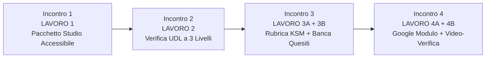

# Slide per la Visualizzazione in Aula — Incontro 1 (5 ore)

## VALUTARE PER CRESCERE
### *I nuovi modelli di Gemini e NotebookLM per l'accessibilità, l'autonomia nello studio e le basi dell'Ingegneria del Prompt*

> [!TIP]
> **Guida per il Formatore in Laboratorio**  
> * Questo documento contiene la **traccia visuale slide-per-slide** da proiettare sulla LIM/schermo del laboratorio durante le 5 ore dell'Incontro 1 (`3 blocchi da 90' + 2 pause da 15'`).  
> * Per la proiezione interattiva a schermo intero nel browser, apri il file gemello [Incontro_1_Presentazione_Aula.html](file:///c:/Users/amart/Desktop/Corsi%20per%20docenti/Intelligenza%20Artificiale%20nella%20didattica%20e%20nella%20valutazione/Incontro_1/Incontro_1_Presentazione_Aula.html).  
> * Ogni blocco rispetta il ritmo **15' Inquadramento visuale → 25' Demo live su Gemini/NotebookLM → 40' Laboratorio pratico → 10' Confronto**.

---

## 🟢 BLOCCO 1 (`00:00 – 01:30` · 90 min)
### *I nuovi modelli di Google Gemini, le barriere allo studio e la Privacy a prova di GDPR*

---

### SLIDE 1 — Benvenuti a "VALUTARE PER CRESCERE"
* **Sottotitolo**: *Valutare con l'IA: verifiche accessibili e personalizzate nella Secondaria di I Grado*
* **Incontro 1 di 4 (5 ore)**: *Dallo studio inclusivo alle basi dell'Ingegneria del Prompt*
* **Il nostro ritmo di oggi**:
  * `00:00 – 01:30` **Blocco 1**: I nuovi modelli di Gemini, accessibilità e Privacy/GDPR
  * `01:30 – 01:45` ☕ **PAUSA 1 (15 min)**
  * `01:45 – 03:15` **Blocco 2**: Gemini Multimodale, NotebookLM e **Lavoro Pratico 1**
  * `03:15 – 03:30` ☕ **PAUSA 2 (15 min)**
  * `03:30 – 05:00` **Blocco 3**: Condivisione Lavoro 1 e **VerifichIAmo con l'IA (Prompt in 5 punti)**

> **Nota Formatore (5')**: Dare il benvenuto tenendo conto che i docenti arrivano dopo la mattinata a scuola: tono pratico, zero teoria astratta, oggi si esce già con il primo materiale pronto per la propria classe.

---

### SLIDE 2 — Setup Operativo in 3 Minuti (PC di Laboratorio)
1. Apri Chrome e accedi al tuo account **Google Workspace for Education**.
2. Vai su **Google Drive** e crea la cartella:  
   📁 `Corso_Valutare_Per_Crescere`
3. Dentro la cartella crea 4 sottocartelle:
   * `01_Studio_Accessibile`
   * `02_Verifica_Multilivello_UDL`
   * `03_Rubrica_KSM_e_Banca_Quesiti`
   * `04_Quiz_Digitale_e_Verifica_Multimodale`
4. Apri in due schede affiancate: **Google Gemini** (`gemini.google.com`) e **Google NotebookLM** (`notebooklm.google`).

> ⚠️ **Promemoria importante**: siamo su PC condivisi della scuola → salvate tutto su Drive e ricordate il **Logout** a fine pomeriggio!

---

### SLIDE 3 — Il Filo Rosso del Corso: 4 Lavori → 1 Kit Pronto per la Classe
Nessun esame teorico finale. Scegli **un argomento reale** che insegnerai nelle prossime settimane e costruisci passo dopo passo il tuo **Kit Valutativo Inclusivo**:

---

### SLIDE 4 — Cosa Cambia con i Nuovi Modelli di Google Gemini?
Non siamo più davanti a una semplice "chat testuale". Ecco le **4 leve nuove** che useremo nel corso:

| Nuova Capacità | Cosa fa concretamente per il docente di Scuola Media |
| :--- | :--- |
| 📸 **1. Multimodalità Nativa** | Carichi la **foto della pagina del libro cartaceo**, una mappa, un grafico o un PDF: Gemini legge testo + immagini insieme senza ricopiare nulla. |
| 🧠 **2. Modello Rapido (*Flash*) vs Ragionamento (*Thinking*)** | *Flash* per adattare testi e creare glossari in 3 secondi; *Thinking* (ragionamento passo-passo) per problemi STEM, domande HOTS e *"Caccia all'errore"*. |
| ✍️ **3. Gemini Canvas & Gem** | In **Canvas** modifichi o semplifichi una sola frase selezionandola col mouse; con i **Gem** salvi il tuo assistente disciplinare permanente. |
| 📄 **4. Esportazione in 1 Clic** | Pulsante diretto **"Esporta in Documenti"** o **"Esporta in Fogli"** (per tabelle e quiz) direttamente nel tuo Google Drive. |

---

### SLIDE 5 — Le Barriere Invisibili nello Studio (11–14 anni)
Quando uno studente di 1ª, 2ª o 3ª media apre una pagina di sussidiario, cosa può bloccarlo?

* **DSA (L. 170/2010)**: fatica nella decodifica grafemico-fonologica, lentezza di lettura, memoria di lavoro verbale che si satura su frasi lunghe.
* **NAI / Italiano L2**: possiede il concetto nella lingua madre, ma è bloccato dalla *lingua dello studio* (forme passive, subordinate, lessico astratto).
* **Disabilità (L. 104/92) e FIL**: necessità di concetti essenziali concreti, esempi visivi e passaggi guidati.
* **ADHD / Fragilità Esecutive**: pagina "muro di testo" senza punti di ancoraggio visivo → perdita immediata del filo attentivo.

> 💡 **Principio UDL**: *Abbassare la barriera strumentale (grafica e linguistica) NON significa abbassare la dignità cognitiva del compito!*

---

### SLIDE 6 — Perché "Studiare solo a Memoria" (`LOTS 1`) Penalizza i Più Fragili
La scala cognitiva di **Anderson & Krathwohl (2001)** che useremo per guidare l'IA:

| Fascia | Livello Cognitivo | Risultato se usiamo male l'IA | Come useremo invece Gemini e NotebookLM |
| :--- | :--- | :--- | :--- |
| **LOTS** | **1. Ricordare** | ❌ Liste di date e definizioni a memoria (il punto più debole per DSA/BES!) | ✅ Banche di parole, glossari visivi, mappe con ganci mnemonici |
| **LOTS** | **2. Comprendere** | ❌ Riassunti troppo astratti o tagliati male | ✅ Testi *Easy-to-Read*, esempi quotidiani, Audio Overview |
| **Ponte** | **3. Applicare** | ❌ Esercizi senza guida | ✅ Procedure *step-by-step* con il 1° esercizio già svolto come modello |
| **HOTS** | **4. Analizzare · 5. Valutare · 6. Creare** | ❌ Esclusi dalle prove facilitate! | ✅ Tabelle comparative semicompilate e *"Caccia all'errore"* accessibile a tutti |

---

### SLIDE 7 — Privacy, GDPR e IA: La Regola d'Oro a Scuola
> [!CAUTION]
> **DIVIETO ASSOLUTO (GDPR Art. 9 + Linee Guida MIM / Garante Privacy)**  
> Non inserire **MAI** in Gemini o in qualsiasi servizio online:
> * Nomi, cognomi, iniziali riconoscibili o date di nascita degli alunni;
> * Codici fiscali, nome della classe/scuola associato a casi clinici;
> * Codici diagnostici (`ICD-10`, es. `F81.0`), diagnosi mediche o file PDF di **PEI e PDP**.

**E allora come facciamo a personalizzare con precisione?**  
👉 Applichiamo il **Protocollo del Profilo Funzionale Anonimizzato**!

---

### SLIDE 8 — Il Protocollo del Profilo Funzionale Anonimizzato
A Gemini **non serve l'etichetta medica**: lavora molto meglio se gli descriviamo **come funziona l'apprendimento** e **quali supporti servono**.

| ❌ Prompt VIETATO (Viola il GDPR) | ✅ Prompt CORRETTO (Profilo Funzionale Anonimizzato) |
| :--- | :--- |
| *"Adatta questo brano di storia per Luca Rossi della 1ª B che ha dislessia F81.0 e ADHD, ti incollo il suo PDP..."* | *"Adatta questo brano di storia per una 1ª media includendo supporti per studenti con affaticamento nella lettura di testi lunghi e tempi brevi di attenzione: usa paragrafi di max 4 righe, frasi attive sotto le 16 parole, parole chiave in grassetto e un glossario finale."* |
| *"Prepara una scheda di scienze per Fatima, alunna NAI arrivata un mese fa che non sa l'italiano..."* | *"Riscrivi questa scheda di scienze per studenti di 2ª media con Italiano L2 a livello A1/A2: usa verbi al presente, lessico ad alta frequenza e spiega i 5 termini scientifici obbligatori con esempi concreti della vita quotidiana."* |

*(Vedi scheda completa nel [03_Kit_Privacy_GDPR_e_Strumenti_Locali.md](file:///c:/Users/amart/Desktop/Corsi%20per%20docenti/Intelligenza%20Artificiale%20nella%20didattica%20e%20nella%20valutazione/Materiali_Trasversali/03_Kit_Privacy_GDPR_e_Strumenti_Locali.md))*

---

### SLIDE 9 — Demo Live: 4 Strumenti Locali Gratuiti per il PC Personale
*(Dimostrazione di 10 minuti sul PC del formatore — nessuna installazione richiesta in laboratorio)*

1. 🛡️ **PDF24 Creator** *(Windows, 100% offline)*: funzione **"Oscura PDF"** per cancellare in modo irreversibile nomi e intestazioni da vecchie verifiche o PDF prima di usarli, ed estrarre pagine senza caricarle su siti web.
2. 🤖 **LM Studio / GPT4All** *(Windows/Mac, 100% offline)*: far girare un piccolo modello IA locale sul proprio PC di casa anche **con il Wi-Fi spento** per rielaborare bozze riservate.
3. 🧩 **Lumi Education (H5P Desktop)** *(offline)*: creare video interattivi e quiz HTML5 sul PC di casa da caricare su Classroom come singolo file.
4. 📝 **LibreOffice** *(offline)*: pulizia metadati ed esportazione PDF accessibili.

> 📌 **Nota**: Nella cartella Drive del corso trovate anche il **Modulo Extra A** (*Uso etico e consapevole dell'IA da parte degli alunni a casa*, con bozza di Patto di Classe e scheda per le famiglie).

---

## ☕ PAUSA 1 (`01:30 – 01:45` · 15 minuti)
*Ci ritroviamo tra 15 minuti per mettere le mani su Gemini Multimodale e NotebookLM!*

---

## 🔵 BLOCCO 2 (`01:45 – 03:15` · 90 min)
### *Gemini Multimodale, Google NotebookLM e Lavoro Pratico 1*

---

### SLIDE 10 — Trasformare una Pagina del Libro con Gemini Multimodale + Canvas
**Il flusso in 4 passaggi (Demo Live su Italiano e Matematica/Geografia)**:
1. **Input Multimodale**: carico su Gemini la **foto/screenshot** di una pagina del libro di testo (o un PDF).
2. **Attivo Gemini Canvas**: chiedo di trasformarla in una **Scheda di Studio ad Alta Leggibilità (*Easy-to-Read*)**.
3. **Rifinitura chirurgica in Canvas**: evidenzio con il mouse un passaggio ancora difficile e lo semplifico al volo.
4. **Esporta in Documenti**: con 1 clic apro il file in **Google Documenti**, imposto il font **Lexend** o **Atkinson Hyperlegible** (interlinea `1,5`, allineamento a sinistra) e mostro la **Digitazione Vocale**.

---

### SLIDE 11 — Le 5 Regole *Easy-to-Read* da Inserire nel Prompt
Quando chiedete a Gemini di adattare un testo di studio per la Scuola Media, inserite sempre questi **5 vincoli**:

1. **Frasi brevi e attive**: massimo 15–18 parole per frase; niente forme passive o doppie negazioni.
2. **Paragrafi "a bocconi" (*Chunking*)**: massimo 4–5 righe per paragrafo, ciascuno con un **titolo-domanda** (*"Perché avviene la fotosintesi?"*).
3. **Proteggere i termini chiave della disciplina**: non cancellare le parole tecniche! Mettile in **grassetto** e spiegale subito tra parentesi.
4. **Tabella Glossario**: 5–8 parole difficili spiegate con linguaggio concreto + un esempio pratico.
5. **Domande-guida progressive (`LOTS 1 → 3`)**: 3 domande con un **suggerimento di avvio** (*"Aiuto: guarda il paragrafo 2..."*).

---

### SLIDE 12 — Google NotebookLM: L'IA a "Zero Allucinazioni" Ancorata alle Tue Fonti
Perché **NotebookLM** (`notebooklm.google`) è una rivoluzione per l'inclusione?

* 🔒 **Lavora SOLO sulle fonti che carichi tu**: PDF, tuoi Google Documenti, tue Google Presentazioni, link a pagine web o **video YouTube**.
* 🔢 **Citazioni verificabili**: ogni risposta ha un numerino cliccabile che ti mostra la riga esatta della tua dispensa da cui è tratta.
* 🗺️ **Mappe Mentali Interattive Automatiche**: con 1 clic genera lo schema ad albero navigabile e scaricabile di tutto il capitolo!
* 🎧 **Audio Overview (Podcast a due voci in italiano)**: genera un dialogo audio di 6–8 minuti che spiega la tua lezione agli alunni che faticano a leggere (personalizzabile per l'età 11–14 anni!).

---

### SLIDE 13 — Demo Live su NotebookLM (Scienze & Storia)
1. Creiamo un nuovo taccuino: *"Scienze 1ª Media — La Cellula"* (oppure *"Storia 2ª Media — Il Rinascimento"*).
2. Carichiamo **1 PDF del docente + 1 video YouTube** sull'argomento.
3. Clicchiamo su **Mappa Mentale** → esploriamo i rami e scarichiamo l'immagine PNG per la classe.
4. Clicchiamo su **Audio Overview → Personalizza**:
   > *"Parlate in italiano rivolgendovi a ragazzi di 1ª media (11 anni). Usate un tono chiaro e incoraggiante. Spiegate con la metafora di una fabbrica la differenza tra cellula animale e vegetale."*
5. Chiediamo nella chat del taccuino una **Guida allo studio graduata** basata solo sulle due fonti.

---

### SLIDE 14 — 🛠️ LAVORO PRATICO 1 (40 minuti in Laboratorio)
### *Crea il tuo "Pacchetto di Studio Accessibile" con Gemini e NotebookLM*

Scegli un argomento della tua disciplina (su cui lavorerai anche negli Incontri 2, 3 e 4) e segui il tuo binario:

* **🟢 BINARIO BASE ("Pronti Via")**:
  1. Prendi un testo/pagina della tua materia (o usa uno dei testi pronti nella cartella condivisa).
  2. Usa il **Prompt Template 1** (dal [01_Ricettario_Prompt_30_Esempi_Scuola_Media.md](file:///c:/Users/amart/Desktop/Corsi%20per%20docenti/Intelligenza%20Artificiale%20nella%20didattica%20e%20nella%20valutazione/Materiali_Trasversali/01_Ricettario_Prompt_30_Esempi_Scuola_Media.md)) su **Gemini** per ottenere: *Testo ad alta leggibilità + Glossario in tabella + 3 domande guida con aiuto*.
  3. Clicca su **"Esporta in Documenti"**, applica il font **Lexend** (`12 pt`, interlinea `1,5`) e salva nella tua cartella Drive `01_Studio_Accessibile`.
* **🔵 BINARIO APPROFONDIMENTO**:
  1. Parti da una **foto/PDF** con **Gemini Multimodale in Canvas** e affina i paragrafi.
  2. Carica lo stesso materiale (+ un video YouTube) su **NotebookLM**, genera la **Mappa Mentale** (scaricala e incollala nel Documento Google) e avvia l'**Audio Overview personalizzato** per la tua classe.

*(Istruzioni passo-passo complete in [02_Schede_Operative_4_Lavori_Pratici.md](file:///c:/Users/amart/Desktop/Corsi%20per%20docenti/Intelligenza%20Artificiale%20nella%20didattica%20e%20nella%20valutazione/Materiali_Trasversali/02_Schede_Operative_4_Lavori_Pratici.md))*

---

## ☕ PAUSA 2 (`03:15 – 03:30` · 15 minuti)
*Stacco di 15 minuti! Al rientro: condivisione lampo dei lavori e avvio di "VerifichIAmo con l'IA".*

---

## 🟣 BLOCCO 3 (`03:30 – 05:00` · 90 min)
### *Condivisione Lavoro 1 e Avvio a "VerifichIAmo con l'IA": Il Prompt in 5 Punti*

---

### SLIDE 15 — Restituzione e Galleria Lampo del Lavoro 1 (`03:30 – 04:10` · 40 min)
* **Primi 20 minuti**: completamento dell'esportazione su Google Documenti e salvataggio della Mappa Mentale / Audio Overview da NotebookLM nella cartella Drive `01_Studio_Accessibile`.
* **Secondi 20 minuti — Confronto tra Dipartimenti (3 esempi dal vivo)**:
  1. Cosa ha funzionato subito bene nell'adattamento di Gemini?
  2. Dove avete dovuto intervenire voi (*Human-in-the-Loop*) per correggere un termine o una semplificazione eccessiva?
  3. Come usereste la Mappa Mentale o l'Audio Overview di NotebookLM con i vostri alunni BES/DSA/NAI?

---

### SLIDE 16 — Avvio a "VerifichIAmo con l'IA" (`04:10 – 05:00` · 50 min)
### *Perché i Prompt Generici producono Verifiche Sbagliate?*

Facciamo una prova dal vivo su Gemini con un **Prompt Ingenuo**:
> ❌ *"Creami una verifica sul Teorema di Pitagora / sulla Rivoluzione Francese per la seconda media, anche per ragazzi con DSA."*

**Cosa sbaglia quasi sempre l'IA se non la guidiamo?**
1. Fa domande all'80% solo mnemoniche (`LOTS 1 — Ricordare`).
2. Per la versione "DSA" taglia metà programma o toglie i problemi di ragionamento (abbassando la dignità cognitiva!).
3. Usa consegne lunghe, ambigue o con doppie negazioni (*"Quale tra le seguenti NON è una causa..."*).

---

### SLIDE 17 — Il Framework del Prompt Didattico in 5 Punti (`R-C-N-A-F`)
La "formula" che useremo in tutto il corso per governare Gemini:

| Lettera | Elemento del Prompt | Domanda chiave che guida Gemini |
| :---: | :--- | :--- |
| **1. R** | **RUOLO** | *Chi sei?* ("Agisci come docente esperto di [Materia] alla Secondaria di I grado ed esperto di valutazione inclusiva UDL...") |
| **2. C** | **CLASSE E CONTESTO** | *Per chi?* ("Classe [1ª/2ª/3ª] media, ragazzi di [11/12/13] anni...") |
| **3. N** | **NUCLEI E SCALA COGNITIVA** | *Cosa valuti e a che livello?* ("Sui seguenti nuclei fondanti [...], distribuisci i quesiti lungo la scala **LOTS → HOTS** e gli assi **KSM**...") |
| **4. A** | **ACCESSIBILITÀ E PROFILO** | *Quali supporti?* ("Profilo funzionale anonimizzato: consegne numerate *step-by-step*, zero doppie negazioni, parole chiave in grassetto, *scaffolding*...") |
| **5. F** | **FORMATO DI OUTPUT** | *Come lo vuoi impaginato?* ("Restituisci una tabella / scheda pronta per Esporta in Documenti / Fogli con soluzioni e guida...") |

---

### SLIDE 18 — Esercitazione Guidata Finale: Trasformiamo 2 Prompt Insieme!
Proviamo tutti insieme su Gemini la differenza tra prompt ingenuo e prompt in 5 punti (`R-C-N-A-F`) scegliendo la nostra area disciplinare:

* **Gruppo A (Area Lettere / Lingue)**: dal brano del Lavoro 1 a 4 domande progressive (`Ricordare → Comprendere → Applicare → Analizzare`) con *scaffolding* e frasi-avvio (*sentence starters*).
* **Gruppo B (Area Matematica / Scienze / Tecnologia)**: da un argomento del Lavoro 1 a un esercizio guidato *step-by-step* + 1 quesito *"Caccia all'errore"* (`HOTS 5 — Valutare`) usando il modello di **Ragionamento (*Thinking*)** di Gemini.
* **Gruppo C (Area Artistica / Musicale / Motoria / IRC)**: lettura guidata di un'immagine/opera o situazione pratica dalla descrizione (`LOTS`) al confronto critico (`HOTS`).

---

### SLIDE 19 — Checklist di Fine Incontro 1 e Ponte verso l'Incontro 2
Prima di spegnere il PC di laboratorio, verifica di avere nella tua cartella Google Drive `Corso_Valutare_Per_Crescere/01_Studio_Accessibile`:
- [x] Il Documento Google con il tuo **Pacchetto di Studio Accessibile** (Lavoro 1);
- [x] La **Mappa Mentale** (e/o l'**Audio Overview**) generata con **NotebookLM**;
- [x] Il tuo primo test di **Prompt in 5 punti (`R-C-N-A-F`)** salvato.
- [ ] 🔒 **Fai LOGOUT dal tuo account Google sul PC del laboratorio!**

> 🚀 **Nel prossimo incontro (Incontro 2 — 5 ore)**: useremo il modello di **Ragionamento (*Thinking*)**, la **Multimodalità** e **Gemini Canvas/Gem** per costruire l'intera **Verifica UDL Multilivello (Base, Standard, Potenziamento)** bilanciata sulla scala **LOTS → HOTS**!
