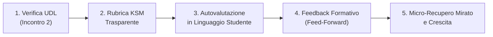

# Dispensa di Studio e Approfondimento — Incontro 3 di 5 (4 ore)

## VALUTARE PER CRESCERE
### *VerifichIAmo con l'IA (Parte II): progettare Griglie e Rubriche secondo Anderson & Krathwohl × Criterio KSM, Schede di Autovalutazione Studente e Feedback Formativi (*Feed-Forward*) con Google Gemini*

> [!NOTE]
> **Come utilizzare questa dispensa**  
> Questo documento costituisce la **parte di studio approfondito e discorsivo** dell'**Incontro 3 (Giorno 3 di 5 · 4 ore)**, dedicato alla seconda parte del modulo centrale *"VerifichIAmo con l'Intelligenza Artificiale"* (`4h` su `10/20` del corso). Ogni **termine tecnico** è spiegato nel testo e dotato di un **collegamento esterno autorevole**. Tutti i richiami agli **esempi disciplinari dell'Incontro 3** sono collegati direttamente al [Ricettario dei 30 Esempi](../Materiali_Trasversali/01_Ricettario_Prompt_30_Esempi_Scuola_Media.md). In chiusura sono presenti il **Glossario Tecnico Linkato** (Capitolo 6) e la **Valutazione delle Fonti secondo il Criterio KSM** (Capitolo 7).

---

## Capitolo 1 — Dal Voto Numerico alla Valutazione Formativa: Il Senso di "Valutare per Crescere"

### 1.1 Limiti della valutazione puramente sommativa e distorsioni percettive
Nella tradizione scolastica, il momento valutativo rischia spesso di ridursi alla sola **[valutazione sommativa](https://it.wikipedia.org/wiki/Valutazione_scolastica)** (*Assessment of Learning*): una fotografia finale espressa tramite un voto numerico in decimi (nella Scuola Secondaria di Primo Grado, ai sensi del **[D.Lgs. 62/2017](https://www.normattiva.it/uri-res/N2Ls?urn:nir:stato:decreto.legislativo:2017-04-13;62)**) che certifica ciò che lo studente ha saputo fare in un dato giorno, ma dice pochissimo su **come migliorare**.

Inoltre, la ricerca in **[docimologia](https://it.wikipedia.org/wiki/Docimologia)** ha da tempo evidenziato come una correzione priva di criteri espliciti e strutturati sia esposta a forti distorsioni cognitive (*bias* del valutatore), tra cui:
* l'**[Effetto Alone (*Halo Effect*)](https://it.wikipedia.org/wiki/Effetto_alone)**, per cui l'impressione generale su uno studente (o il disordine grafico/ortografico di un elaborato) influenza inconsciamente il giudizio sulla qualità del suo ragionamento;
* l'**[Effetto Pigmalione (o profezia che si autoavvera)](https://it.wikipedia.org/wiki/Effetto_Pigmalione)**, studiato da Rosenthal e Jacobson, per cui le aspettative implicite dell'insegnante condizionano il rendimento e l'autostima dell'alunno;
* la **penalizzazione strumentale degli alunni con [DSA (L. 170/2010)](https://www.normattiva.it/uri-res/N2Ls?urn:nir:stato:legge:2010-10-08;170) o [BES](https://www.mim.gov.it/bisogni-educativi-speciali)**: valutare l'aspetto formale (es. il tratto grafico incerto in Tecnologia per un alunno con [disgrafia](https://it.wikipedia.org/wiki/Disgrafia) o il refuso ortografico residuo in Italiano/Inglese per chi ha [disortografia](https://it.wikipedia.org/wiki/Disortografia)) invece del processo cognitivo raggiunto.

### 1.2 Valutazione per l'apprendimento (*for Learning*) e come apprendimento (*as Learning*)
Il paradigma **"Valutare per crescere"** integra nella pratica quotidiana due dimensioni complementari:
1. **Valutazione Formativa (*Assessment for Learning*)**: la prova e la sua correzione forniscono al docente e allo studente informazioni azionabili per regolare l'insegnamento e lo studio prima della fine del percorso.
2. **Valutazione Formatrice (*Assessment as Learning*)**: lo studente stesso, grazie a criteri trasparenti e comprensibili, impara ad **[autovalutarsi](https://it.wikipedia.org/wiki/Autovalutazione)** e a monitorare i propri processi cognitivi (**[metacognizione](https://it.wikipedia.org/wiki/Metacognizione)**).

---

## Capitolo 2 — Architettura delle Griglie e Rubriche di Valutazione: Anderson & Krathwohl × Criterio KSM

### 2.1 Che cos'è una Rubrica di Valutazione (*Scoring Rubric*) e perché l'IA generica la sbaglia
Una **[rubrica di valutazione (*rubric*)](https://en.wikipedia.org/wiki/Rubric_(academic))** è uno strumento docimologico che scompone una prestazione complessa in:
* **Dimensioni / Indicatori** (che cosa si osserva e con quale peso percentuale);
* **Livelli di padronanza** (graduati in 4 fasce: *Iniziale, Base, Intermedio, Avanzato*);
* **Descrittori analitici** (frasi che descrivono in modo concreto e osservabile cosa sa fare lo studente a ciascun livello).

Se chiediamo a [Google Gemini](https://gemini.google.com/) una griglia con un prompt generico (*"Fai una griglia di valutazione per questa verifica"*), il modello commette quasi sempre **due errori docimologici**:
1. **L'errore degli avverbi quantitativi vaghi**: differenzia i 4 livelli cambiando solo un aggettivo o un avverbio (*"Conosce gli argomenti in modo **insufficiente** / **sufficiente** / **buono** / **ottimo**"*). Una griglia simile non aiuta né il docente a essere oggettivo, né l'alunno a capire cosa deve fare per passare dal livello 6 al livello 8!
2. **Lo squilibrio sul solo Sapere dichiarativo**: valuta solo la quantità di nozioni ricordate, dimenticando l'applicazione procedurale e l'autonomia metacognitiva.

### 2.2 Lo Standard del Corso: la Matrice Integrata KSM × Anderson & Krathwohl (`4 × 6`)
Per ottenere da Gemini rubriche scientificamente solide ed eque, nel nostro corso istruiamo il modello di **[Ragionamento (*Thinking*)](https://ai.google.dev/gemini-api/docs/thinking?hl=it)** affinché applichi rigorosamente la **[Tassonomia di Anderson e Krathwohl (2001)](https://en.wikipedia.org/wiki/Bloom%27s_taxonomy#Revised_taxonomy_(2001))** integrata con il **Criterio KSM**:

| Pilastro KSM | Peso Standard | Dimensioni della Conoscenza (Anderson & Krathwohl) | Processi Cognitivi Prevalenti | Cosa misura concretamente nella verifica |
| :--- | :---: | :--- | :--- | :--- |
| **K — Knowledge** *(Il Sapere)* | **30% – 35%** | **A. Fattuale** (termini, dati) **B. Concettuale** (categorie, leggi, relazioni) | `1. Ricordare` `2. Comprendere` `4. Analizzare (concetti)` | Comprensione dei nuclei fondanti e delle relazioni causa-effetto (anche tramite mappe o glossari compensativi). |
| **S — Skills** *(Il Saper Fare)* | **40% – 45%** | **C. Procedurale** (algoritmi, tecniche, metodi) | `3. Applicare` (*Eseguire / Implementare*) `4. Analizzare (procedure)` | Capacità di applicare regole, risolvere problemi *step-by-step*, organizzare dati in tabella o strutturare un testo/disegno. |
| **M — Mindset, Metacognition & Mastery** *(Il Saper Essere e Divenire)* | **20% – 25%** | **D. Metacognitiva** (strategie, consapevolezza di sé e del compito) | `5. Valutare` (*Controllare / Criticare*) `6. Creare` (*Generare / Progettare*) | Individuazione e correzione dell'errore (*"Caccia all'errore"*), pensiero critico, uso consapevole degli aiuti e autovalutazione. |

### 2.3 Le 5 Regole Obbligatorie nei Prompt di Generazione delle Rubriche
Ogni prompt per generare una griglia su Gemini deve imporre questi **5 requisiti**:
1. **Raggruppamento esplicito sotto i 3 assi `K`, `S`, `M`** con i rispettivi pesi percentuali (`35% / 40% / 25%` o `30% / 45% / 25%` per le prove pratiche come Musica/Tecnologia).
2. **Tracciabilità tassonomica `[A-D][1-6]`**: ogni indicatore deve dichiarare i codici della matrice `4 × 6` (es. `[A1, B2 → B4]`, `[C3 → C5]`, `[D2 → D6]`).
3. **Progressione qualitativa `LOTS → HOTS` nei 4 livelli**:
   * *Livello 1 — Iniziale (Voto 4–5 / D)*: presidio parziale e frammentario dei processi **LOTS** anche se guidato;
   * *Livello 2 — Base (Voto 6 / C)*: presidio consolidato dei processi **LOTS (`1. Ricordare`, `2. Comprendere`, `3. Applicare esecutivo`)** in situazioni note (anche con strumenti compensativi);
   * *Livello 3 — Intermedio (Voto 7–8 / B)*: passaggio al ponte **LOTS → HOTS (`3. Applicare implementativo`, `4. Analizzare`)** con buona autonomia;
   * *Livello 4 — Avanzato (Voto 9–10 / A)*: piena padronanza dei processi **HOTS (`5. Valutare`, `6. Creare`)** e autoregolazione metacognitiva (`D`).
4. **Verbi d'azione osservabili** all'inizio di ogni descrittore (*"Individua...", "Spiega...", "Confronta...", "Argomenta..."*), con divieto assoluto di differenziare i livelli tramite i soli avverbi *"poco / abbastanza / molto"*.
5. **Clausola di equità inclusiva (PDP/PEI)**: esplicitare nei descrittori che l'utilizzo legittimo degli strumenti compensativi e dello *[scaffolding](https://it.wikipedia.org/wiki/Scaffolding)* previsto nella Versione Facilitata (mappe, formulari, spartiti con note colorate, videoscrittura) consente di raggiungere tutti i livelli di padronanza, incluso il **Livello 4 Avanzato**.

---

## Capitolo 3 — Dalla Rubrica Docente all'Autovalutazione Studente e all'Importazione in Google Classroom

### 3.1 Tradurre la Rubrica in "Linguaggio Studente" (11–14 anni) con un solo Prompt
Una rubrica tecnica scritta con lessico docimologico è indispensabile per il docente e per il Consiglio di Classe, ma risulta ostica per un ragazzo di 11–14 anni. Una volta generata la rubrica docente in Gemini, basta un secondo prompt consecutivo nella stessa chat:
> *"Ora trasforma questa rubrica in una breve Scheda di Autovalutazione in prima persona ('Io so...', 'Come ho lavorato oggi') adatta a studenti di [1ª/2ª/3ª] media, usando parole semplici, incoraggianti e ad alta leggibilità."*

Questo attiva la dimensione **`D. Conoscenza Metacognitiva`** (sottotipi `Db` comprensione del compito e `Dc` conoscenza dei propri punti di forza e di miglioramento): lo studente non subisce il voto come un verdetto misterioso, ma impara a leggere la propria prova.

### 3.2 Esportazione in Google Fogli e utilizzo nelle Griglie di Google Classroom
Quando Gemini restituisce la rubrica in formato tabellare, compare in basso il pulsante nativo **"Esporta in Fogli"**. Con un clic la rubrica diventa un file di **[Google Fogli](https://support.google.com/docs/topic/9054603?hl=it)** salvato nel Drive del docente.

All'interno di **[Google Classroom](https://support.google.com/edu/classroom/answer/9335069?hl=it)**, quando l'insegnante crea un *Compito*, può cliccare sul pulsante **`+ Griglia`** (*Rubric*):
* può **creare o riutilizzare una griglia** copiando i 3 criteri (`K — Conoscenze`, `S — Abilità`, `M — Metacognizione`) e i 4 livelli direttamente dal Foglio Google, oppure **importarla da Google Fogli**;
* lo studente vede la griglia **prima ancora di consegnare il compito** (trasparenza valutativa) e, al momento della restituzione, visualizza con un colore chiaro in quale livello si colloca per ciascuno dei tre assi `K`, `S`, `M`!

---

## Capitolo 4 — Generare Feedback Formativi (*Feed-Forward*) e Micro-Recupero con Gemini + I 6 Esempi dell'Incontro 3

### 4.1 Dal Feedback retrospettivo al *Feed-Forward* (Hattie & Timperley)
Secondo le celebri meta-analisi di John Hattie (*Visible Learning*), il **[feedback formativo](https://en.wikipedia.org/wiki/Corrective_feedback)** è uno dei fattori a più alto impatto sull'apprendimento degli studenti, a condizione che non si limiti a dire cosa è sbagliato nel passato (*feedback retrospettivo*), ma indichi **quale azione concreta compiere nel passo successivo**, secondo il modello del **[Feed-Forward](https://en.wikipedia.org/wiki/Feed_forward_(control))**.

Con Google Gemini possiamo generare in pochi secondi commenti formativi personalizzati per i profili d'errore tipici della classe (sempre **100% anonimizzati**, incollando solo l'errore o il profilo funzionale, mai il nome dell'alunno!) strutturati nella formula a **3 passi (`🌟 - 🔍 - 🚀`)**:
1. **🌟 Punto di forza (*Glow*)**: riconoscere ciò che lo studente ha compreso o impostato bene (protegge l'autoefficacia e la motivazione, cruciale per BES e DSA);
2. **🔍 Punto di attenzione (*Grow*)**: spiegare con parole semplici la natura dell'errore commesso;
3. **🚀 Il tuo prossimo passo (*Feed-Forward*)**: assegnare **1 micro-esercizio mirato da 5–10 minuti** costruito da Gemini esattamente su quell'inciampo.

### 4.2 I 6 Esempi Disciplinari dell'Incontro 3 (con Collegamenti Diretti al Ricettario)
Per il laboratorio dell'Incontro 3 sono pronti **6 esempi completi** nel [Ricettario dei 30 Esempi](../Materiali_Trasversali/01_Ricettario_Prompt_30_Esempi_Scuola_Media.md) (clicca su ciascun collegamento per aprire il prompt completo):

1. **[Esempio #05 — Italiano (3ª Media)](../Materiali_Trasversali/01_Ricettario_Prompt_30_Esempi_Scuola_Media.md#esempio-05)**: Rubrica di valutazione KSM per la produzione di un testo argomentativo (con tutela per alunni con disortografia/PDP) + checklist di autovalutazione in 5 punti.
2. **[Esempio #20 — Seconda Lingua: Francese / Spagnolo (1ª Media)](../Materiali_Trasversali/01_Ricettario_Prompt_30_Esempi_Scuola_Media.md#esempio-20)**: Scheda di dialogo guidato, supporto fonetico/ortografico e feedback formativo per alunni con DSA.
3. **[Esempio #23 — Tecnologia / Disegno Tecnico (1ª–2ª Media)](../Materiali_Trasversali/01_Ricettario_Prompt_30_Esempi_Scuola_Media.md#esempio-23)**: Rubrica di valutazione KSM per una tavola di Disegno Geometrico / Proiezioni Ortogonali equa per alunni con **disgrafia o difficoltà grafo-motorie** + checklist di autoverifica prima della consegna.
4. **[Esempio #26 — Musica (1ª–2ª Media)](../Materiali_Trasversali/01_Ricettario_Prompt_30_Esempi_Scuola_Media.md#esempio-26)**: Rubrica KSM (`K 30%, S 45%, M 25%`) per prova pratica di esecuzione strumentale/vocale che valorizza l'uso dello spartito compensativo (note colorate) e l'ascolto in musica d'insieme.
5. **[Esempio #28 — Educazione Fisica (2ª Media)](../Materiali_Trasversali/01_Ricettario_Prompt_30_Esempi_Scuola_Media.md#esempio-28)**: Scheda di Autovalutazione Metacognitiva motoria (Asse `M`: impegno, Fair Play, gestione dell'errore in partita, ruolo di arbitro/osservatore) + quesiti situazionali.
6. **[Esempio #30 — IRC / Attività Alternativa ed Educazione Civica (2ª–3ª Media)](../Materiali_Trasversali/01_Ricettario_Prompt_30_Esempi_Scuola_Media.md#esempio-30)**: Prova autentica su Micro-Scenario di Cittadinanza Digitale con Rubrica KSM focalizzata sui processi superiori **HOTS (`4. Analizzare`, `5. Valutare`)** e sull'asse **M (`Mindset & Metacognition`)**.

---

## Capitolo 5 — Deontologia del Feedback Assistito dall'IA (*Human-in-the-Loop*)

L'uso di Gemini per generare griglie e feedback formativi deve sempre rispettare tre regole deontologiche di **[Human-in-the-Loop](https://en.wikipedia.org/wiki/Human-in-the-loop)** (coerenti anche con l'**[AI Act europeo — Regolamento UE 2024/1689](https://digital-strategy.ec.europa.eu/it/policies/regulatory-framework-ai)** per i sistemi impiegati nell'istruzione):
1. **Divieto di valutazione automatizzata cieca**: l'IA non attribuisce mai il voto finale a uno studente reale; propone la struttura della rubrica e una bozza di commento formativo che il docente personalizza con la propria sensibilità pedagogica.
2. **Anonimizzazione integrale degli errori sottoposti a Gemini**: quando si chiede a Gemini di formulare un feedback o un esercizio di recupero su un errore commesso in verifica, si trascrive esclusivamente il passaggio errato o la tipologia di errore (*"Uno studente ha confuso perimetro e area in questo problema..."*), senza mai caricare nomi o dati personali.
3. **Tono educativo e orientato alla crescita (*Growth Mindset*)**: verificare sempre che il feedback generato giudichi **la strategia o il passaggio del compito**, mai la persona o l'intelligenza dello studente (secondo la teoria del *[Growth Mindset](https://en.wikipedia.org/wiki/Mindset#Fixed_and_growth_mindset)* di Carol Dweck).

---

## Capitolo 6 — Glossario Ragionato dei Termini Tecnici dell'Incontro 3 (con Collegamenti Esterni)

| Termine Tecnico | Spiegazione sintetica per il docente | Collegamento esterno di approfondimento |
| :--- | :--- | :--- |
| **Autovalutazione (*Self-Assessment*)** | Processo metacognitivo con cui lo studente valuta la qualità del proprio lavoro e delle proprie strategie rispetto a criteri chiari e condivisi. | [Wikipedia IT — Autovalutazione](https://it.wikipedia.org/wiki/Autovalutazione) |
| **Disgrafia e Disortografia** | Disturbi Specifici dell'Apprendimento (L. 170/2010) che riguardano rispettivamente la realizzazione grafica/motoria della scrittura e la correttezza ortografica; nelle griglie KSM non devono penalizzare la valutazione dei processi cognitivi. | [Wikipedia IT — Disgrafia](https://it.wikipedia.org/wiki/Disgrafia) · [Disortografia](https://it.wikipedia.org/wiki/Disortografia) |
| **Effetto Alone (*Halo Effect*)** | Bias cognitivo per cui un singolo tratto visibile (es. calligrafia ordinata o disordinata, comportamento in classe) influenza il giudizio complessivo sulla prova. | [Wikipedia IT — Effetto alone](https://it.wikipedia.org/wiki/Effetto_alone) |
| **Effetto Pigmalione** | Fenomeno psicopedagogico per cui le aspettative (positive o negative) del docente influenzano il rendimento reale degli studenti. | [Wikipedia IT — Effetto Pigmalione](https://it.wikipedia.org/wiki/Effetto_Pigmalione) |
| **Feed-Forward** | Evoluzione del feedback formativo: anziché soffermarsi solo sull'errore passato, fornisce indicazioni operative concrete su cosa fare nel passo successivo. | [Wikipedia EN — Feed forward](https://en.wikipedia.org/wiki/Feed_forward_(control)) |
| **Feedback Formativo (*Corrective Feedback*)** | Informazione restituita allo studente per colmare il divario tra il livello attuale della prestazione e l'obiettivo di apprendimento atteso. | [Wikipedia EN — Corrective feedback in education](https://en.wikipedia.org/wiki/Corrective_feedback) |
| **Griglie di Google Classroom (*Rubrics*)** | Funzione nativa di Google Classroom che permette di allegare a un compito una rubrica strutturata in criteri e livelli (creata o importata da Google Fogli), visibile anche agli studenti. | [Guida di Google Classroom — Creare o riutilizzare una griglia](https://support.google.com/edu/classroom/answer/9335069?hl=it) |
| **Growth Mindset (Mentalità di crescita)** | Teoria psicologica (Carol Dweck) secondo cui le abilità cognitive si sviluppano attraverso l'impegno, le buone strategie e l'analisi costruttiva dell'errore (*Valutare per crescere*). | [Wikipedia EN — Fixed and growth mindset](https://en.wikipedia.org/wiki/Mindset#Fixed_and_growth_mindset) |
| **Rubrica di Valutazione (*Scoring Rubric*)** | Tabella docimologica che incrocia indicatori/dimensioni con livelli graduati di padronanza descritti tramite comportamenti osservabili. | [Wikipedia EN — Rubric (academic)](https://en.wikipedia.org/wiki/Rubric_(academic)) |
| **Valutazione Formativa vs Sommativa** | La valutazione *formativa* accompagna il percorso per migliorarlo in itinere; quella *sommativa* tira le somme al termine di un'unità o quadrimestre. | [Wikipedia IT — Valutazione scolastica](https://it.wikipedia.org/wiki/Valutazione_scolastica) |

---

## Capitolo 7 — Valutazione delle Fonti secondo il Criterio KSM (Anderson & Krathwohl + KSM)

Tutte le fonti esterne citate nella presente dispensa sono state selezionate e classificate applicando i tre assi del **Criterio KSM** (**K `35%` `[A5, B5]`**, **S `40%` `[C4, C5]`**, **M `25%` `[B4, D5]`**):

| Fonte / Riferimento Esterno | Criterio K — Knowledge `[A5, B5]` (35%) | Criterio S — Skills & Metodo `[C4, C5]` (40%) | Criterio M — Mindset & Triangolazione `[B4, D5]` (25%) | Livello KSM |
| :--- | :--- | :--- | :--- | :---: |
| **Normattiva, MIM & Commissione Europea** (*D.Lgs. 62/2017, L. 170/2010, AI Act UE 2024/1689*) | **[A5/B5]** Fonti legislative primarie nazionali ed europee su valutazione nel primo ciclo, DSA e sorveglianza umana sull'IA. | **[C5]** Criteri giuridici vincolanti per l'equità valutativa e la trasparenza. | **[D5]** Piena neutralità e ufficialità istituzionale. | **Livello A** *(Primaria / Gold Standard)* |
| **Documentazione Ufficiale Google Workspace for Education (Guida Google Classroom — Griglie / Rubrics e Google Fogli)** | **[A5/B4]** Documentazione tecnica ufficiale sulle funzioni di creazione, importazione e condivisione delle griglie in Classroom. | **[C4/C5]** Istruzioni procedurali passo-passo direttamente verificabili nell'ambiente scolastico. | **[B4/D5]** Fonte primaria del produttore del software in uso nella scuola. | **Livello B** *(Qualificata / Ufficiale)* |
| **Voci Enciclopediche Scientifiche e Docimologiche (Wikipedia IT/EN)** (*Rubric, Valutazione scolastica, Docimologia, Effetto Alone, Effetto Pigmalione, Corrective Feedback, Growth Mindset*) | **[A2/B4]** Sintesi concettuali basate sulla letteratura psicopedagogica internazionale (Anderson & Krathwohl, Hattie & Timperley, Dweck, Rosenthal). | **[C3/C4]** Tracciabilità bibliografica verso gli studi empirici primari. | **[B4/D3]** Scopo informativo aperto, triangolato con i modelli formali del corso (Tassonomia A&K e Criterio KSM). | **Livello B / C** *(Qualificata / Divulgativa verificata)* |
