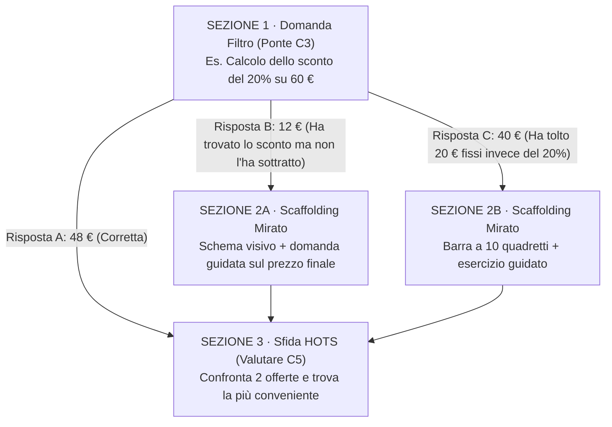

# Dispensa di Studio e Approfondimento — Incontro 4 di 5 (4 ore)

## VALUTARE PER CRESCERE
### *Area 1 — Progettare domande e quiz con il supporto dell'IA (`2/20`) e Area 2 — Quiz digitali per la valutazione (`2/20`): da Google Gemini e Google Fogli a Google Moduli Ramificati, Wordwall e Quizizz*

> [!NOTE]
> **Come utilizzare questa dispensa**  
> Questo documento costituisce la **parte di studio approfondito e discorsivo** dell'**Incontro 4 (Giorno 4 di 5 · 4 ore)**, che unisce in un unico flusso operativo l'**Area 1 — Progettare domande e quiz con il supporto dell'IA** (`Blocco 1 · 2h`) e l'**Area 2 — Quiz digitali per la valutazione** (`Blocco 2 · 2h`). Ogni **termine tecnico** è spiegato nel testo e dotato di un **collegamento esterno autorevole**. Tutti i richiami agli **esempi disciplinari dell'Incontro 4** sono collegati direttamente al [Ricettario dei 30 Esempi](../Materiali_Trasversali/01_Ricettario_Prompt_30_Esempi_Scuola_Media.md). In chiusura trovate il **Glossario Tecnico Linkato** (Capitolo 6) e la **Valutazione delle Fonti secondo il Criterio KSM** (Capitolo 7).

---

## Capitolo 1 — Area 1: Progettare Quesiti Strutturati Inclusivi con Google Gemini

### 1.1 Anatomia docimologica di un quesito a scelta multipla (*Multiple Choice Item*)
Nella [docimologia](https://it.wikipedia.org/wiki/Docimologia) classica e moderna, un **[quesito a scelta multipla (*Multiple Choice Question* — MCQ)](https://it.wikipedia.org/wiki/Scelta_multipla)** ben costruito si compone di tre elementi strutturali:
1. lo **Stimolo o Premessa (*Stem*)**: la domanda diretta o il micro-scenario che presenta il problema da risolvere;
2. la **Chiave (*Key*)**: l'unica alternativa inequivocabilmente corretta;
3. i **[Distrattori (*Distractors*)](https://en.wikipedia.org/wiki/Multiple_choice#Structure)**: le alternative errate ma plausibili per chi non ha ancora consolidato il concetto o la procedura.

Quando un docente utilizza [Google Gemini](https://gemini.google.com/) per generare una batteria di quiz per una classe della Scuola Secondaria di Primo Grado (11–14 anni), deve istruire il modello per evitare le **quattro insidie** che rendono molti test tradizionali discriminanti verso gli alunni con **[DSA (Legge 170/2010)](https://www.normattiva.it/uri-res/N2Ls?urn:nir:stato:legge:2010-10-08;170)**, **[ADHD](https://www.issalute.it/index.php/la-salute-dalla-a-alla-z-menu/a/adhd-disturbo-da-deficit-di-attenzione-e-iperattivita)** o **[Italiano L2 (NAI)](https://www.mim.gov.it/studenti-con-cittadinanza-non-italiana)**:

| Insidia tradizionale nei Quiz | Perché penalizza BES / DSA / NAI | Regola di Prompt Engineering su Gemini |
| :--- | :--- | :--- |
| **1. Doppie negazioni nello stimolo** (*"Quale dei seguenti NON è estraneo..."*) | Raddoppia il carico sulla [memoria di lavoro](https://it.wikipedia.org/wiki/Memoria_di_lavoro) verbale; lo studente sa la regola ma sbaglia la logica della negazione. | *"Formula tutte le domande in forma affermativa diretta; divieto assoluto di doppie negazioni o domande con il NON."* |
| **2. Quattro o cinque opzioni molto lunghe** (A, B, C, D, E) | Costringe un alunno con [dislessia](https://it.wikipedia.org/wiki/Dislessia) a leggere 120 parole per un singolo item, esaurendo il tempo a disposizione. | *"Usa 3 opzioni di risposta (A, B, C) brevi, sintatticamente parallele e della stessa lunghezza."* |
| **3. Distrattori ortografici o visivamente confondenti** (es. in Inglese: *went / wnet / wetn*) | Non valuta la competenza grammaticale, ma colpisce direttamente il disturbo specifico di decodifica visiva (*crowding*). | *"I distrattori non devono mai basarsi su inversioni di lettere o micro-refusi ortografici, ma su errori concettuali o morfosintattici reali"* (vedi [Esempio #12 — Inglese](../Materiali_Trasversali/01_Ricettario_Prompt_30_Esempi_Scuola_Media.md#esempio-12)). |
| **4. Opzioni "Tutte le precedenti" o "Nessuna delle precedenti"** | Aumentano l'ambiguità logica e impediscono di capire quale specifica [misconcezione](https://en.wikipedia.org/wiki/List_of_common_misconceptions) abbia guidato la scelta dello studente. | *"Non usare mai le opzioni 'Tutte le precedenti' o 'Nessuna delle precedenti'."* |

---

### 1.2 Sfatare un mito: progettare Quiz a Scelta Multipla di livello HOTS
Un pregiudizio molto diffuso sostiene che i quiz a scelta multipla possano valutare soltanto la memoria meccanica (**[LOTS](https://it.wikipedia.org/wiki/Tassonomia_di_Bloom)** `1. Ricordare`). In realtà, attivando il modello di **[Ragionamento (*Thinking*)](https://ai.google.dev/gemini-api/docs/thinking?hl=it)** di Gemini, possiamo progettare quesiti chiusi o semistrutturati che valutano autenticamente i processi cognitivi intermedi e superiori (**[HOTS](https://en.wikipedia.org/wiki/Higher-order_thinking)** `3. Applicare`, `4. Analizzare`, `5. Valutare`):
* **Quesiti basati su micro-scenari inediti (`[C3, B4]`)**: lo stimolo presenta una situazione concreta di 2–3 righe mai vista a lezione (es. un'azione di gioco in palestra nell'[Esempio #28 — Ed. Fisica](../Materiali_Trasversali/01_Ricettario_Prompt_30_Esempi_Scuola_Media.md#esempio-28) o una frase con uso figurato nell'[Esempio #06 — Italiano](../Materiali_Trasversali/01_Ricettario_Prompt_30_Esempi_Scuola_Media.md#esempio-06)) a cui applicare la regola.
* **Quesiti di *Error Spotting* ("Individua il passaggio errato" — `[C4, C5]`)**: lo stimolo mostra un'equazione svolta in 3 passaggi ([Esempio #09 — Matematica](../Materiali_Trasversali/01_Ricettario_Prompt_30_Esempi_Scuola_Media.md#esempio-09)) o un dialogo in lingua straniera ([Esempio #21 — Francese/Spagnolo](../Materiali_Trasversali/01_Ricettario_Prompt_30_Esempi_Scuola_Media.md#esempio-21)), e le 3 opzioni chiedono di identificare **dove e perché** è stato commesso l'errore.
* **Distrattori diagnostici basati sulle misconcezioni**: ogni distrattore viene progettato da Gemini per corrispondere a un preciso errore tipico degli studenti (es. nel calcolo dello sconto del 20% su 60 €, il distrattore `12 €` intercetta chi ha calcolato lo sconto ma ha dimenticato di sottrarlo dal prezzo, come nell'[Esempio #10 — Matematica](../Materiali_Trasversali/01_Ricettario_Prompt_30_Esempi_Scuola_Media.md#esempio-10)).

### 1.3 Oltre la scelta multipla: Cloze, Abbinamenti e Varianti Equivalenti
Oltre ai quesiti a scelta multipla, Gemini permette di generare rapidamente:
* **[Esercizi Cloze (testi a buchi mirati)](https://it.wikipedia.org/wiki/Cloze_test)**: utilissimi per alunni con disortografia o Italiano L2 se accompagnati da una **banca delle parole** (perché valutano la comprensione contestuale senza richiedere la rievocazione ortografica dal nulla);
* **Varianti equivalenti (Fila A / Fila B e Prova di Recupero)**: chiedendo a Gemini di mantenere invariata la matrice tassonomica `[A-D][1-6]` cambiando solo i contesti esemplificativi o i valori numerici.

---

## Capitolo 2 — Il Ponte Automatico verso l'Area 2: Esportare la Banca Quesiti in Google Fogli

Chiedendo a Gemini di restituire l'intera banca di 10–12 quesiti in un'unica **tabella strutturata** con colonne fisse (`N. | Livello e Codice [A-D][1-6] | Domanda | Opzione A | Opzione B | Opzione C | Risposta Corretta | Suggerimento (Scaffolding) | Feedback Formativo`), il docente ottiene in un solo passaggio:
1. il pulsante **"Esporta in Fogli"** che salva la banca quesiti in **[Google Fogli](https://support.google.com/docs/topic/9054603?hl=it)**;
2. tutti i testi di **[scaffolding](https://it.wikipedia.org/wiki/Scaffolding)** e di **[feedback formativo](https://en.wikipedia.org/wiki/Corrective_feedback)** già pronti per essere inseriti in **[Google Moduli](https://www.google.it/intl/it/forms/about/)**;
3. una tabella già compatibile per l'importazione rapida in piattaforme di **[gamification didattica](https://it.wikipedia.org/wiki/Gamification)** come **[Wordwall](https://wordwall.net/it)** e **[Quizizz](https://quizizz.com/)**.

---

## Capitolo 3 — Area 2: Google Moduli Inclusivi e Percorsi Condizionali Ramificati (LOTS → HOTS)

### 3.1 Le 4 Impostazioni Inclusive Fondamentali in Google Moduli
**[Google Moduli (*Google Forms*)](https://support.google.com/docs/answer/6281888?hl=it)** è lo strumento ideale per la valutazione digitale nella Scuola Secondaria di I grado perché non richiede agli studenti alcuna registrazione esterna, si integra nativamente con **[Google Classroom](https://edu.google.com/intl/ALL_it/workspace-for-education/products/classroom/)** ed è pienamente compatibile con le estensioni di **[Sintesi Vocale (TTS — *Text-to-Speech*)](https://it.wikipedia.org/wiki/Sintesi_vocale)** del browser Chrome.

Per trasformare un Google Modulo in uno strumento realmente inclusivo e formativo (*Valutare per crescere*), occorre configurare quattro elementi:
1. **Descrizione della domanda come *Scaffolding***: attivando `⋮ → Descrizione` sotto il titolo di ogni domanda, il docente incolla il **Suggerimento** generato da Gemini (*"Aiuto: ricorda di osservare prima l'unità di misura..."*).
2. **Supporto visivo multimodale (UDL)**: aggiungere un'immagine, una carta geografica ([Esempio #17 — Geografia](../Materiali_Trasversali/01_Ricettario_Prompt_30_Esempi_Scuola_Media.md#esempio-17)) o uno schema per affiancare il canale iconico a quello verbale.
3. **Feedback automatico differenziato nella *Chiave di risposta***: in modalità *Quiz*, cliccando su **`Chiave di risposta → Aggiungi feedback sulla risposta`**, l'insegnante incolla nella scheda *Risposte errate* la spiegazione incoraggiante generata da Gemini. Appena lo studente invia il modulo, riceve un tutoraggio immediato sull'errore!
4. **Assenza di timer ansiogeni**: a differenza dei giochi a tempo televisivi, Google Moduli permette a ciascuno studente (inclusi gli alunni con PDP che hanno diritto al 30% di tempo aggiuntivo o a pause) di procedere al proprio ritmo di decodifica.

### 3.2 Progettare un Quiz Adattivo Ramificato (*Branching Logic*) in Google Moduli
Una funzione potentissima e spesso poco conosciuta di Google Moduli è la **[logica di ramificazione (*Vai alla sezione in base alla risposta*)](https://support.google.com/docs/answer/141062?hl=it)**, che permette di realizzare un vero **[test adattivo](https://en.wikipedia.org/wiki/Computerized_adaptive_testing)** lungo la scala **LOTS → HOTS**:

Come si attiva in Google Moduli in 3 clic:
1. Si divide il modulo in **Sezioni** tramite il pulsante `〓 Aggiungi sezione` nella barra laterale.
2. Sulla domanda-filtro della *Sezione 1*, si clicca sui tre puntini `⋮` in basso a destra e si spunta **"Vai alla sezione in base alla risposta"**.
3. Accanto a ciascuna opzione (`A, B, C`) compare un menu a tendina che indirizza lo studente alla sezione di *scaffolding* corrispondente al suo specifico errore, per poi ricondurlo alla *Sezione 3*!

### 3.3 Lettura delle Statistiche d'Errore (*Item Analysis*) per il Recupero in Classe
Nella scheda **`Risposte → Riepilogo`** di Google Moduli, il box automatico **"Domande in cui si riscontrano spesso errori"** esegue un'immediata **[Item Analysis](https://en.wikipedia.org/wiki/Item_analysis)**: se il 65% della classe ha scelto il distrattore `B` nella domanda 4, il docente sa esattamente quale concetto rispiegare nei primi 10 minuti della lezione successiva.

---

## Capitolo 4 — Ambienti Gamificati Inclusivi Gratuiti (Wordwall e Quizizz) e i 6 Esempi dell'Incontro 4

### 4.1 Wordwall e Quizizz: quando e come usarli senza creare barriere
Accanto a Google Moduli, due piattaforme gratuite molto apprezzate nella Scuola Secondaria di I grado permettono di riutilizzare con un semplice copia-incolla le colonne del Foglio Google generato da Gemini:
* **[Wordwall](https://wordwall.net/it)** *(piano gratuito)*: il suo punto di forza per l'inclusione (BES, DSA, L. 104, NAI) è il **cambio istantaneo di formato (*Switch Template*)**. Inserendo una sola volta 10 coppie `Termine / Definizione` dalla tabella di Google Fogli, il docente può proporre lo stesso contenuto come *Quiz*, *Abbinamento*, *Carte da girare* o *Completa la frase (Cloze)*.
* **[Quizizz](https://quizizz.com/)** *(piano gratuito)*: offre un'importazione diretta da foglio di calcolo e due impostazioni cruciali per l'accessibilità che il docente deve sempre attivare:
  1. **Disattivare il timer (*Timer Off*)**: nei quiz in cui il punteggio dipende dalla velocità di clic al millisecondo, gli alunni con dislessia o lentezza esecutiva vengono sistematicamente umiliati anche quando sanno la risposta corretta; spegnendo il timer, conta solo l'accuratezza!
  2. **Attivare *Read Aloud* (Lettura ad alta voce)**: legge automaticamente tramite sintesi vocale il testo della domanda e delle opzioni.

### 4.2 I 6 Esempi Disciplinari dell'Incontro 4 (con Collegamenti Diretti al Ricettario)
Per il laboratorio dell'Incontro 4 sono pronti **6 esempi completi** nel [Ricettario dei 30 Esempi](../Materiali_Trasversali/01_Ricettario_Prompt_30_Esempi_Scuola_Media.md) (clicca su ciascun collegamento per aprire il prompt pronto da copiare):

1. **[Esempio #06 — Italiano (1ª Media)](../Materiali_Trasversali/01_Ricettario_Prompt_30_Esempi_Scuola_Media.md#esempio-06)**: Banca di 10 quesiti su Lessico, Sinonimi, Polisemia e Linguaggio Figurato (LOTS → HOTS) con feedback esplicativo per NAI e DSA.
2. **[Esempio #09 — Matematica (3ª Media)](../Materiali_Trasversali/01_Ricettario_Prompt_30_Esempi_Scuola_Media.md#esempio-09)**: Banca di 10 quesiti sulle Equazioni di Primo Grado con distrattori basati sui reali errori di trasporto/segno e quesiti HOTS *"Individua il passaggio errato"*.
3. **[Esempio #10 — Matematica (2ª Media)](../Materiali_Trasversali/01_Ricettario_Prompt_30_Esempi_Scuola_Media.md#esempio-10)**: Progettazione completa con Gemini di un **Google Modulo condizionale ramificato** in 4 Sezioni su Percentuali e Sconti.
4. **[Esempio #12 — Inglese (2ª Media)](../Materiali_Trasversali/01_Ricettario_Prompt_30_Esempi_Scuola_Media.md#esempio-12)**: Banca di 10 quesiti sul *Past Simple* con *Grammar Detective* (HOTS) e vincolo rigoroso di zero distrattori ortografici confondenti per dislessia.
5. **[Esempio #17 — Geografia (2ª Media)](../Materiali_Trasversali/01_Ricettario_Prompt_30_Esempi_Scuola_Media.md#esempio-17)**: Quiz digitale visivo in Google Moduli su Ambienti ed Economia dell'Europa (con indicazione della carta/immagine da abbinare a ogni domanda).
6. **[Esempio #21 — Seconda Lingua: Francese / Spagnolo (2ª Media)](../Materiali_Trasversali/01_Ricettario_Prompt_30_Esempi_Scuola_Media.md#esempio-21)**: Banca di 10 quesiti comunicativi e situazionali (*Al ristorante / In città*) pronta per Google Fogli e Wordwall.

---

## Capitolo 5 — Glossario Ragionato dei Termini Tecnici dell'Incontro 4 (con Collegamenti Esterni)

| Termine Tecnico | Spiegazione sintetica per il docente | Collegamento esterno di approfondimento |
| :--- | :--- | :--- |
| **Cloze Test (Testo a buchi)** | Prova di comprensione costituita da un testo in cui alcune parole chiave sono sostituite da spazi vuoti da completare (in ottica inclusiva, sempre con banca parole di supporto). | [Wikipedia IT — Cloze test](https://it.wikipedia.org/wiki/Cloze_test) |
| **Distrattore (*Distractor*)** | Alternativa errata in un quesito a scelta multipla; un buon distrattore è plausibile e riflette un errore tipico di ragionamento, mai un trabocchetto lessicale o visivo. | [Wikipedia EN — Multiple choice structure](https://en.wikipedia.org/wiki/Multiple_choice#Structure) |
| **Gamification (Ludicizzazione)** | Utilizzo di meccaniche tipiche del gioco (sfide, feedback immediato, livelli) in contesti educativi per aumentare il coinvolgimento e ridurre l'ansia valutativa. | [Wikipedia IT — Gamification](https://it.wikipedia.org/wiki/Gamification) |
| **Google Moduli — Modalità Quiz** | Funzione di Google Forms che consente di assegnare punteggi, impostare la chiave di risposta e restituire feedback formativi automatici per risposte corrette ed errate. | [Guida di Google Documenti — Creare e valutare quiz con Google Moduli](https://support.google.com/docs/answer/6281888?hl=it) |
| **Item Analysis (Analisi dei quesiti)** | Esame statistico delle risposte fornite dalla classe a ciascun quesito di un test per individuare domande troppo difficili o misconcezioni condivise dal gruppo. | [Wikipedia EN — Item analysis](https://en.wikipedia.org/wiki/Item_analysis) |
| **Logica di Ramificazione (*Branching Logic*)** | Funzione di Google Moduli (*"Vai alla sezione in base alla risposta"*) che indirizza lo studente a pagine diverse del quiz a seconda dell'opzione scelta. | [Guida di Google Documenti — Mostrare domande in base alle risposte](https://support.google.com/docs/answer/141062?hl=it) |
| **Misconcezione (*Misconception*)** | Idea ingenua o regola errata interiorizzata dallo studente (es. *"moltiplicare aumenta sempre il numero"*); usarla per costruire i distrattori rende il quiz altamente diagnostico. | [Wikipedia EN — Misconceptions in education](https://en.wikipedia.org/wiki/List_of_common_misconceptions) |
| **Quesito a Scelta Multipla (MCQ)** | Quesito strutturato composto da uno stimolo (*stem*) e da un insieme di alternative di cui una corretta (*chiave*) e le altre errate (*distrattori*). | [Wikipedia IT — Scelta multipla](https://it.wikipedia.org/wiki/Scelta_multipla) |
| **Test Adattivo (*Adaptive Testing*)** | Prova digitale che adatta il percorso delle domande in tempo reale in base alle risposte dello studente, offrendo rinforzo in caso di errore o sfide più alte in caso di successo. | [Wikipedia EN — Computerized adaptive testing](https://en.wikipedia.org/wiki/Computerized_adaptive_testing) |

---

## Capitolo 6 — Valutazione delle Fonti secondo il Criterio KSM (Anderson & Krathwohl + KSM)

Tutte le fonti esterne citate nella presente dispensa sono valutate secondo i tre assi del **Criterio KSM** (**K `35%` `[A5, B5]`**, **S `40%` `[C4, C5]`**, **M `25%` `[B4, D5]`**):

| Fonte / Riferimento Esterno | Criterio K — Knowledge `[A5, B5]` (35%) | Criterio S — Skills & Metodo `[C4, C5]` (40%) | Criterio M — Mindset & Triangolazione `[B4, D5]` (25%) | Livello KSM |
| :--- | :--- | :--- | :--- | :---: |
| **Normattiva & MIM** (*L. 170/2010 DSA, Linee guida BES e Italiano L2*) | **[A5/B5]** Fonti normative primarie vigenti per la tutela degli alunni nelle prove strutturate e digitali. | **[C5]** Prescrizioni operative su tempi aggiuntivi, riduzione quantitativa e strumenti compensativi. | **[D5]** Piena ufficialità istituzionale. | **Livello A** *(Primaria / Gold Standard)* |
| **Documentazione Ufficiale Google Workspace (Guida Google Moduli — Modalità Quiz e Ramificazione Condizionale)** | **[A5/B4]** Documentazione tecnica primaria sulle funzionalità di Google Forms e Google Sheets. | **[C4/C5]** Procedure passo-passo verificate e riproducibili nel laboratorio scolastico. | **[B4/D5]** Fonte ufficiale del produttore del software integrato nell'ecosistema della scuola. | **Livello B** *(Qualificata / Ufficiale)* |
| **Voci Enciclopediche Tecniche e Docimologiche (Wikipedia IT/EN)** (*Scelta multipla, Distrattori, Cloze test, Item analysis, Computerized adaptive testing, Gamification*) | **[A2/B4]** Sintesi docimologiche accurate e referenziate per il chiarimento dei termini specialistici. | **[C3/C4]** Definizioni coerenti con la letteratura internazionale sul testing educativo (Haladyna, Downing). | **[B4/D3]** Scopo informativo neutrale, validato per triangolazione con la cornice UDL e Anderson & Krathwohl. | **Livello B / C** *(Qualificata / Divulgativa verificata)* |
