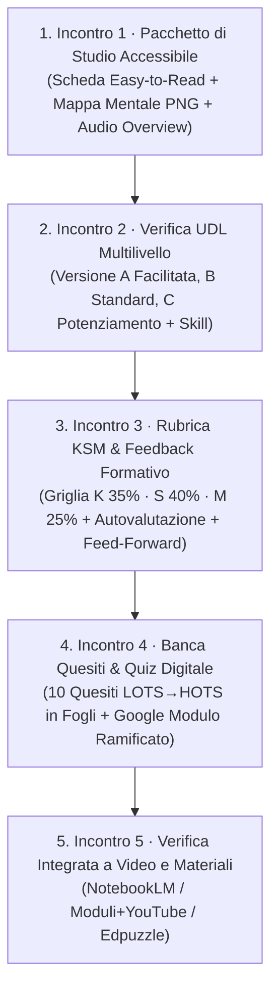

# Dispensa di Studio e Approfondimento — Incontro 5 di 5 (4 ore)

## VALUTARE PER CRESCERE
### *Area 3 — Verifiche integrate a contenuti video e materiali (`2/20`) e VerifichIAmo con l'IA (Parte III · `2h su 10/20`): da Google NotebookLM, Moduli+YouTube ed Edpuzzle all'Orchestrazione in Google Classroom e alla Peer-Review del Kit Valutativo Inclusivo*

> [!NOTE]
> **Come utilizzare questa dispensa**  
> Questo documento costituisce la **parte di studio approfondito e discorsivo** dell'**Incontro 5 (Giorno 5 di 5 · 4 ore)**, giornata conclusiva del corso che integra l'**Area 3 — Verifiche integrate a contenuti video e materiali** (`Blocco 1 · 2h`) con la chiusura di **VerifichIAmo con l'Intelligenza Artificiale — Parte III** (`Blocco 2 · 2h`). Ogni **termine tecnico** è spiegato nel testo e dotato di un **collegamento esterno autorevole**. Tutti i richiami agli **esempi disciplinari dell'Incontro 5** sono collegati direttamente al [Ricettario dei 30 Esempi](../Materiali_Trasversali/01_Ricettario_Prompt_30_Esempi_Scuola_Media.md). In chiusura trovate il **Glossario Tecnico Linkato** (Capitolo 6) e la **Valutazione delle Fonti secondo il Criterio KSM** (Capitolo 7).

---

## Capitolo 1 — Area 3: Basi Neurodidattiche della Valutazione Multimodale

### 1.1 Teoria del Doppio Codice e Apprendimento Multimediale nella Secondaria di I Grado
Perché una verifica che si appoggia esclusivamente alla lettura e alla scrittura di un testo verbale continuo può fornire una fotografia distorta delle competenze reali di uno studente di 11–14 anni?

La risposta risiede nella **[Teoria della Doppia Codifica (*Dual-Coding Theory*) di Allan Paivio](https://en.wikipedia.org/wiki/Dual-coding_theory)** e nella **[Teoria Cognitiva dell'Apprendimento Multimediale (*Cognitive Theory of Multimedia Learning*) di Richard E. Mayer](https://it.wikipedia.org/wiki/Apprendimento_multimediale)**. Il cervello umano elabora le informazioni attraverso due canali distinti e complementari:
1. il **canale verbale/uditivo** (parole scritte o ascoltate);
2. il **canale visivo/pittorico** (immagini statiche, schemi, animazioni, video di esperimenti o gesti motori).

Quando una prova di valutazione integra un **video didattico di 3–5 minuti**, un **brano audio** o un **documento illustrato** con domande mirate in crescendo cognitivo (**[LOTS](https://it.wikipedia.org/wiki/Tassonomia_di_Bloom) → [HOTS](https://en.wikipedia.org/wiki/Higher-order_thinking)**), offre tre vantaggi decisivi per l'inclusione secondo l'**[Universal Design for Learning (UDL)](https://udlguidelines.cast.org/)**:
* **Aggira la barriera di decodifica grafemico-fonologica**: un alunno con **[dislessia (L. 170/2010)](https://www.normattiva.it/uri-res/N2Ls?urn:nir:stato:legge:2010-10-08;170)** o con **[Italiano L2 (NAI)](https://www.mim.gov.it/studenti-con-cittadinanza-non-italiana)** può osservare il fenomeno scientifico ([Esempio #19 — Scienze](../Materiali_Trasversali/01_Ricettario_Prompt_30_Esempi_Scuola_Media.md#esempio-19)), ascoltare il documento storico ([Esempio #15 — Storia](../Materiali_Trasversali/01_Ricettario_Prompt_30_Esempi_Scuola_Media.md#esempio-15)) o seguire i sottotitoli in lingua inglese ([Esempio #13 — Inglese](../Materiali_Trasversali/01_Ricettario_Prompt_30_Esempi_Scuola_Media.md#esempio-13)), dedicando tutta la propria energia mentale al ragionamento;
* **Segmenta l'attenzione (*Chunking temporale*)**: per gli studenti con **[ADHD](https://www.issalute.it/index.php/la-salute-dalla-a-alla-z-menu/a/adhd-disturbo-da-deficit-di-attenzione-e-iperattivita)** o fragilità nelle **[funzioni esecutive](https://it.wikipedia.org/wiki/Funzioni_esecutive)**, un video spezzato da domande ancorate a un preciso **[timestamp (minutaggio)](https://it.wikipedia.org/wiki/Marca_temporale)** (*"Guarda dal minuto 01:10 al 01:50 e rispondi..."*) mantiene viva la concentrazione ed evita che lo studente si perda;
* **Abilita la [Flipped Classroom (Classe Capovolta)](https://it.wikipedia.org/wiki/Insegnamento_capovolto) e il recupero autonomo**: la video-verifica non serve solo per dare un voto in classe, ma può essere assegnata su **[Google Classroom](https://edu.google.com/intl/ALL_it/workspace-for-education/products/classroom/)** come attività preparatoria o di recupero personalizzato in cui l'alunno può riascoltare un passaggio difficile quante volte desidera.

---

## Capitolo 2 — I Tre Percorsi Online per Verifiche Integrate a Video e Materiali ( più la Soluzione Locale Lumi H5P)

### 2.1 Percorso 1 — Google NotebookLM Multimodale (Incrociare PDF + Slide + Video YouTube)
**[Google NotebookLM](https://notebooklm.google/)**, introdotto nell'Incontro 1 per lo studio, rivela nell'Area 3 la sua massima potenza per la progettazione di **verifiche multimodali ancorate a più fonti (*Multi-Source Grounding*)** tramite architettura **[RAG (*Retrieval-Augmented Generation*)](https://cloud.google.com/use-cases/retrieval-augmented-generation?hl=it)**.

Il docente può caricare nello stesso taccuino:
1. la propria **dispensa in PDF o Google Documenti**;
2. le **Google Presentazioni** proiettate in classe;
3. l'**URL di un video didattico di [YouTube](https://www.youtube.com/)**.

A questo punto può chiedere a NotebookLM di progettare una **verifica integrata** che metta in dialogo il video e il testo scritto (vedi [Esempio #15 — Storia](../Materiali_Trasversali/01_Ricettario_Prompt_30_Esempi_Scuola_Media.md#esempio-15)):
* NotebookLM legge automaticamente la **trascrizione temporizzata del video YouTube** e la incrocia con i paragrafi della dispensa;
* genera domande con l'indicazione del **minutaggio del video** per i quesiti `LOTS` di osservazione/comprensione, domande `Ponte` di confronto tra ciò che si vede nel video e la regola scritta nella dispensa, e domande `HOTS` di valutazione critica delle fonti;
* permette inoltre di allegare alla verifica l'**Audio Overview** o la **Mappa Mentale PNG** come supporto compensativo!

### 2.2 Percorso 2 — Google Moduli con Video YouTube Integrato (100% interno a Google Workspace)
Quando la scuola preferisce non utilizzare piattaforme esterne a Google Workspace for Education, la soluzione più pulita, stabile e conforme al **[GDPR](https://www.garanteprivacy.it/regolamentoue)** è combinare **[Google Gemini](https://gemini.google.com/)** + **[Google Moduli](https://support.google.com/docs/answer/6281888?hl=it)**:
1. il docente fornisce a Gemini l'argomento (o la trascrizione) di un breve video YouTube di 3–4 minuti e chiede **5 domande in crescendo `LOTS → Ponte → HOTS`** con l'indicazione del minutaggio e il feedback formativo;
2. dentro Google Moduli clicca sull'icona **`🎬 Aggiungi video`** nella barra laterale destra e incolla l'URL di YouTube;
3. inserisce subito sotto il video i 5 quesiti: lo studente guarda il video direttamente dentro la pagina del Modulo (potendo mettere in pausa o tornare indietro al minuto suggerito) e riceve il feedback immediato al termine!

### 2.3 Percorso 3 — Edpuzzle collegato a Google Classroom
**[Edpuzzle](https://edpuzzle.com/)** *(piano gratuito fino a 20 video interattivi)* è la piattaforma specifica più diffusa per trasformare un video YouTube in un **[video interattivo](https://en.wikipedia.org/wiki/Interactive_video)** in cui la riproduzione **si mette in pausa automaticamente** nel secondo esatto scelto dal docente per far comparire sullo schermo:
* una **Nota Vocale o Testuale del docente** (*Scaffolding* pre-ascolto: *"Fai attenzione a cosa succede ora alla lampadina quando apriamo l'interruttore..."*);
* una domanda a scelta multipla con correzione immediata;
* una domanda aperta finale di livello **HOTS** (a cui gli studenti possono rispondere anche tramite audio nei piani supportati o con *sentence starters*).
Edpuzzle si collega con un clic a **Google Classroom**, importando le classi senza che gli studenti debbano creare password separate.

### 2.4 La Soluzione Locale e Offline per il PC Personale: Lumi Education (H5P Desktop)
Per i docenti che desiderano creare un video interattivo o una verifica multimodale **100% sul proprio PC personale (senza dipendere da alcun server esterno)**, l'applicazione gratuita open-source **[Lumi Education](https://app.lumi.education/)** permette di utilizzare il modulo ***Interactive Video*** dello standard **[H5P](https://h5p.org/)**:
* si inserisce il link al video YouTube (o un file video `.mp4` locale) e si incollano lungo la timeline le domande generate da Gemini;
* si esporta l'attività come **singolo file `.html` autonomo** e lo si carica come allegato in un compito di Google Classroom!

---

## Capitolo 3 — I 6 Esempi Disciplinari dell'Incontro 5 (con Collegamenti Diretti al Ricettario)

Per il laboratorio dell'Area 3 nell'Incontro 5 sono pronti **6 esempi completi** nel [Ricettario dei 30 Esempi](../Materiali_Trasversali/01_Ricettario_Prompt_30_Esempi_Scuola_Media.md) (clicca su ciascun collegamento per aprire il prompt pronto da copiare):

1. **[Esempio #13 — Inglese (3ª Media)](../Materiali_Trasversali/01_Ricettario_Prompt_30_Esempi_Scuola_Media.md#esempio-13)**: Verifica multimodale di *Listening & Video Comprehension* su YouTube in 3 fasi (*Before watching* con Word Bank → *While watching* con timestamp → *After watching* HOTS con *sentence starters*).
2. **[Esempio #15 — Storia (3ª Media)](../Materiali_Trasversali/01_Ricettario_Prompt_30_Esempi_Scuola_Media.md#esempio-15)**: Percorso su **Google NotebookLM** che incrocia una dispensa PDF del docente e un video documentario YouTube sul Novecento per generare una tabella `Causa → Evento → Conseguenza` e 5 domande sulle fonti storiche (`[A5, B5]`).
3. **[Esempio #19 — Scienze (3ª Media)](../Materiali_Trasversali/01_Ricettario_Prompt_30_Esempi_Scuola_Media.md#esempio-19)**: Verifica integrata a un video di esperimento scientifico di laboratorio (circuiti elettrici o genetica di Mendel) scandita lungo le fasi del metodo sperimentale (`Osservare → Ipotizzare prima dell'esperimento → Verificare → Caccia all'errore sperimentale`).
4. **[Esempio #25 — Arte e Immagine (3ª Media)](../Materiali_Trasversali/01_Ricettario_Prompt_30_Esempi_Scuola_Media.md#esempio-25)**: Verifica digitale visiva e multimodale in Google Moduli sulle Avanguardie del Novecento (Impressionismo, Cubismo, Futurismo) con *"Caccia all'errore nella scheda del museo"*.
5. **[Esempio #27 — Musica (2ª–3ª Media)](../Materiali_Trasversali/01_Ricettario_Prompt_30_Esempi_Scuola_Media.md#esempio-27)**: Verifica multimodale di **Ascolto Guidato** integrata a un video/audio musicale su YouTube (*La Primavera* di Vivaldi o *In the Hall of the Mountain King* di Grieg), dal riconoscimento timbrico (`LOTS`) all'analisi espressiva e rielaborazione creativa (`HOTS`).
6. **[Esempio #29 — Educazione Fisica (3ª Media)](../Materiali_Trasversali/01_Ricettario_Prompt_30_Esempi_Scuola_Media.md#esempio-29)**: Video-verifica sull'analisi di un gesto tecnico-motorio (es. fondamentale della pallavolo) o su una procedura di **Primo Soccorso / Sicurezza a scuola**, con *"Occhio all'errore motorio/procedurale"*.

---

## Capitolo 4 — VerifichIAmo con l'IA (Parte III): Orchestrazione del Kit Completo in Google Classroom e Peer-Review

### 4.1 Dal singolo strumento all'Ecosistema Valutativo Inclusivo
Nelle 20 ore del corso (5 incontri da 4 ore), ogni docente ha costruito sul proprio argomento un **Kit Valutativo Inclusivo in 5 Cartelle** perfettamente coerente:

Come si orchestra questo kit nella vita reale di una classe di Scuola Secondaria di Primo Grado usando **[Google Classroom](https://support.google.com/edu/classroom/?hl=it)**?
1. **Fase 1 — Prima della Verifica (Autonomia nello studio)**: il docente pubblica in Classroom il materiale dell'**Incontro 1** (*Scheda Easy-to-Read + Mappa Mentale PNG + Audio Overview MP3*) e, come allenamento formativo in classe o a casa, il quiz o il video interattivo degli **Incontri 4–5**, rendendo già visibile la **Griglia KSM (Incontro 3)** così che tutti sappiano su quali criteri verranno valutati.
2. **Fase 2 — Durante la Verifica (Assegnazione differenziata senza stigma)**: grazie alla funzione di Classroom **`Per: Tutti gli studenti ▾`** (deselezionando la classe intera e spuntando solo i singoli destinatari), l'insegnante assegna la **Versione A (Facilitata/Equipollente)** agli alunni con PDP/BES, la **Versione B (Standard)** al gruppo centrale e la **Versione C (Potenziamento)** agli alunni rapidi, senza che nessun ragazzo veda cosa hanno ricevuto i compagni!
3. **Fase 3 — Dopo la Verifica (*Valutare per crescere*)**: alla restituzione della prova valutata con la **Rubrica KSM**, lo studente compila in 3 minuti la **Mini-Scheda di Autovalutazione**, legge il proprio **Feedback Formativo (`🌟 Glow → 🔍 Grow → 🚀 Feed-Forward`)** e svolge la **micro-attività di recupero mirato da 10 minuti** esattamente sull'asse (`K`, `S` o `M`) in cui ha incontrato difficoltà.
4. **Integrazione con la Prova Orale Inclusiva (Modulo Extra B)**: per gli alunni che svolgono la verifica o il recupero in forma orale (o in vista del **[Colloquio dell'Esame di Stato conclusivo del primo ciclo — D.Lgs. 62/2017](https://www.normattiva.it/uri-res/N2Ls?urn:nir:stato:decreto.legislativo:2017-04-13;62)**), il docente dispone nel [Modulo Extra B](../Moduli_Extra/Modulo_Extra_B_Prova_Orale_Inclusiva.md) dei prompt per generare la **Scaletta "Semi-Muta" per parole-gancio** e della **Griglia di valutazione dell'orale KSM**.

### 4.2 La Peer-Review tra Colleghi (*Validazione Incrociata di Dipartimento*)
Nell'ultima parte dell'Incontro 5 (`Fase 5B`), i docenti sperimentano la **[valutazione tra pari (*Peer Review / Peer Assessment*)](https://it.wikipedia.org/wiki/Valutazione_tra_pari)** professionale: lavorando in coppia con un collega dello stesso dipartimento (o di ambito affine), esaminano i rispettivi Kit Valutativi attraverso la **Checklist Finale in 5 Semafori** (accessibilità *Easy-to-Read*, presenza della *"Caccia all'errore"* HOTS con *scaffolding*, rigore della Rubrica KSM, assenza di doppie negazioni/trabocchetti nei quiz e conformità integrale al GDPR).

---

## Capitolo 5 — Glossario Ragionato dei Termini Tecnici dell'Incontro 5 (con Collegamenti Esterni)

| Termine Tecnico | Spiegazione sintetica per il docente | Collegamento esterno di approfondimento |
| :--- | :--- | :--- |
| **Apprendimento Multimediale (Teoria di Mayer)** | Modello delle scienze cognitive secondo cui gli studenti apprendono più efficacemente quando parole e immagini/video sono integrate in modo coerente rispetto al solo testo scritto. | [Wikipedia IT — Apprendimento multimediale](https://it.wikipedia.org/wiki/Apprendimento_multimediale) |
| **Assegnazione Differenziata in Classroom** | Funzione di Google Classroom che permette di inviare un compito, un quiz o un materiale di supporto a singoli studenti o sottogruppi in modo riservato. | [Guida di Google Classroom — Assegnare compiti a singoli studenti](https://support.google.com/edu/classroom/answer/6020260?hl=it) |
| **Flipped Classroom (Insegnamento Capovolto)** | Metodologia didattica che sposta la prima fruizione del contenuto (es. tramite breve video interattivo con domande guida) prima della lezione, liberando il tempo d'aula per laboratorio e recupero. | [Wikipedia IT — Insegnamento capovolto](https://it.wikipedia.org/wiki/Insegnamento_capovolto) |
| **H5P & Lumi Education** | Framework gratuito e open-source basato su HTML5 per creare video interattivi e oggetti didattici; con Lumi Desktop si lavora offline sul PC esportando un singolo file `.html`. | [H5P.org — Interactive Video](https://h5p.org/interactive-video) · [Lumi Education](https://app.lumi.education/) |
| **Peer Review / Valutazione tra Pari** | Processo di revisione collaborativa e strutturata in cui due pari (studenti o docenti) esaminano reciprocamente un elaborato utilizzando una checklist di criteri condivisi. | [Wikipedia IT — Valutazione tra pari](https://it.wikipedia.org/wiki/Valutazione_tra_pari) |
| **Teoria della Doppia Codifica (Paivio)** | Teoria cognitiva che dimostra come l'attivazione simultanea del canale verbale e del canale visivo/iconico potenzi la comprensione e il recupero mnestico. | [Wikipedia EN — Dual-coding theory](https://en.wikipedia.org/wiki/Dual-coding_theory) |
| **Timestamp (Marca temporale / Minutaggio)** | Indicazione precisa del minuto e secondo di un file video o audio (es. `01:15 – 02:00`); nelle video-verifiche funge da *scaffolding* attentivo per BES, DSA e ADHD. | [Wikipedia IT — Marca temporale](https://it.wikipedia.org/wiki/Marca_temporale) |
| **Video Interattivo (*Interactive Video*)** | Video digitale arricchito da domande a comparsa, note vocali e bivi che trasformano la visione da passiva ad attiva e autovalutativa. | [Wikipedia EN — Interactive video](https://en.wikipedia.org/wiki/Interactive_video) |

---

## Capitolo 6 — Valutazione delle Fonti secondo il Criterio KSM (Anderson & Krathwohl + KSM)

Tutte le fonti esterne citate nella presente dispensa sono valutate lungo i tre assi del **Criterio KSM** (**K `35%` `[A5, B5]`**, **S `40%` `[C4, C5]`**, **M `25%` `[B4, D5]`**):

| Fonte / Riferimento Esterno | Criterio K — Knowledge `[A5, B5]` (35%) | Criterio S — Skills & Metodo `[C4, C5]` (40%) | Criterio M — Mindset & Triangolazione `[B4, D5]` (25%) | Livello KSM |
| :--- | :--- | :--- | :--- | :---: |
| **Normattiva, MIM & Garante Privacy** (*D.Lgs. 62/2017, L. 170/2010, GDPR UE 2016/679*) | **[A5/B5]** Fonti normative primarie vigenti su valutazione nel primo ciclo, strumenti compensativi e protezione dei dati. | **[C5]** Regole vincolanti per l'uso di piattaforme digitali e multimediali in ambito scolastico. | **[D5]** Piena ufficialità istituzionale. | **Livello A** *(Primaria / Gold Standard)* |
| **Documentazione Ufficiale Google Workspace, Google NotebookLM, H5P.org e Lumi Education** | **[A5/B4]** Documentazione tecnica ufficiale su taccuini multimodali, inserimento video in Google Moduli, assegnazione in Classroom e standard aperto H5P. | **[C4/C5]** Procedure tecniche direttamente riproducibili in laboratorio e sul PC personale. | **[B4/D5]** Fonti primarie dei rispettivi progetti tecnologici (commerciali e open-source), triangolate con i requisiti GDPR della scuola. | **Livello B** *(Qualificata / Ufficiale)* |
| **Voci Enciclopediche Scientifiche e Psicopedagogiche (Wikipedia IT/EN)** (*Apprendimento multimediale, Dual-coding theory di Paivio, Flipped Classroom, Valutazione tra pari, Interactive video*) | **[A2/B4]** Sintesi teoriche accurate che rimandano agli studi classici di Mayer e Paivio. | **[C3/C4]** Chiara esposizione dei principi cognitivi applicati alla progettazione multimediale. | **[B4/D3]** Scopo informativo aperto, integrato nella cornice UDL del corso. | **Livello B / C** *(Qualificata / Divulgativa verificata)* |
