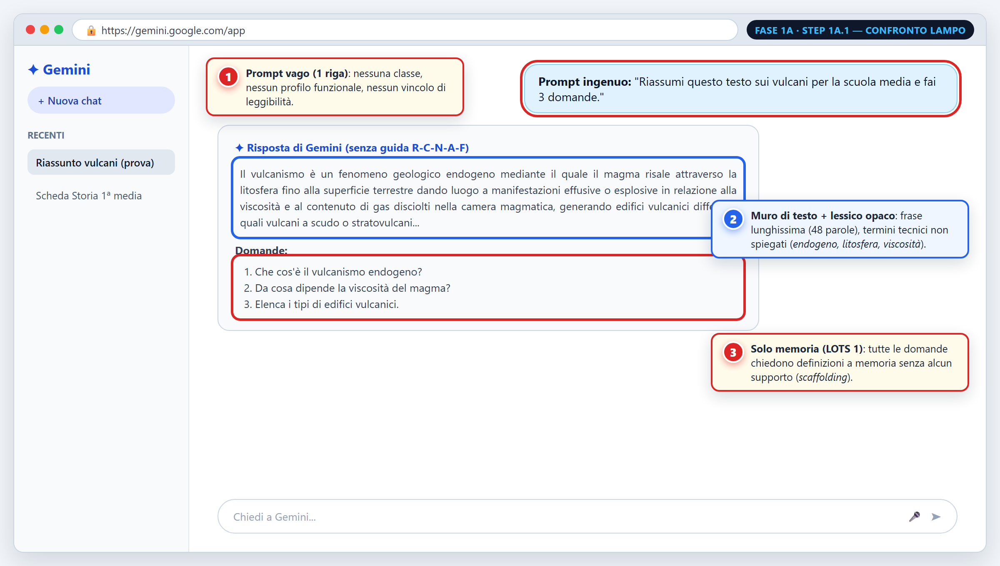
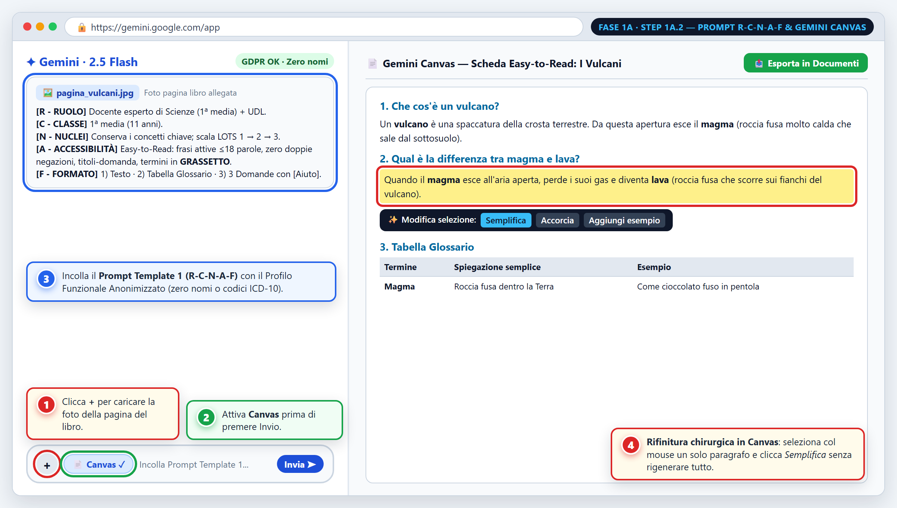
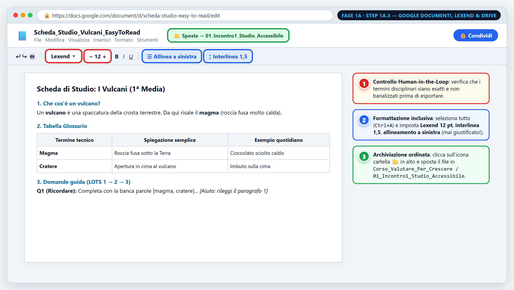
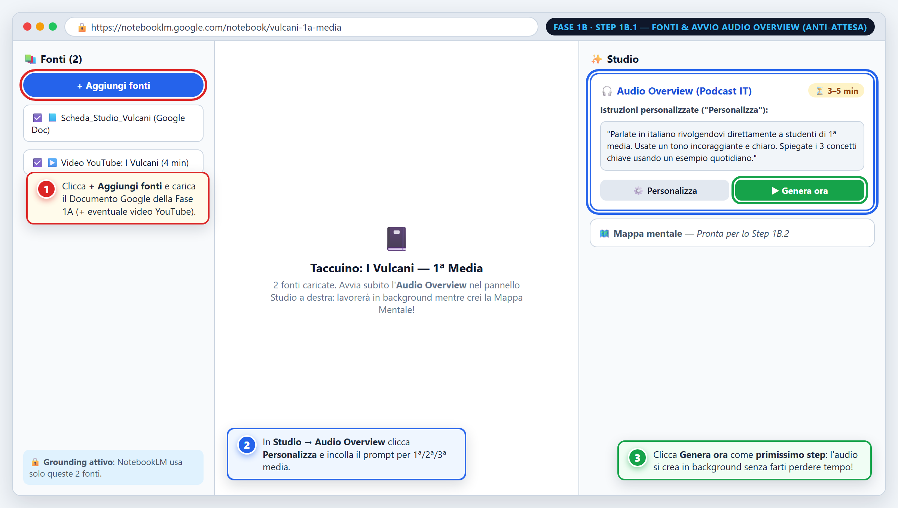
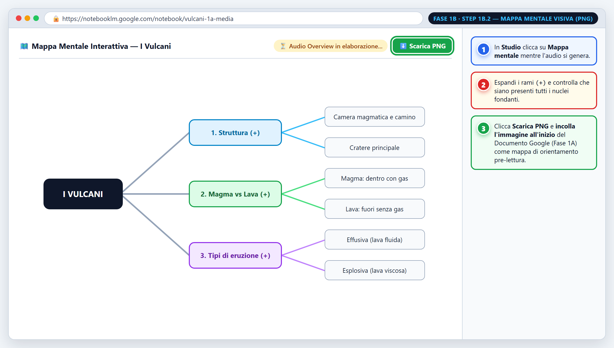
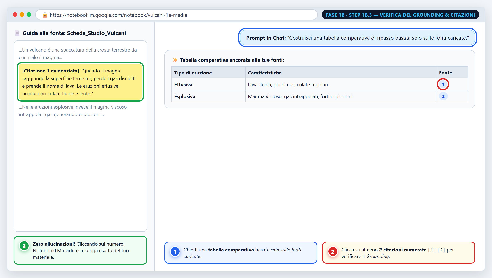
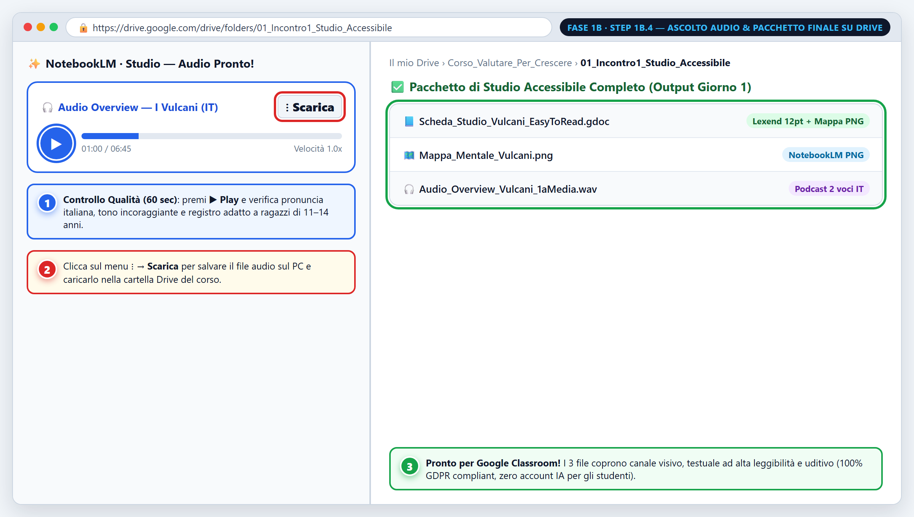

# Schede Operative per i 5 Lavori Pratici in Aula (5 Incontri × 4 Ore)

## VALUTARE PER CRESCERE
### *Dal Pacchetto di Studio Accessibile al Kit Valutativo Inclusivo Completo (con Google Gemini, NotebookLM e Google Workspace)*

> [!TIP]
> **Come sono organizzati i 5 Lavori Pratici nei 5 Incontri da 4 Ore (Struttura Progressiva a Micro-Step)**  
> Ogni incontro pomeridiano di **4 ore (`Blocco 1: 110' → Pausa: 20' → Blocco 2: 110'`)** prevede **un Lavoro Pratico unitario**, suddiviso in **Fase A (Blocco 1)** e **Fase B (Blocco 2)**, ciascuna articolata in **micro-step temporizzati a difficoltà crescente** così che sia i principianti assoluti sia i docenti più esperti procedano senza intoppi né tempi morti.  
> Per chi arriva in laboratorio senza un testo o una verifica propria, è sempre disponibile il [Kit Materiali Campione Pronti per l'Aula](04_Kit_Materiali_Campione_Pronti_Aula.md).

---

## Quadro Sinottico dei 5 Lavori Pratici (Cartella Google Drive: `Corso_Valutare_Per_Crescere`)

| Incontro (4h) | Modulo del Corso | Sottocartella Google Drive | Fase A (nel Blocco 1 · `00:00–01:50`) | Fase B (nel Blocco 2 · `02:10–04:00`) | Output Finale della Giornata |
| :--- | :--- | :--- | :--- | :--- | :--- |
| **Incontro 1** | Accessibilità, autonomia e studio (`4/20`) | `01_Incontro1_Studio_Accessibile` | **Fase 1A (`30'` · 3 step)**: Riscaldamento (`5'`) → Scheda *Easy-to-Read* su Gemini (`15'`) → Esporta e formatta Lexend (`10'`) | **Fase 1B (`45'` · ordine anti-attesa)**: Avvia Audio Overview (`5'`) → Mappa Mentale PNG (`15'`) → Chat con citazioni (`15'`) → Ascolto/Salvataggio Audio (`10'`) | **1. Pacchetto di Studio Accessibile e Multisensoriale** |
| **Incontro 2** | VerifichIAmo con l'IA — Parte I (`4h su 10/20`) | `02_Incontro2_Verifica_UDL_Multilivello` | **Fase 2A (`30'` · 3 step)**: Scelta verifica propria o campione (`5'`) → Radiografia LOTS→HOTS (`15'`) → Confronto in coppia (`10'`) | **Fase 2B (`55'` · *Prompt Chaining*)**: Genera e valida Versione B + Correttorio (`20'`) → Genera A e C parallele + Canvas (`20'`) → Crea Skill (`15'`) | **2. Verifica UDL a 3 Livelli + Correttorio `[A-D][1-6]`** |
| **Incontro 3** | VerifichIAmo con l'IA — Parte II (`4h su 10/20`) | `03_Incontro3_Rubrica_KSM_e_Feedback` | **Fase 3A (`40'` · 3 step)**: Rubrica KSM in Fogli (`15'`) → Audit descrittori + opzione Template Classroom (`15'`) → Autovalutazione Studente (`10'`) | **Fase 3B (`45'` · 3 step)**: Test tono su 1 errore reale (`10'`) → Kit 3 profili K/S/M (`20'`) → 1 Micro-Attività di recupero curata in Lexend (`15'`) | **3. Rubrica KSM + Autovalutazione + Kit Feedback** |
| **Incontro 4** | Area 1 Domande IA (`2/20`) + Area 2 Quiz Digitali (`2/20`) | `04_Incontro4_Banca_Quesiti_e_Quiz_Digitale` | **Fase 4A (`50'` · Area 1)**: Genera 10 quesiti in Fogli (`20'`) → Audit distrattori in coppia (`15'`) → Importazione lampo Wordwall/Quizizz (`15'`) | **Fase 4B (`55'` · Area 2)**: Mini-Modulo Pilota 4 quesiti (`20'`) → 1 Ramificazione condizionale (`20'`) → Collaudo incrociato "lato studente" (`15'`) | **4. Banca Quesiti in Fogli + Google Modulo Ramificato** |
| **Incontro 5** | Area 3 Video/Materiali (`2/20`) + VerifichIAmo III (`2h su 10/20`) | `05_Incontro5_Verifica_Multimodale_e_Kit_Finale` | **Fase 5A (`50'` · Area 3)**: Selezione video da playlist testata (`5'`) → Domande con minutaggio su NotebookLM (`20'`) → Moduli+Video o Edpuzzle/Lumi (`25'`) | **Fase 5B (`45'` · VerifichIAmo III)**: Scheda Regia 1 Pagina (`10'`) → Simulazione assegnazione differenziata su Classroom (`15'`) → Peer-Review (`20'`) | **5. Verifica Multimodale + Kit Valutativo Completo** |

---

## 🛠️ LAVORO PRATICO 1 — Incontro 1 (4 ore)
### *Il Pacchetto di Studio Accessibile e Multisensoriale (con Google Gemini e NotebookLM)*

* **Modulo**: Accessibilità, autonomia e studio degli studenti (`4h = 4/20`).
* **Cartella Drive**: `Corso_Valutare_Per_Crescere / 01_Incontro1_Studio_Accessibile`
* **Esempi di riferimento nel Ricettario**: [#01 Italiano](01_Ricettario_Prompt_30_Esempi_Scuola_Media.md#esempio-01), [#02 Italiano L2/NAI](01_Ricettario_Prompt_30_Esempi_Scuola_Media.md#esempio-02), [#07 Matematica](01_Ricettario_Prompt_30_Esempi_Scuola_Media.md#esempio-07), [#11 Inglese](01_Ricettario_Prompt_30_Esempi_Scuola_Media.md#esempio-11), [#16 Geografia](01_Ricettario_Prompt_30_Esempi_Scuola_Media.md#esempio-16), [#18 Scienze](01_Ricettario_Prompt_30_Esempi_Scuola_Media.md#esempio-18).
* **Materiali di emergenza**: se non hai un testo tuo, prendi uno dei brani pronti nel [Kit Materiali Campione](04_Kit_Materiali_Campione_Pronti_Aula.md#parte-1).
* **Obiettivo**: partire da una pagina del libro di testo o da una propria dispensa per costruire un pacchetto di studio che abbatta le barriere di decodifica e memoria di lavoro (BES, DSA, L. 104, NAI, ADHD) nel rispetto del GDPR, accompagnando lo studente da `1. Ricordare` a `2. Comprendere` e `3. Applicare`.

---

### Fase 1A (Blocco 1 · `30 min` · 3 Micro-Step) — La Scheda di Studio *Easy-to-Read* con Gemini Multimodale e Canvas

#### Step 1A.1 — Riscaldamento "Confronto Lampo" (`5 min`)
1. **Scegli il testo di partenza**: prendi una pagina del tuo libro di testo (o un tuo breve testo disciplinare di 1ª, 2ª o 3ª media su cui lavorerai lungo tutti e 5 gli incontri). Se non hai un file pronto, apri il [Kit Materiali Campione](04_Kit_Materiali_Campione_Pronti_Aula.md#parte-1) e copia uno dei 4 testi pronti.
2. **Apri Google Gemini**: vai su `https://gemini.google.com` ed effettua l'accesso con il tuo account Google.
3. **Esegui il test con il prompt ingenuo**: clicca su **"+ Nuova chat"**, incolla il testo scelto e scrivi una richiesta generica di una sola riga, ad esempio: *"Riassumi questo testo per la scuola media e fai 3 domande"*.
4. **Osserva i limiti in 30 secondi**: nota i tre difetti tipici di un prompt non guidato: (1) un **muro di testo** con frasi lunghe e dense, (2) **termini tecnici** non spiegati o eliminati, (3) domande solo di memoria (**LOTS 1**) senza alcun aiuto (*scaffolding*).



---

#### Step 1A.2 — Ingegneria del Prompt `R-C-N-A-F`, Upload Multimodale e Gemini Canvas (`15 min`)
1. **Prepara il Profilo Funzionale Anonimizzato (GDPR)**: apri la Parte 2 del [03_Kit_Privacy_GDPR_e_Strumenti_Locali.md](03_Kit_Privacy_GDPR_e_Strumenti_Locali.md) e scegli la descrizione funzionale adatta alla tua classe. **Verifica sempre** di non inserire mai nomi, cognomi, classi identificabili o codici diagnostici (es. ICD-10).
2. **Apri una nuova chat pulita** su `gemini.google.com` (in alto a sinistra clicca **"+ Nuova chat"**) così il modello non viene influenzato dalla prova ingenua precedente.
3. **Allega il materiale e attiva Canvas**:
   * 🟢 **Binario Base ("Pronti Via")**: incolla direttamente il **Prompt Template 1 (`R-C-N-A-F`)** qui sotto e, in coda, il testo di partenza copiato.
   * 🔵 **Binario Approfondimento (Multimodale + Canvas)**: clicca sul pulsante **`+`** nella barra di input per caricare direttamente la **foto/screenshot o il PDF** della pagina del libro (con testo e schemi), poi clicca sul pulsante **`Canvas`** nella stessa barra prima di premere **Invia**.
4. **Rifinitura chirurgica in Gemini Canvas**: quando il documento appare nel pannello laterale destro di **Canvas**, evidenzia con il mouse una sola frase o un paragrafo ancora troppo denso e clicca sugli strumenti rapidi a comparsa (**"Semplifica"** o **"Accorcia"**) per migliorarlo al volo senza rigenerare l'intera scheda.



```text
[R - RUOLO] Agisci come un docente esperto di [MATERIA] nella Scuola Secondaria di Primo Grado e specialista in didattica inclusiva UDL.
[C - CLASSE] Lavoriamo per una classe [1ª / 2ª / 3ª] media (studenti di [11 / 12 / 13] anni).
[N - NUCLEI E SCALA COGNITIVA] Partendo dal testo o dall'immagine allegata su [ARGOMENTO], conserva tutti i concetti fondamentali della disciplina ma riorganizzali per accompagnare lo studente dal semplice ricordare (LOTS 1) alla comprensione delle relazioni causa-effetto e all'applicazione pratica (LOTS 2 e 3).
[A - ACCESSIBILITÀ E PROFILO FUNZIONALE] Applica rigorosamente le regole Easy-to-Read per studenti con affaticamento nella lettura e memoria di lavoro fragile:
- frasi brevi (massimo 15-18 parole) in forma attiva e zero doppie negazioni;
- testo diviso in 3 o 4 paragrafi brevi, ciascuno introdotto da un titolo-domanda;
- termini tecnici fondamentali mantenuti in GRASSETTO e spiegati subito tra parentesi con parole semplici.
[F - FORMATO DI OUTPUT] Restituisci una scheda strutturata in 3 parti:
1. TESTO AD ALTA LEGGIBILITÀ (con paragrafi titolati e parole chiave in grassetto);
2. TABELLA GLOSSARIO (colonne: Termine tecnico | Spiegazione semplice | Esempio concreto quotidiano);
3. TRE DOMANDE GUIDA ALLO STUDIO graduate (1 sul Ricordare con banca parole, 1 sul Comprendere, 1 sull'Applicare), ciascuna accompagnata da un suggerimento "[Aiuto: ...]".
```

---

#### Step 1A.3 — Validazione *Human-in-the-Loop*, Esportazione in Google Documenti e Formattazione Lexend (`10 min`)
1. **Controllo disciplinare (*Human-in-the-Loop*)**: rileggi l'intera scheda generata da Gemini e verifica che i concetti chiave siano corretti, che non ci siano errori fattuali (allucinazioni) e che i termini disciplinari siano conservati e spiegati bene.
2. **Esporta in 1 clic**: clicca sul pulsante **"Esporta in Documenti"** (in alto a destra in Canvas, oppure sotto la risposta nella chat standard) per aprire automaticamente la scheda in **Google Documenti**.
3. **Applica la formattazione ad alta leggibilità**:
   * premi `Ctrl + A` (su Mac `Cmd + A`) per selezionare tutto il documento;
   * nel menu dei caratteri scegli **Lexend** (oppure **Atkinson Hyperlegible**);
   * imposta la dimensione a **`12 pt`** (o `14 pt` per ipovisione/affaticamento visivo);
   * clicca su **Interlinea e spaziatura paragrafi** → imposta **`1,5`**;
   * imposta l'**allineamento a sinistra** ("a bandiera", **mai giustificato**).
4. **Rinomina e archivia in Google Drive**: assegna un titolo chiaro in alto a sinistra (es. `Scheda_Studio_[Argomento]_EasyToRead`), clicca sull'icona della cartella **`📁 Sposta`** accanto al titolo e salva il file dentro `Corso_Valutare_Per_Crescere / 01_Incontro1_Studio_Accessibile`.



---

### Fase 1B (Blocco 2 · `45 min` · 4 Micro-Step in Ordine Anti-Attesa) — Audio Overview, Mappa Mentale e Citazioni con Google NotebookLM

> 💡 **Trucco di regia in laboratorio:** l'elaborazione dell'*Audio Overview* richiede 3–5 minuti. Lanciandolo **come primissimo step**, lavorerai in parallelo su Mappa Mentale e Chat senza alcun tempo morto!

#### Step 1B.1 — Carica le Fonti e Avvia Subito l'Audio Overview in Background (`5 min`)
1. **Crea il taccuino**: apri `https://notebooklm.google.com` e clicca su **"+ Nuovo taccuino"** (o **"+ Nuovo"**).
2. **Carica le fonti certificate**: nel riquadro a sinistra (**Fonti**), clicca su **"+ Aggiungi fonti"**, scegli **Google Drive** e seleziona il Documento Google appena creato nella Fase 1A (puoi aggiungere anche il PDF della tua dispensa e/o il link a un breve video **YouTube** sull'argomento).
3. **Personalizza e avvia l'Audio Overview**: spostati subito nel pannello **Studio** a destra, individua il riquadro **Audio Overview**, clicca su **"Personalizza"**, incolla l'istruzione qui sotto e clicca subito su **"Genera"**:
   > *"Parlate in italiano rivolgendovi direttamente a studenti di [1ª/2ª/3ª] media. Usate un tono incoraggiante e chiaro. Spiegate i 3 concetti chiave del documento usando una metafora o un esempio vicino alla vita quotidiana dei ragazzi."*
4. **Lascialo lavorare in background**: mentre compare l'indicatore di elaborazione (3–5 minuti), passa immediatamente allo Step 1B.2.



---

#### Step 1B.2 — Genera e Incolla la Mappa Mentale Visiva (`15 min`)
1. **Avvia la Mappa Mentale**: mentre l'audio si genera, nel pannello **Studio** a destra clicca sul pulsante **"Mappa mentale"**.
2. **Esplora e valida i nodi**: clicca sui nodi con il simbolo **`+`** per espandere tutti i rami concettuali e verifica che i nuclei fondanti del tuo argomento siano rappresentati in modo gerarchico e chiaro.
3. **Scarica l'immagine PNG**: clicca sul pulsante **"Scarica"** (in alto a destra nella vista mappa) per salvare la mappa sul PC in formato **`.png`**.
4. **Integra la mappa nella scheda di studio**: riapri il Documento Google della Fase 1A, posiziona il cursore all'inizio della prima pagina (subito sotto il titolo) e scegli `Inserisci → Immagine → Carica dal computer` per inserire la mappa come **organizzatore anticipato visivo** prima della lettura. Carica una copia del file `.png` anche nella cartella Drive `01_Incontro1_Studio_Accessibile`.



---

#### Step 1B.3 — Verifica del *Grounding* e Tabella Comparativa in Chat (`15 min`)
1. **Interroga solo le tue fonti**: nel pannello centrale (**Chat**) di NotebookLM, scrivi questo prompt:
   > *"Costruisci una tabella comparativa di ripasso basata solo sulle fonti caricate, evidenziando differenze, cause ed effetti."*
2. **Verifica le citazioni numerate**: nella risposta generata compariranno dei piccoli numeri cliccabili (**`[1]`**, **`[2]`**, ecc.). Clicca su almeno **2 citazioni numerate**.
3. **Controlla l'evidenziazione a sinistra**: osserva che il pannello sinistro apre automaticamente la tua fonte e **evidenzia la riga esatta** da cui NotebookLM ha tratto quell'informazione. Questo conferma il funzionamento del **Grounding** (ancoraggio rigoroso alle fonti del docente, zero allucinazioni!).
4. *(Facoltativo)* Clicca su **"Salva nella nota"** oppure copia la tabella comparativa in fondo al tuo Documento Google come schema di ripasso finale.



---

#### Step 1B.4 — Controllo Qualità e Salvataggio dell'Audio Overview (`10 min`)
1. **Ascolta i primi 60 secondi**: torna nel pannello **Studio** a destra, dove il player dell'**Audio Overview** sarà ormai pronto, e premi **`▶ Play`**. Verifica:
   * la correttezza della pronuncia italiana dei termini disciplinari;
   * il tono dialogico e incoraggiante;
   * l'adeguatezza del registro linguistico per studenti di 11–14 anni.
2. **Scarica il file audio**: clicca sul menu a tre puntini **`⋮`** accanto al player audio e seleziona **"Scarica"**.
3. **Completa il Pacchetto di Studio Accessibile su Drive**: carica il file audio scaricato nella sottocartella `Corso_Valutare_Per_Crescere / 01_Incontro1_Studio_Accessibile`. Al termine della giornata la tua cartella conterrà tutti e 3 i canali del pacchetto multisensoriale (**Documento Google Lexend con Mappa PNG** + **Mappa PNG** + **Audio Overview**), pronti per essere caricati su **Google Classroom** senza richiedere alcun account IA agli studenti!



---

## 🛠️ LAVORO PRATICO 2 — Incontro 2 (4 ore)
### *Dalla "Radiografia" alla Verifica UDL Multilivello sulla Scala LOTS → HOTS (con Gemini Thinking, Canvas e Skill)*

* **Modulo**: VerifichIAmo con l'Intelligenza Artificiale — Parte I (`4h su 10/20`).
* **Cartella Drive**: `Corso_Valutare_Per_Crescere / 02_Incontro2_Verifica_UDL_Multilivello`
* **Esempi di riferimento nel Ricettario**: [#03 Italiano narrativa](01_Ricettario_Prompt_30_Esempi_Scuola_Media.md#esempio-03), [#04 Italiano grammatica](01_Ricettario_Prompt_30_Esempi_Scuola_Media.md#esempio-04), [#08 Matematica Pitagora](01_Ricettario_Prompt_30_Esempi_Scuola_Media.md#esempio-08), [#14 Storia Feudalesimo](01_Ricettario_Prompt_30_Esempi_Scuola_Media.md#esempio-14), [#22 Tecnologia Energia](01_Ricettario_Prompt_30_Esempi_Scuola_Media.md#esempio-22), [#24 Arte e Immagine](01_Ricettario_Prompt_30_Esempi_Scuola_Media.md#esempio-24).
* **Obiettivo**: analizzare criticamente una verifica tradizionale con Gemini Multimodale e costruire per step incrementali (*Prompt Chaining*) con il modello di **Ragionamento (*Thinking*)** e **Gemini Canvas** una **Verifica UDL su 3 livelli paralleli** (*Versione A Facilitata/Equipollente*, *Versione B Standard*, *Versione C Potenziamento*) bilanciata sulla scala **LOTS → HOTS**.

---

### Fase 2A (Blocco 1 · `30 min` · 3 Micro-Step) — "Radiografia" di una Verifica Reale con Gemini Multimodale

* **Step 2A.1 — Selezione della Verifica di Partenza (`5 min`)**: prendi il PDF, il testo o la **foto** di una tua verifica tradizionale; se non ne hai una a portata di mano, copia una delle **4 Verifiche Tradizionali Campione** (Lettere, STEM, Lingue, Tecnico-Artistiche) dal [Kit Materiali Campione](04_Kit_Materiali_Campione_Pronti_Aula.md#parte-2).
* **Step 2A.2 — Radiografia Tassonomica su Gemini (`15 min`)**: carica la verifica in **Google Gemini** e incolla il **Prompt di Radiografia Tassonomica**:

```text
Analizza questa verifica per la classe [1ª / 2ª / 3ª] della Scuola Secondaria di I grado secondo la Tassonomia di Anderson & Krathwohl (1. Ricordare, 2. Comprendere, 3. Applicare, 4. Analizzare, 5. Valutare, 6. Creare) e il Criterio KSM (Knowledge, Skills, Mindset/Metacognition).
Restituisci:
1. Una TABELLA DIAGNOSTICA con colonne: N. Quesito | Processo Cognitivo e Codice [A-D][1-6] | Asse KSM | Eventuali barriere linguistiche, visive o mnemoniche per alunni con DSA, BES o Italiano L2;
2. La percentuale attuale di quesiti LOTS (1-3) rispetto ai quesiti HOTS (4-6);
3. Tre proposte concrete per riequilibrare la prova senza abbassare gli obiettivi disciplinari.
```

* **Step 2A.3 — Confronto Lampo in Coppia (`10 min`)**: confronta la diagnosi con il collega di banco (*quante domande erano solo `LOTS 1 — Ricordare`?*) e annota i 2 correttivi prioritari da applicare nel Blocco 2.

---

### Fase 2B (Blocco 2 · `55 min` · 3 Micro-Step a *Prompt Chaining*) — Co-Progettazione Incrementale della Verifica UDL a 3 Livelli e della "Skill"

> 💡 **Perché *Prompt Chaining* in 2 mosse invece di un solo mega-prompt?** Chiedere 3 versioni × 6 quesiti + correttorio in un colpo solo aumenta il rischio di output troncati o errori nei calcoli. Costruendo prima la **Versione B** e validandola, le **Versioni A e C** nasceranno perfettamente parallele e prive di errori!

* **Step 2B.1 — Genera e Valida il Cuore della Prova: Versione B + Correttorio (`20 min`)**:
  1. Attiva in Google Gemini il modello di **Ragionamento (*Thinking*)** + **Gemini Canvas**.
  2. Incolla il **Prompt Template 2B.1** qui sotto sull'argomento scelto all'Incontro 1.
  3. Esegui subito il controllo **Human-in-the-Loop** (ricalcola i numeri STEM, controlla date/citazioni, verifica che Q5 *"Caccia all'errore"* abbia un errore realistico e chiaro).

```text
[R - RUOLO] Agisci come docente esperto di [MATERIA] nella Scuola Secondaria di I Grado e progettista di prove inclusive secondo UDL, Tassonomia di Anderson & Krathwohl (LOTS -> HOTS) e Criterio KSM.
[C - CLASSE] Classe [1ª / 2ª / 3ª] media (durata: 45-50 minuti).
[N - NUCLEI E SCALA COGNITIVA] Progetta la VERSIONE B (Standard ad alta leggibilità) di una verifica su [ARGOMENTO] basata sui nuclei fondanti: [ELENCA 3 NUCLEI].
Struttura esattamente 6 quesiti bilanciati:
- Q1 e Q2 (LOTS — 1. Ricordare / 2. Comprendere — Asse K);
- Q3 e Q4 (Ponte — 3. Applicare / 4. Analizzare — Asse S);
- Q5 (HOTS — 5. Valutare — Asse M): attività "Caccia all'errore" (svolgimento di uno studente immaginario con 1 errore concettuale/procedurale da individuare, motivare e correggere);
- Q6 (HOTS — 6. Creare / Riflettere — Asse M): breve rielaborazione personale o ipotesi applicativa.
[A - ACCESSIBILITÀ] Consegne chiare, un solo verbo d'azione per punto, zero doppie negazioni.
[F - FORMATO] Restituisci la VERSIONE B seguita dal CORRETTORIO COMPLETO con i codici tassonomici [A-D][1-6] di ogni quesito.
```

* **Step 2B.2 — Differenziazione UDL Parallela (Versioni A e C) + Rifinitura in Canvas (`20 min`)**:
  1. Nella **stessa chat**, dopo aver verificato/corretto la Versione B, incolla il **Prompt Template 2B.2**:

```text
Perfetto, la Versione B è validata. Ora genera, mantenendo esattamente gli STESSI obiettivi e nuclei della Versione B:
1. VERSIONE A (Facilitata / Equipollente per BES, DSA, NAI): consegne brevi numerate passo-passo, parole chiave in grassetto, banca parole per Q1-Q2, tabella semicompilata o dati interi semplici per Q3-Q4, suggerimento "Dove guardare" e frase-avvio (sentence starter) per Q5 e Q6 ("L'errore si trova nel passaggio... perché...").
2. VERSIONE C (Potenziamento): mantiene Q1-Q5 e sostituisce Q6 con una sfida aperta di livello HOTS 6 (collegamento interdisciplinare o progettazione di un caso nuovo).
Impagina in modo pulito pronto per "Esporta in Documenti".
```

  2. Usa **Gemini Canvas** per rifinire col mouse almeno 1–2 consegne (es. accorciare una frase nella Versione A), clicca su **"Esporta in Documenti"**, formatta in **Lexend `12 pt`** (`interlinea 1,5`) e salva in `02_Incontro2_Verifica_UDL_Multilivello`.
* **Step 2B.3 — Crea la tua "Skill" Disciplinare Permanente (`15 min` · Binario Approfondimento / Opzionale)**:
  1. Menu laterale di Gemini → **Skill → + Nuova Skill**.
  2. Nome: `"Progettista Verifiche UDL - [Tua Materia]"`, incolla nelle **Istruzioni** le regole fisse dei Prompt 2B.1 e 2B.2 e salva.

---

## 🛠️ LAVORO PRATICO 3 — Incontro 3 (4 ore)
### *La Rubrica di Valutazione KSM, l'Autovalutazione Studente e il Feedback Formativo (con Gemini, Fogli e Classroom)*

* **Modulo**: VerifichIAmo con l'Intelligenza Artificiale — Parte II (`4h su 10/20`).
* **Cartella Drive**: `Corso_Valutare_Per_Crescere / 03_Incontro3_Rubrica_KSM_e_Feedback`
* **Esempi di riferimento nel Ricettario**: [#05 Italiano Rubrica KSM](01_Ricettario_Prompt_30_Esempi_Scuola_Media.md#esempio-05), [#20 2ª Lingua supporto e feedback](01_Ricettario_Prompt_30_Esempi_Scuola_Media.md#esempio-20), [#23 Tecnologia Rubrica KSM disegno](01_Ricettario_Prompt_30_Esempi_Scuola_Media.md#esempio-23), [#26 Musica Rubrica KSM](01_Ricettario_Prompt_30_Esempi_Scuola_Media.md#esempio-26), [#28 Ed. Fisica Autovalutazione M](01_Ricettario_Prompt_30_Esempi_Scuola_Media.md#esempio-28), [#30 IRC/Ed. Civica Scenario HOTS + Rubrica KSM](01_Ricettario_Prompt_30_Esempi_Scuola_Media.md#esempio-30).
* **Obiettivo**: dotare la verifica dell'Incontro 2 di una **Rubrica di valutazione KSM × Anderson & Krathwohl** validata, di una **Scheda di Autovalutazione Studente** e di un **Kit di Feedback Formativi (*feed-forward*) con micro-recupero pronto da stampare**.

---

### Fase 3A (Blocco 1 · `40 min` · 3 Micro-Step) — Rubrica KSM, Audit Descrittori e Autovalutazione

* **Step 3A.1 — Genera la Rubrica KSM con Gemini ed Esporta in Fogli (`15 min`)**:
  1. Nella stessa chat della tua verifica (o incollando il testo della verifica del Lavoro 2), esegui su **Google Gemini (*Thinking*)** il **Prompt Template 3A** qui sotto.
  2. Clicca sotto la tabella su **"Esporta in Fogli"** e salva il Foglio Google in `03_Incontro3_Rubrica_KSM_e_Feedback`.
* **Step 3A.2 — Audit Docimologico dei Descrittori + Opzione Template Classroom (`15 min`)**:
  1. Controlla la tabella nel Foglio Google rispetto allo **Standard Obbligatorio** qui sotto: elimina qualsiasi avverbio vago (*"poco / abbastanza / molto"*), verifica che i pesi sommino a `100%` (`K 35% + S 40% + M 25%`) e che l'uso degli strumenti compensativi (PDP/PEI) non penalizzi il voto.
  2. *(Nota tecnica importante per Google Classroom)*: la tabella libera esportata da Gemini è perfetta come archivio docimologico e stampa, ma **Google Classroom importa solo Fogli strutturati secondo il proprio template ufficiale** (`Griglia → Importa da Fogli`). Chi desidera importarla subito in Classroom copia i descrittori validati nel **Template Fogli ufficiale di Classroom** fornito dal formatore in Drive.
* **Step 3A.3 — Mini-Scheda di Autovalutazione Studente (`10 min`)**:
  1. Controlla la Mini-Scheda generata in prima persona per ragazzi di 11–14 anni (*"Valutare per crescere"*) e salvala nel Documento della verifica.

```text
[R - RUOLO] Agisci come esperto di valutazione formativa e docimologia nella Scuola Secondaria di Primo Grado.
[C - CLASSE] Classe [1ª / 2ª / 3ª] media.
[N - NUCLEI E MODELLO KSM] Costruisci la Griglia/Rubrica di valutazione per la verifica su [ARGOMENTO] (prodotta nel Lavoro 2), basandoti obbligatoriamente sulla Tassonomia di Anderson & Krathwohl (matrice 4x6: Conoscenze A Fattuale, B Concettuale, C Procedurale, D Metacognitiva x Processi 1. Ricordare, 2. Comprendere, 3. Applicare, 4. Analizzare, 5. Valutare, 6. Creare) e sul Criterio KSM:
- Asse K (Knowledge — Conoscenze A e B — peso 35%)
- Asse S (Skills — Abilità procedurali C — peso 40%)
- Asse M (Mindset, Metacognition & Mastery — Metacognizione D, individuazione dell'errore e autonomia — peso 25%)
[A - ACCESSIBILITÀ ED EQUITÀ] I descrittori devono valutare il raggiungimento del processo cognitivo anche attraverso l'uso legittimo degli strumenti compensativi e dello scaffolding presenti nella Versione Facilitata (prove equipollenti). Non usare avverbi vaghi ("poco, abbastanza, molto"), ma verbi d'azione osservabili che progrediscono da LOTS (Livelli 1-2) a HOTS (Livelli 3-4).
[F - FORMATO DI OUTPUT] Restituisci:
1. TABELLA RUBRICA DOCENTE (Colonne: Asse KSM e Peso % | Indicatore e Codice [A-D][1-6] | Livello 1 Iniziale (Voto 4-5) | Livello 2 Base (Voto 6) | Livello 3 Intermedio (Voto 7-8) | Livello 4 Avanzato (Voto 9-10));
2. MINI-SCHEDA DI AUTOVALUTAZIONE PER LO STUDENTE ("Valutare per crescere"): 4 domande brevi in prima persona ("Che cosa ho capito bene...", "Dove ho trovato difficoltà...", "Come ho usato gli aiuti/schemi...", "Il mio prossimo passo per migliorare...") per riflettere sulla prova.
```

#### Standard Obbligatorio di Controllo della tua Griglia KSM

| Asse KSM e Peso | Indicatore e Codice Tassonomico `[A-D][1-6]` | Livello 1: Iniziale *(LOTS parziale — Voto 4–5 / D)* | Livello 2: Base *(LOTS consolidato — Voto 6 / C)* | Livello 3: Intermedio *(Ponte LOTS → HOTS — Voto 7–8 / B)* | Livello 4: Avanzato *(HOTS + Mastery — Voto 9–10 / A)* |
| :--- | :--- | :--- | :--- | :--- | :--- |
| **K — Knowledge** *(Il Sapere — Peso 35%)* | **K1. Padronanza dei nuclei fattuali e concettuali** `[A1, B2 → B4]` | **[A1–B1 parziale]** Individua solo alcuni termini o dati isolati anche con il supporto della banca parole; fatica a collegare i concetti di base. | **[A1–B2]** Riconosce correttamente i termini chiave e spiega le relazioni essenziali dell'argomento (anche avvalendosi di glossario o mappe). | **[B2–B4]** Spiega in modo organico concetti e relazioni causa-effetto; confronta e distingue gli elementi principali con lessico appropriato. | **[B4–B6]** Padroneggia in modo completo il quadro concettuale; confronta criticamente i fenomeni e stabilisce collegamenti originali. |
| **S — Skills** *(Il Saper Fare — Peso 40%)* | **S1. Applicazione di procedure e analisi di dati/testi** `[C3 → C5]` | **[C1–C3 guidato]** Esegue i passaggi procedurali in modo incompleto o meccanico; necessita di guida costante per utilizzare tabelle o schemi. | **[C3 esecutivo]** Applica correttamente la procedura standard o completa la tabella guidata nei casi familiari, giungendo a un risultato globalmente corretto. | **[C3–C4]** Implementa procedure e organizza i dati con sicurezza; scompone il problema nei passaggi chiave in modo autonomo ed efficace. | **[C4–C6]** Seleziona e adatta con precisione il metodo risolutivo anche in quesiti complessi o non familiari, giustificando i passaggi svolti. |
| **M — Mindset, Metacognition & Mastery** *(Il Saper Essere e Divenire — Peso 25%)* | **M1. Analisi critica dell'errore (*Caccia all'errore*) e autovalutazione** `[D2 → D6]` | **[D1–D2 passivo]** Non individua l'errore nel caso proposto anche con il suggerimento guidato; compila l'autovalutazione in modo superficiale. | **[D2–D3 base]** Individua il punto in cui si trova l'errore grazie allo *scaffolding* e completa la riflessione guidata sul proprio lavoro. | **[D4–D5]** Riconosce e corregge l'errore spiegandone il motivo; autovaluta con consapevolezza i propri punti di forza e gli aspetti da rivedere. | **[D5–D6]** Argomenta in modo rigoroso la natura dell'errore proponendo una strategia alternativa; elabora un piano lucido di miglioramento personale. |

---

### Fase 3B (Blocco 2 · `45 min` · 3 Micro-Step) — Calibrazione del Feedback Formativo (*Feed-Forward*) e Micro-Recupero

* **Step 3B.1 — Calibrazione del Tono su 1 Errore Reale (`10 min`)**:
  1. Scrivi in 2 righe (100% anonimo!) **un errore tipico reale** che incontri ogni anno nella tua classe sull'argomento della verifica.
  2. Chiedi a Gemini un feedback in 3 righe (*🌟 Punto di forza · 🔍 Punto di attenzione · 🚀 Prossimo passo*) e verifica che il tono sia davvero caldo, chiaro e incoraggiante per un ragazzo di 11–14 anni (non burocratico né giudicante).
* **Step 3B.2 — Estensione ai 3 Profili Tipici K / S / M (`20 min`)**:
  1. Incolla il **Prompt Template 3B** qui sotto per ottenere il set completo dei 3 feedback pronti all'uso per i 3 assi KSM.
* **Step 3B.3 — 1 Sola Micro-Attività di Recupero Mirato ma Pronta da Stampare (`15 min`)**:
  1. Tra i 3 profili, scegli **l'inciampo più frequente nella tua classe** e chiedi a Gemini di trasformarlo in **1 sola Micro-Attività di Recupero da 10 minuti** (con esempio svolto + *scaffolding*), esportala in **Google Documenti** in font **Lexend `12 pt`** e salvala in `03_Incontro3_Rubrica_KSM_e_Feedback`.

```text
[R - RUOLO] Agisci come docente esperto in valutazione formativa ("Valutare per crescere") nella Scuola Secondaria di Primo Grado.
[C - CLASSE] Classe [1ª / 2ª / 3ª] media — Verifica su [ARGOMENTO].
[N - FEEDBACK E RECUPERO] A partire dalla verifica, dalla Rubrica KSM e dal tono calibrato sopra, genera 3 Feedback Formativi (100% anonimi) per 3 profili tipici:
- Profilo 1 (Asse K): studente che confonde i termini chiave o le relazioni di base;
- Profilo 2 (Asse S): studente che ha capito la regola ma si blocca nell'applicazione procedurale o nella lettura della tabella;
- Profilo 3 (Asse M): studente che risolve gli esercizi standard ma non riesce ad argomentare la "Caccia all'errore".
[A - TONO FORMATIVO E ACCESSIBILE] Ogni feedback (max 3 righe) deve rivolgersi direttamente allo studente con struttura:
- 🌟 Punto di forza (cosa hai dimostrato di saper fare);
- 🔍 Punto di attenzione (dove si trova l'inciampo specifico);
- 🚀 Il tuo prossimo passo (consiglio pratico immediato — feed-forward).
Aggiungi infine 1 SOLA Micro-Attività di Recupero Mirato da 10 minuti (con esempio svolto e scaffolding) dedicata al [Profilo 1 / 2 / 3].
[F - FORMATO DI OUTPUT] Scheda pulita pronta per "Esporta in Documenti".
```

---

## 🛠️ LAVORO PRATICO 4 — Incontro 4 (4 ore)
### *Dalla Banca Quesiti con Gemini (Area 1) al Quiz Digitale Accessibile e Ramificato (Area 2)*

* **Moduli**: Area 1 — Progettare domande e quiz con il supporto dell'IA (`2h = 2/20`) + Area 2 — Quiz digitali per la valutazione (`2h = 2/20`).
* **Cartella Drive**: `Corso_Valutare_Per_Crescere / 04_Incontro4_Banca_Quesiti_e_Quiz_Digitale`
* **Esempi di riferimento nel Ricettario**: [#06 Italiano Lessico](01_Ricettario_Prompt_30_Esempi_Scuola_Media.md#esempio-06), [#09 Matematica Equazioni](01_Ricettario_Prompt_30_Esempi_Scuola_Media.md#esempio-09), [#10 Matematica Modulo ramificato Percentuali](01_Ricettario_Prompt_30_Esempi_Scuola_Media.md#esempio-10), [#12 Inglese Past Simple](01_Ricettario_Prompt_30_Esempi_Scuola_Media.md#esempio-12), [#17 Geografia Quiz Europa](01_Ricettario_Prompt_30_Esempi_Scuola_Media.md#esempio-17), [#21 2ª Lingua Quesiti comunicativi](01_Ricettario_Prompt_30_Esempi_Scuola_Media.md#esempio-21).
* **Obiettivo**: progettare e validare nel Blocco 1 (Area 1) una banca di 10 quesiti inclusivi (LOTS → HOTS) in **Google Fogli** (+ test rapido su Wordwall/Quizizz), e costruire nel Blocco 2 (Area 2) un **Mini-Modulo Pilota ramificato** su **Google Moduli** collaudato in coppia "lato studente".

---

### Fase 4A (Blocco 1 · Area 1 · `50 min` · 3 Micro-Step) — Banca Quesiti in Fogli, Audit Distrattori e Gamification Lampo

* **Step 4A.1 — Genera la Banca di 10 Quesiti in Google Fogli (`20 min`)**:
  1. Esegui su **Google Gemini (*Thinking*)** il **Prompt Template 4A** qui sotto sul tuo argomento.
  2. Clicca sotto la tabella su **"Esporta in Fogli"** e salva in `04_Incontro4_Banca_Quesiti_e_Quiz_Digitale`.
* **Step 4A.2 — Audit dei Distrattori in Coppia (`15 min`)**:
  1. Con il collega di banco controlla ogni riga del Foglio Google:
     * nessuna doppia negazione (*"Quale NON è..."*);
     * nessun distrattore basato su trabocchetti ortografici/visivi per DSA;
     * ogni distrattore rappresenta una **misconcezione reale** degli alunni ed è spiegato dal feedback formativo.
* **Step 4A.3 — Importazione Lampo su Wordwall o Quizizz (`15 min`)**:
  1. Copia le colonne `Domanda | Opzione A | B | C` dal tuo Foglio Google e testale in **Wordwall** (provando il cambio istantaneo di template visivo) oppure in **Quizizz** (attivando lettura vocale *Read Aloud* e modalità **senza timer**).

```text
[R - RUOLO] Agisci come esperto di progettazione di test e quiz inclusivi per la Scuola Secondaria di Primo Grado.
[C - CLASSE] Classe [1ª / 2ª / 3ª] media — Materia: [MATERIA] — Argomento: [ARGOMENTO].
[N - NUCLEI E SCALA LOTS -> HOTS] Genera una banca di 10 quesiti a scelta multipla così distribuiti:
- 4 quesiti LOTS (1. Ricordare / 2. Comprendere — codice [A1, B2]);
- 4 quesiti PONTE (3. Applicare / 4. Analizzare tramite brevi casi pratici — codice [C3, B4]);
- 2 quesiti HOTS (5. Valutare tramite "Individua l'errore nel ragionamento" — codice [C5, D4]).
[A - ACCESSIBILITÀ BES/DSA/NAI] Rispetta questi vincoli in tutti i quesiti:
- domande brevi e dirette, ZERO doppie negazioni ("Quale NON è..." è vietato);
- 3 opzioni di risposta (A, B, C) chiare e della stessa lunghezza: 1 corretta e 2 distrattori plausibili basati su errori frequenti (niente trabocchetti lessicali o ortografici);
- per ogni quesito aggiungi un breve "Suggerimento / Scaffolding" (senza svelare la risposta) e un "Feedback formativo" che spieghi con tono incoraggiante perché la risposta corretta è giusta e come correggere l'eventuale errore.
[F - FORMATO DI OUTPUT] Restituisci ESCLUSIVAMENTE una tabella con queste colonne esatte (pronta per "Esporta in Fogli"):
N. | Livello LOTS/HOTS e Codice [A-D][1-6] | Testo della Domanda | Opzione A | Opzione B | Opzione C | Risposta Corretta | Suggerimento (Scaffolding) | Feedback Formativo per lo Studente
```

---

### Fase 4B (Blocco 2 · Area 2 · `55 min` · 3 Micro-Step) — Mini-Modulo Pilota Ramificato e Collaudo in Coppia

* **Step 4B.1 — Costruisci il Mini-Modulo Pilota da 4 Quesiti (`20 min`)**:
  1. In `04_Incontro4_Banca_Quesiti_e_Quiz_Digitale` crea **`+ Nuovo → Google Moduli`** e in `Impostazioni` attiva **"Trasforma in un quiz"** (*Subito dopo ogni invio*).
  2. Per evitare un lungo copia-incolla meccanico, inserisci **4 quesiti rappresentativi** dalla tua tabella di Fogli (`1 LOTS`, `2 Ponte`, `1 HOTS`), aggiungendo: **Suggerimento** nella descrizione, **Feedback Formativo** nella Chiave di risposta e almeno **1 immagine/schema visivo** di supporto.
* **Step 4B.2 — Aggiungi 1 Bivio Condizionale LOTS → HOTS (`20 min`)**:
  1. Usa l'[Esempio #10](01_Ricettario_Prompt_30_Esempi_Scuola_Media.md#esempio-10) come modello per creare **3 Sezioni** (*Sezione 1*: Domanda filtro `Ponte C3`; *Sezione 2*: Rinforzo guidato con spiegazione semplice per chi sbaglia; *Sezione 3*: Sfida `HOTS` per chi risponde correttamente o dopo il rinforzo).
  2. Sulla domanda filtro clicca sui tre puntini `⋮` → **"Vai alla sezione in base alla risposta"** e collega ciascuna opzione alla sezione corretta.
* **Step 4B.3 — Collaudo Incrociato "Lato Studente" in Coppia (`15 min`)**:
  1. Condividi il link del tuo Modulo con il collega di banco.
  2. Ciascuno compila il quiz dell'altro **sbagliando volutamente la domanda filtro** per verificare dal vivo che la ramificazione porti alla Sezione di Rinforzo e che i feedback formativi siano chiari e leggibili!

---

## 🛠️ LAVORO PRATICO 5 — Incontro 5 (4 ore)
### *La Verifica Multimodale su Video/Materiali (Area 3) e la Validazione Finale del Kit Valutativo Inclusivo (VerifichIAmo Parte III)*

* **Moduli**: Area 3 — Verifiche integrate a contenuti video e materiali (`2h = 2/20`) + VerifichIAmo con l'IA — Parte III: Sintesi e Integrazione (`2h su 10/20`).
* **Cartella Drive**: `Corso_Valutare_Per_Crescere / 05_Incontro5_Verifica_Multimodale_e_Kit_Finale`
* **Esempi di riferimento nel Ricettario**: [#13 Inglese Video-Listening](01_Ricettario_Prompt_30_Esempi_Scuola_Media.md#esempio-13), [#15 Storia NotebookLM PDF+Video](01_Ricettario_Prompt_30_Esempi_Scuola_Media.md#esempio-15), [#19 Scienze Video esperimento](01_Ricettario_Prompt_30_Esempi_Scuola_Media.md#esempio-19), [#25 Arte Avanguardie](01_Ricettario_Prompt_30_Esempi_Scuola_Media.md#esempio-25), [#27 Musica Ascolto su video/audio](01_Ricettario_Prompt_30_Esempi_Scuola_Media.md#esempio-27), [#29 Ed. Fisica Video gesto motorio/Primo Soccorso](01_Ricettario_Prompt_30_Esempi_Scuola_Media.md#esempio-29).
* **Obiettivo**: realizzare nel Blocco 1 (Area 3) una verifica multimodale ancorata a video + dispensa con flusso unificato su NotebookLM, e completare nel Blocco 2 (VerifichIAmo Parte III) la simulazione reale di assegnazione differenziata su Classroom e la *Peer-Review* del Kit.

---

### Fase 5A (Blocco 1 · Area 3 · `50 min` · 3 Micro-Step Unificati) — Dal Video + Dispensa alla Verifica Multimodale

* **Step 5A.1 — Selezione del Video Didattico (`5 min`)**:
  1. Usa il link di un tuo breve video YouTube (3–6 minuti, con sottotitoli attivi) oppure scegli subito uno dei video già verificati nella [Mini-Playlist Video Testati](04_Kit_Materiali_Campione_Pronti_Aula.md#parte-3).
* **Step 5A.2 — Generazione Unificata delle Domande con Minutaggio su NotebookLM (`20 min`)**:
  1. Apri il tuo taccuino **NotebookLM** (creato all'Incontro 1), aggiungi l'**URL del video YouTube** come nuova fonte accanto alla tua dispensa e lancia il prompt qui sotto:

```text
Incrociando esclusivamente la dispensa e il video YouTube caricati in questo taccuino (riportando sempre le citazioni delle fonti):
1. Genera una micro-verifica multimodale di 5 quesiti in crescendo cognitivo LOTS -> HOTS:
   - Q1 e Q2 (LOTS - Comprensione [A2, B2]): domande sul contenuto del video con indicazione dell'intervallo di minuti esatto da guardare "[Guarda dal minuto ... al minuto ...]";
   - Q3 e Q4 (Ponte - Applicazione e Analisi [C3, B4]): domande che mettono in relazione un esempio mostrato nel video con una regola spiegata nella dispensa;
   - Q5 (HOTS - Valutazione critica [B5, C5]): domanda di riflessione o "caccia all'errore" supportata da 2 frasi-avvio (sentence starters) per alunni BES/DSA.
2. Aggiungi il correttorio sintetico per il docente.
```

* **Step 5A.3 — Messa in Opera Interattiva a Doppio Binario (`25 min`)**:
  * 🟢 **Binario Base — Google Moduli + Video YouTube (100% interno a Workspace)**: crea un nuovo **Google Modulo** in `05_Incontro5_Verifica_Multimodale_e_Kit_Finale`, clicca su **"Aggiungi video"** nella barra laterale, incolla l'URL YouTube e inserisci sotto le 5 domande con minutaggio-guida e feedback formativo automatico.
  * 🔵 **Binario Approfondimento — Edpuzzle (oppure Lumi Education H5P)**: accedi a `edpuzzle.com` con l'account Google scolastico, incolla il video YouTube e posiziona sulla timeline le domande LOTS → HOTS + 1 nota vocale di orientamento (in alternativa, testa l'esportazione offline `.html` in **Lumi H5P**).

---

### Fase 5B (Blocco 2 · VerifichIAmo Parte III · `45 min` · 3 Micro-Step) — Scheda Regia, Simulazione Classroom e Peer-Review

* **Step 5B.1 — Crea la "Scheda Regia in 1 Pagina" con Gemini (`10 min`)** *(opzionale: aggiungi la Scaletta "Semi-Muta" per l'orale dal Modulo Extra B)*:
  ```text
  Agisci come coordinatore didattico esperto in inclusione e Google Classroom.
  Ho realizzato per la mia classe [1ª/2ª/3ª] media su [ARGOMENTO] un Kit Valutativo Inclusivo composto da 5 elementi:
  1. Pacchetto di Studio Accessibile (Scheda Easy-to-Read + Mappa Mentale e Audio Overview di NotebookLM);
  2. Verifica scritta UDL a 3 livelli (Facilitata, Standard, Potenziamento) sulla scala LOTS -> HOTS;
  3. Rubrica di valutazione KSM + Scheda di Autovalutazione e Feedback formativi;
  4. Banca quesiti in Fogli + Quiz digitale in Google Moduli;
  5. Micro-verifica multimodale integrata a video.
  Genera una "Scheda di Regia Didattica in 1 Pagina" che indichi passo-passo come distribuire e usare questi 5 strumenti in classe lungo una settimana di lavoro (Prima della verifica -> Durante la verifica con assegnazione differenziata su Classroom -> Dopo la verifica per l'autovalutazione e il recupero).
  ```
* **Step 5B.2 — Simulazione Pratica in Google Classroom ("Assegnazione Differenziata Invisibile" · `15 min`)**:
  1. Entra nella **Google Classroom di prova** predisposta dal formatore (o crea un corso di prova personale con 2 account studente fittizi).
  2. Crea un compito allegando la **Versione A (Facilitata)** e spuntando nel menu *"Per → Tutti gli studenti"* **solo lo studente destinatario**, poi ripeti l'operazione per la **Versione B (Standard)** con la stessa intestazione/titolo: verifica dal vivo come l'assegnazione risulti completamente discreta e priva di stigma!
* **Step 5B.3 — Validazione Incrociata tra Colleghi (*Peer-Review* · `20 min`)**:
  In coppia con un collega dello stesso dipartimento (o affine), aprite le rispettive cartelle Google Drive `Corso_Valutare_Per_Crescere` e verificate i 5 lavori con questa **Checklist Finale in 5 Semafori**:

| N. | Sottocartella e Lavoro Pratico | Criterio di Qualità Inclusiva da Verificare | Esito (`✅ / 🔧`) |
| :---: | :--- | :--- | :---: |
| **1** | `01_Incontro1_Studio_Accessibile` *(Lavoro 1)* | Testo *Easy-to-Read* (frasi brevi, font *Lexend*, parole chiave in grassetto, glossario) + **Mappa Mentale / Audio Overview** di NotebookLM. | `[ ]` |
| **2** | `02_Incontro2_Verifica_UDL_Multilivello` *(Lavoro 2)* | 3 versioni parallele (A Facilitata, B Standard, C Potenziamento) bilanciate **LOTS → HOTS** con almeno 1 quesito **HOTS (*"Caccia all'errore"*)** dotato di *scaffolding*. | `[ ]` |
| **3** | `03_Incontro3_Rubrica_KSM_e_Feedback` *(Lavoro 3)* | Rubrica strutturata sui 3 assi **K (35%), S (40%), M (25%)** con codici `[A-D][1-6]`, verbi osservabili, scheda di autovalutazione studente e feedback *feed-forward* + 1 micro-recupero. | `[ ]` |
| **4** | `04_Incontro4_Banca_Quesiti_e_Quiz_Digitale` *(Lavoro 4)* | Banca di 10 quesiti in Google Fogli (distrattori validati) + Mini-Modulo Pilota ramificato e collaudato in coppia "lato studente". | `[ ]` |
| **5** | `05_Incontro5_Verifica_Multimodale_e_Kit_Finale` *(Lavoro 5)* | Verifica integrata a video/materiali in crescendo **LOTS → HOTS** + simulazione Classroom + pieno rispetto del **GDPR** (zero nomi o dati clinici in tutti i 5 lavori). | `[ ]` |
