# Modulo Aggiuntivo Facoltativo C

## Introduzione Teorica all'Intelligenza Artificiale
### *Percorso Easy-to-Read dai fondamenti storici al Machine Learning, alle Reti Neurali e all'IA Generativa*

**Autori:** Prof. Cristaldi Marco Rosario e Prof. Patanè Roberto

---

## Parte 1 — Cos'è l'Intelligenza Artificiale e come nasce?

### Che cos'è l'intelligenza?
L'intelligenza è la capacità di completare compiti e risolvere problemi nuovi (**problem solving**). Una persona intelligente si adatta all'ambiente e ai suoi cambiamenti. Inoltre comprende, apprende, ragiona e applica le proprie conoscenze in contesti diversi.

Oggi riconosciamo molti tipi di intelligenza, oltre a quella logico-matematica e linguistica. Esistono infatti l'**intelligenza emotiva**, l'**intelligenza relazionale** e quella **sociale**. Essa include anche il riconoscimento di schemi, la creatività e l'intuizione.

> *"Il vero segno dell'intelligenza non è la conoscenza, ma l'immaginazione."* — Albert Einstein

### Che cos'è l'Intelligenza Artificiale?
L'**Intelligenza Artificiale (IA)** unisce molte discipline diverse. Accanto all'**informatica** lavorano la **cibernetica**, la **matematica**, le **neuroscienze**, la **filosofia**, la **psicologia**, le **scienze cognitive**, l'**economia** e la **linguistica**. Questa materia cambia molto rapidamente.

Due definizioni aiutano a capirla bene:
* **John McCarthy** definisce l'**IA** come la scienza e l'ingegneria che creano macchine e programmi intelligenti.
* **Marco Somalvico**, ingegnere italiano, definisce l'**IA** come una disciplina dell'informatica. Essa progetta **hardware** e **software** capaci di offrire prestazioni che sembrano tipiche dell'intelligenza umana.

### Quando e come nasce l'Intelligenza Artificiale?
Nel 1955 **John McCarthy** propose un progetto di ricerca di due mesi con dieci scienziati. L'incontro si svolse nell'estate del **1956** al **Dartmouth College**, negli Stati Uniti. In quella occasione McCarthy usò per la prima volta il termine **Artificial Intelligence (AI)**.

Fin dall'inizio gli studiosi si divisero in due posizioni diverse:
* **IA forte (Strong AI / General AI)**: punta a costruire una macchina con una vera mente umana. Questa macchina avrebbe consapevolezza, comprensione del mondo e capacità di svolgere qualsiasi compito.
* **IA debole (Weak AI / Narrow AI)**: sostiene che un computer simula solo alcuni processi umani. Questa macchina svolge bene compiti specifici, ma resta priva di coscienza e di ragionamento generale.

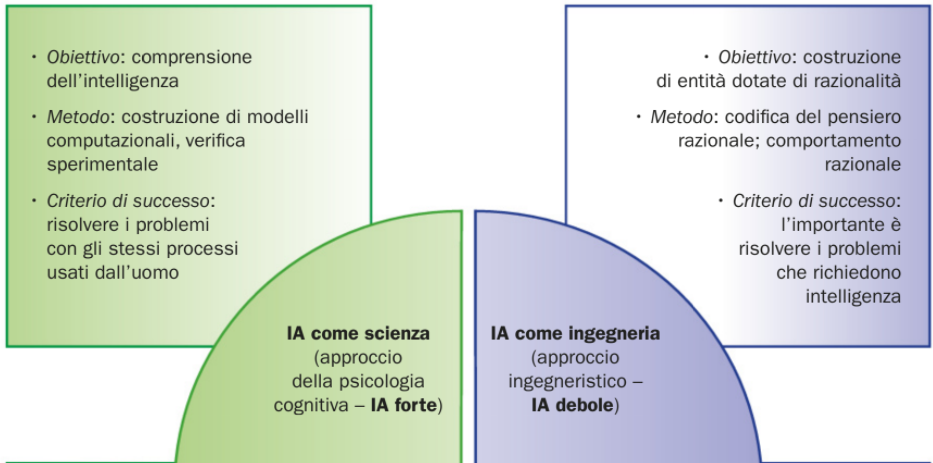

### Quali temi guidarono i primi studi sull'IA?
I primi ricercatori si concentrarono su quattro aree principali:
1. **Rappresentazione della conoscenza** (*knowledge representation*);
2. **Ragionamento** (*reasoning*);
3. **Pianificazione** (*planning*);
4. **Elaborazione del linguaggio naturale** (**Natural Language Processing — NLP**).

In quegli anni gli studiosi dedicarono invece poco spazio a due temi oggi centrali: l'**apprendimento automatico** (**Machine Learning**) e la capacità di riconoscere, classificare e raggruppare dati. Durante la Guerra Fredda (1947–1991), le prime ricerche puntarono soprattutto alla traduzione automatica tra inglese e russo.

### Perché scoppiarono il primo e il secondo inverno dell'IA?
Negli anni '60 le traduzioni automatiche produssero errori famosi. La frase *"The spirit is strong, but the flesh is weak"* (*"Lo spirito è forte, ma la carne è debole"*) venne tradotta in russo e poi di nuovo in inglese. Il risultato divenne *"The whiskey is strong, but the meat is rotten"* (*"Il whiskey è forte, ma la carne è andata a male"*).

Tre limiti causarono il **primo inverno dell'IA** (taglio dei fondi nel **1966**):
* scarsa **potenza di calcolo** dei computer dell'epoca;
* pochi **dati** disponibili e memorie enormi e costose;
* metodi e tecniche di ricerca ancora immaturi.

Negli anni '80 arrivò una nuova ondata di entusiasmo grazie ai **sistemi esperti**. Questi programmi risolvevano problemi complessi in un singolo settore specifico, come la diagnostica medica. Ogni **sistema esperto** aveva tre parti:
1. una **base di conoscenza** (*knowledge base*) con le regole del settore;
2. un **motore inferenziale** che deduce conclusioni tramite **alberi decisionali**;
3. un'**interfaccia utente** per dialogare con la persona.

Presto emersero limiti seri, che portarono al **secondo inverno dell'IA**:
* alti costi di sviluppo e di aggiornamento;
* grande difficoltà nella ricerca degli errori (**debugging**);
* scarsa flessibilità fuori dal proprio settore (come nel celebre programma **ELIZA** del 1964–1966);
* risultati inferiori rispetto alle promesse iniziali.

> **Checkpoint `[A1 → B2]`**: *Ricorda (`[A1]`) la differenza tra **IA forte** e **IA debole**. Poi spiega (`[B2]`) quale legame unisce la mancanza di dati e potenza di calcolo al primo inverno dell'IA.*

---

## Parte 2 — Come evolvono i Sistemi Esperti?

### Come funzionano i sistemi esperti di prima generazione ('60–'70)?
I sistemi di prima generazione usavano la **logica booleana** (vero o falso). Essi seguivano un **modello deterministico** rigido di tipo *causa → effetto*, simile a un **albero decisionale**.

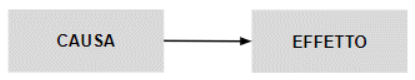

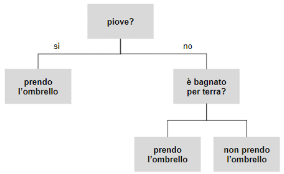

Questo approccio mostrò presto un limite chiaro. La realtà è complessa e la logica rigida creava conflitti. Per questo l'esperto umano superava facilmente il sistema artificiale.

### Cosa cambia con la seconda generazione ('70–'80)?
Per superare i conflitti logici, i ricercatori introdussero il **modello probabilistico** (*causa → probabili effetti*). Il sistema associava una percentuale di probabilità a ogni possibile esito.

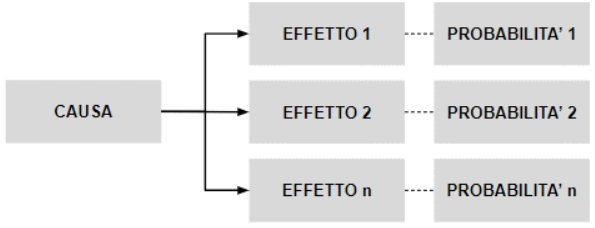

Anche questo modello aveva però un limite importante: sceglieva la risposta più probabile e trascurava il rischio reale. In medicina, un sintomo può indicare al 97% una malattia lieve e al 3% una malattia mortale. Un medico prudente verifica comunque l'ipotesi più grave.

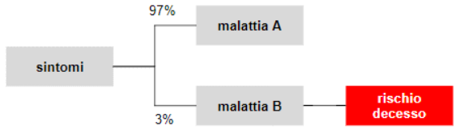

### Cosa introduce la terza generazione ('80–'90)?
La terza generazione introdusse la **logica sfumata** (**fuzzy logic**). Questa logica usa gradi di appartenenza sfumati invece di un taglio netto tra vero e falso. Per esempio, una persona alta 180 cm può sembrare alta a qualcuno e media a qualcun altro.


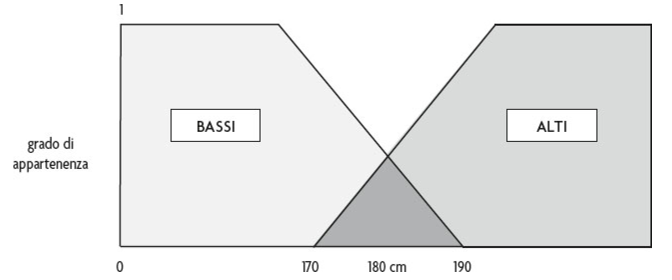

Questi strumenti restavano soprattutto sistemi diagnostici e offrivano risposte, ma lasciavano la decisione all'uomo. Oggi, uniti a **Machine Learning** e **Big Data**, sono diventati **Sistemi di Supporto alle Decisioni** (**DSS — Decision Support System**), come i *Virtual Coach*.

---

## Parte 3 — Le macchine possono davvero pensare?

### Che cos'è il Test di Turing?
Nel **1950** il matematico **Alan Turing** pubblicò l'articolo *"Computing Machinery and Intelligence"*. Egli sostituì la domanda *"Le macchine possono pensare?"* con un gioco pratico: l'**Imitation Game** (*Gioco dell'imitazione*).

Nel gioco originale, un giudice (`C`) fa domande scritte a due persone nascoste (`A` e `B`) per indovinarne il genere. Nella versione per l'IA, un computer sostituisce uno dei due giocatori. Se il giudice scambia spesso la macchina per un essere umano, la macchina supera il **Test di Turing**. Questo test ispira ancora oggi il **Premio Loebner**.

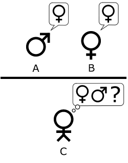

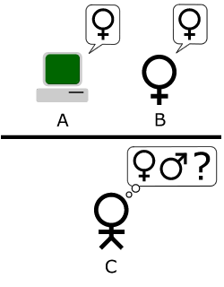

### Qualche IA ha superato davvero il Test di Turing?
La comunità scientifica ritiene che nessuna IA abbia superato il test in senso rigoroso. Esistono però due casi molto discussi:
* **Eugene Goostman (2014)**: questo **chatbot** fingeva di essere un ragazzo ucraino di 13 anni. Ingannò il 33% dei giudici in 5 minuti, ma usava l'età e la lingua straniera come scusa per risposte strane.
* **ChatGPT, Gemini e modelli moderni (dal 2022)**: sostengono conversazioni molto fluide e spesso confondono gli utenti.

Oggi il **Test di Turing** conta meno per misurare l'intelligenza. Una macchina può imitare bene le parole umane senza capire nulla: **simulazione** e **comprensione** restano due cose diverse.

### Perché Luciano Floridi parla di Quarta Rivoluzione?
Il filosofo italiano **Luciano Floridi** collega Alan Turing alle tre grandi rivoluzioni scientifiche della storia:
1. **Copernico** tolse l'uomo dal centro dell'universo.
2. **Darwin** mostrò che l'uomo discende dall'evoluzione animale.
3. **Freud** rivelò che la nostra mente non controlla tutto in modo conscio.
4. **Turing** avviò la **Quarta Rivoluzione**: anche le macchine eseguono calcoli e ragionamenti logici, spesso meglio di noi.

### Cosa dimostra l'esperimento della Stanza Cinese?
Nel **1980** il filosofo **John Searle** ideò l'esperimento mentale della **Stanza Cinese** contro l'**IA forte**. Immagina una persona chiusa in una stanza. Questa persona ignora completamente il cinese, ma possiede un manuale preciso con regole per combinare i simboli.

Quando riceve una domanda in cinese (**input**), usa il manuale e consegna una risposta corretta (**output**). Chi sta fuori pensa che la stanza capisca il cinese. In realtà la persona applica solo regole formali (**sintassi**), senza capire il significato (**semantica**). Per Searle, simulare l'intelligenza non crea né mente né coscienza.

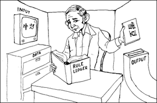

### Come descrive l'IA Nello Cristianini e cos'è il CAPTCHA?
Nel libro *"La scorciatoia"* (2023), lo scienziato **Nello Cristianini** chiarisce un punto essenziale. Una macchina mostra intelligenza quando agisce in modo efficace in situazioni nuove, anche senza un cervello umano. L'IA non sogna e non riflette: usa potenti **scorciatoie statistiche**. Conoscere questi limiti aiuta a usarla in modo responsabile.

Un'applicazione quotidiana del Test di Turing al contrario è il **CAPTCHA** (*Completely Automated Public Turing test to tell Computers and Humans Apart*). In questo test un computer chiede all'utente di leggere parole distorte o selezionare immagini per dimostrare di essere umano.

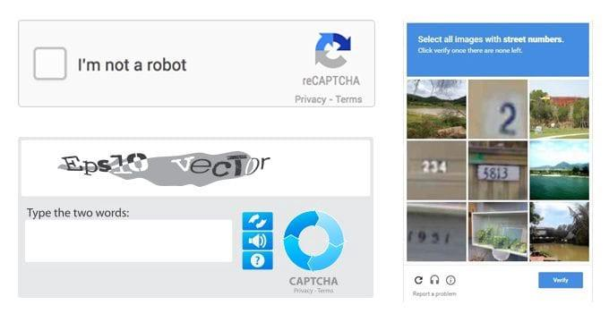

> **Checkpoint `[B2 → C3]`**: *Collega (`[B2]`) l'esperimento della **Stanza Cinese** al concetto di "scorciatoia statistica" di Cristianini. Poi applica (`[C3]`): se un chatbot risponde bene a una domanda di storia, come puoi verificare se ha davvero capito o se sta solo combinando parole?*

---

## Parte 4 — Come imparano le macchine con il Machine Learning?

### Che cos'è il Machine Learning?
Il **Machine Learning (ML)**, o **apprendimento automatico**, è una branca dell'**Intelligenza Artificiale**. I suoi **algoritmi** analizzano grandi quantità di dati e imparano direttamente dall'esperienza. Più dati ricevono, più migliorano le loro prestazioni.

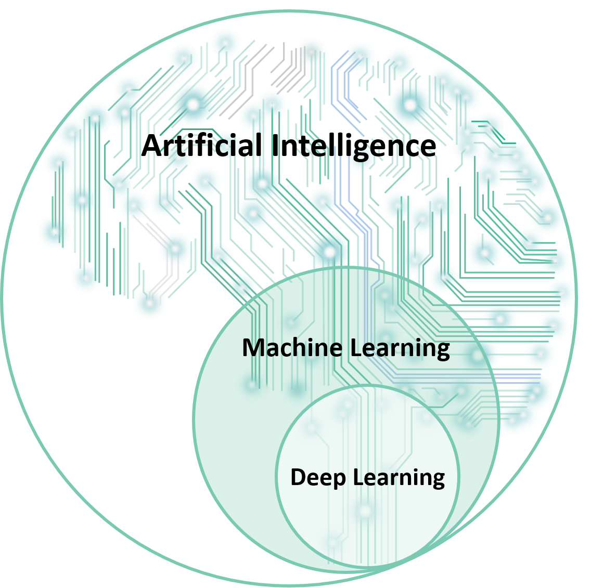

Esistono tre grandi famiglie di **Machine Learning**:
1. **Apprendimento supervisionato** (*Supervised Learning*): include **classificazione** e **regressione**.
2. **Apprendimento non supervisionato** (*Unsupervised Learning*): include il **raggruppamento** (**clustering**).
3. **Apprendimento con rinforzo** (*Reinforcement Learning*).

### Cosa distingue il Machine Learning dalla programmazione tradizionale?
Nella **programmazione tradizionale**, il programmatore inserisce i **dati** e le **regole** (*functions*) per ottenere un **output**. Nel **Machine Learning**, invece, inseriamo i **dati** e gli **output** attesi. Il computer ricava da solo la **funzione** (*regola*) che collega input e output.

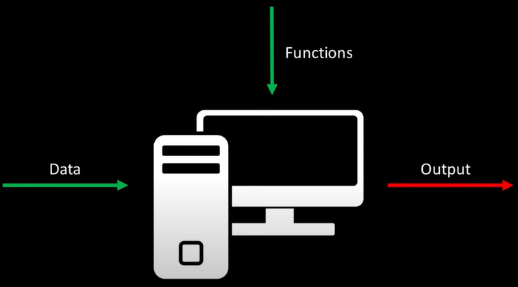

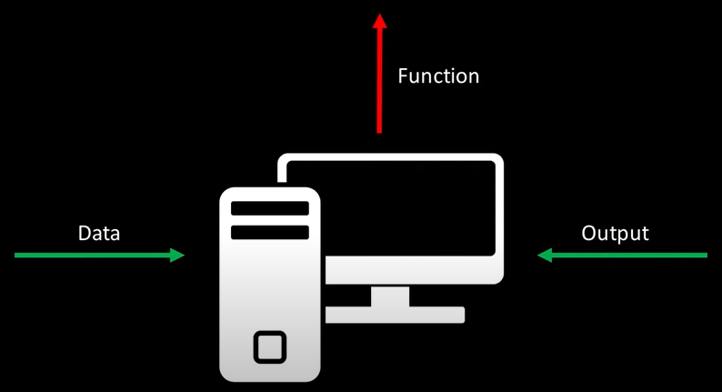

Nell'**apprendimento supervisionato** usiamo cinque elementi fondamentali:
* **Label** (etichetta): l'output che vogliamo prevedere.
* **Features** (caratteristiche): i dati in ingresso che descrivono ogni esempio.
* **Training dataset**: l'insieme di esempi usati per addestrare il modello.
* **Data point**: un singolo esempio del dataset.
* **Test dataset**: nuovi dati usati alla fine per verificare se il modello funziona bene.

### Come funziona la Classificazione?
Nella **classificazione** (*classification*), il modello assegna a ogni input una categoria precisa (**output discreto**). Alcuni esempi sono il riconoscimento dei volti, il filtro **spam** delle e-mail o la distinzione tra foto di cani e gatti.

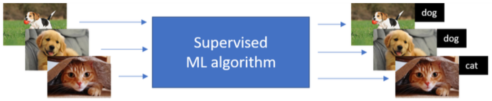

### Come funziona l'algoritmo KNN?
L'algoritmo **KNN** (*K-Nearest Neighbors*) classifica un nuovo dato guardando i **K esempi più vicini** nel training dataset. La classe più frequente tra questi vicini vince. Se scegliamo `K=3` il risultato può cambiare rispetto a `K=7`.

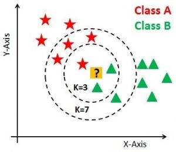

Il **KNN** è un algoritmo "pigro" (*lazy*): memorizza gli esempi e calcola la distanza solo quando arriva un nuovo dato. Per misurare la vicinanza usa due metriche principali:
* **Distanza Euclidea**: misura il percorso diretto in linea retta tra due punti.
* **Distanza Manhattan** (o del tassista): misura il percorso seguendo solo spostamenti orizzontali e verticali sugli assi.

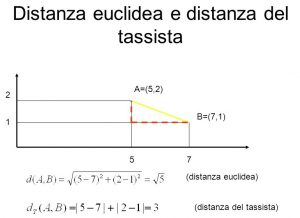

### Come funziona l'algoritmo Naive Bayes?
L'algoritmo **Naive Bayes** usa il **teorema di Bayes** per calcolare la probabilità di una classe. Si chiama *naive* ("ingenuo") perché assume che tutte le caratteristiche siano indipendenti tra loro. Nonostante questa semplificazione, funziona molto bene nei **filtri antispam**.

$$P(A \mid B) = \frac{P(B \mid A) \cdot P(A)}{P(B)}$$


Nel classico esempio del **gioco del golf**, il modello decide se giocare (`Yes` o `No`) osservando meteo, temperatura, umidità e vento su 14 giorni passati. Moltiplicando le probabilità condizionate per il caso *Rainy, Cool, High, True*, l'algoritmo ottiene `P(No|X) = 0,80` contro `P(Yes|X) = 0,20` e prevede `No`.

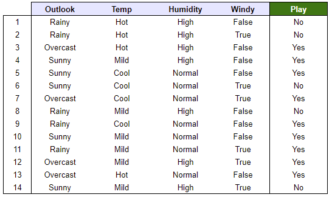

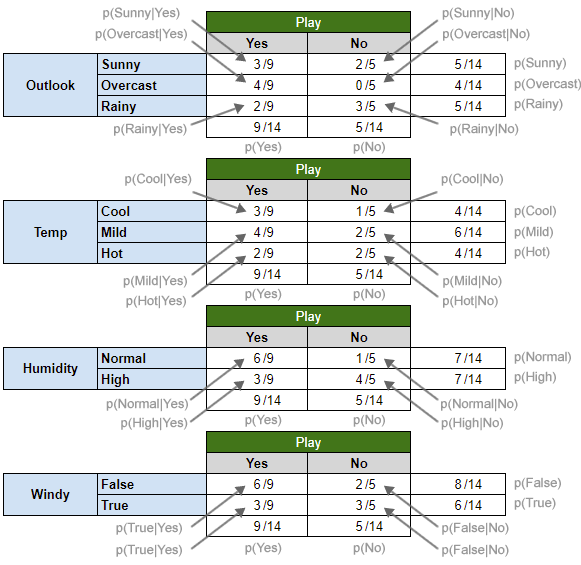

### Come funziona la Regressione lineare semplice?
Nella **regressione** (*regression*), l'output è un valore numerico continuo, come il prezzo di una casa o l'andamento di un titolo in borsa. Il modello cerca la curva che approssima meglio i dati reali, evitando sia errori troppo grandi sia curve troppo rigide sui singoli punti (**overfitting**).

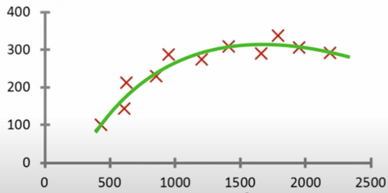

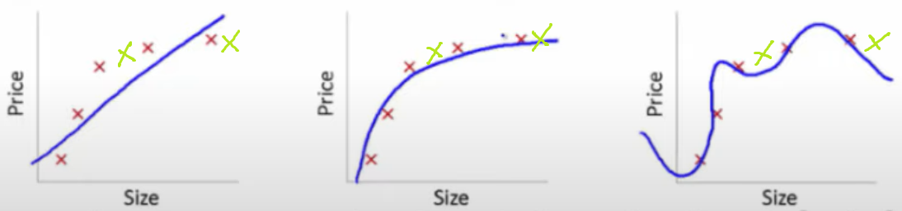

Nella **regressione lineare semplice** cerchiamo la retta $y = mx + q$ tramite il **metodo dei minimi quadrati**, che riduce al minimo la somma dei quadrati degli scarti verticali:

$$m = \frac{n \sum xy - \sum x \sum y}{n \sum x^2 - (\sum x)^2} \qquad q = \frac{\sum y - m \sum x}{n}$$

**Esempio pratico `[C3]`**: con i punti $(1, 2)$, $(2, 3)$ e $(3, 5)$ otteniamo $n = 3$, $\sum x = 6$, $\sum y = 10$, $\sum xy = 23$ e $\sum x^2 = 14$. Le formule restituiscono $m = 1,5$ e $q \approx 0,33$, quindi la retta stimata è $y = 1,5x + 0,33$.

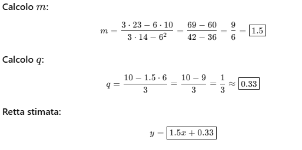

Ecco la stessa procedura tradotta in **codice C++**:

```cpp
#include <iostream>
using namespace std;

void regLin(double x[], double y[], int n, double &m, double &q) {
    double sum_x = 0, sum_y = 0, sum_xy = 0, sum_x2 = 0;
    for (int i = 0; i < n; i++) {
        sum_x += x[i];
        sum_y += y[i];
        sum_xy += x[i] * y[i];
        sum_x2 += x[i] * x[i];
    }
    m = (n * sum_xy - sum_x * sum_y) / (n * sum_x2 - sum_x * sum_x);
    q = (sum_y - m * sum_x) / n;
}

int main() {
    const int n = 3;
    double x[n] = {1, 2, 3};
    double y[n] = {2, 3, 5};
    double m, q;
    regLin(x, y, n, m, q);
    cout << "Retta: y = " << m << "x + " << q << endl;
    return 0;
}
```

### Come raggruppa i dati l'algoritmo K-means?
L'algoritmo **K-means** appartiene all'**apprendimento non supervisionato** e raggruppa i dati simili in **cluster** senza etichette iniziali. Procede in quattro passi ripetuti:
1. sceglie a caso `K` punti centrali chiamati **centroidi**;
2. calcola la distanza tra ogni punto e i centroidi;
3. assegna ogni punto al centroide più vicino;
4. sposta ogni centroide al centro medio del proprio gruppo e ripete il ciclo.

Per scegliere il numero migliore di gruppi (`K`), si usa il **metodo del gomito** (*elbow method*): si osserva il punto in cui la curva dell'errore piega bruscamente.

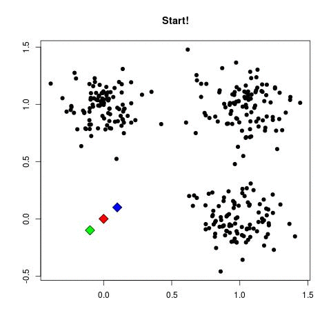

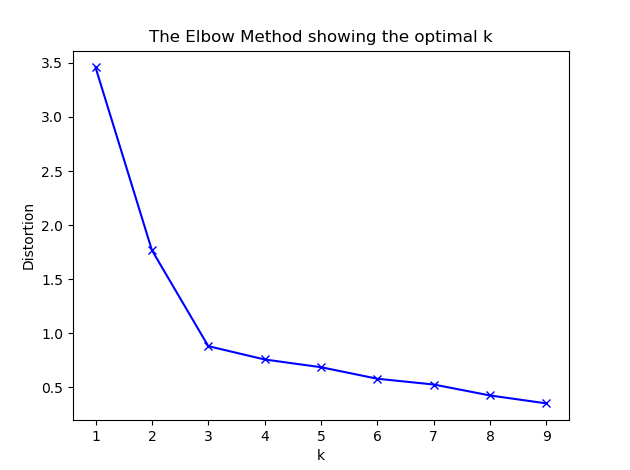

### Come funziona l'Apprendimento con Rinforzo?
Nell'**apprendimento con rinforzo** (*Reinforcement Learning*), un **agente** esplora un ambiente dinamico per raggiungere un obiettivo, come parcheggiare un'auto o vincere una partita. Dopo ogni azione l'agente riceve un **feedback**: una **ricompensa** se agisce bene o una **punizione** se sbaglia. L'agente salva l'esperienza nella sua **Knowledge Base (KB)** e cerca di massimizzare la ricompensa totale.

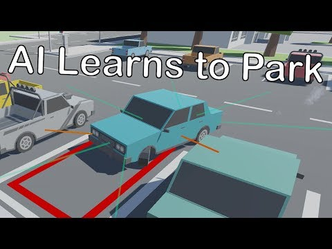

---

## Parte 5 — Cosa sono gli Algoritmi Bio-ispirati, le Reti Neurali e il Deep Learning?

### Cosa sono gli algoritmi bio-ispirati e gli algoritmi genetici?
Gli **algoritmi bio-ispirati** copiano strategie osservate in natura per risolvere problemi complessi. I due esempi principali sono gli **Algoritmi Genetici (GA)** e le **Reti Neurali Artificiali (ANN)**.

Gli **Algoritmi Genetici** si ispirano alla **selezione naturale** di Darwin:
1. valutano ogni soluzione candidata con una **fitness function** (funzione di adattamento);
2. selezionano gli individui migliori;
3. generano nuovi individui con il **crossover** (scambio di parti tra due genitori) e la **mutazione** (piccole modifiche casuali);
4. ripetono il ciclo per molte generazioni fino a trovare una soluzione ottimale.

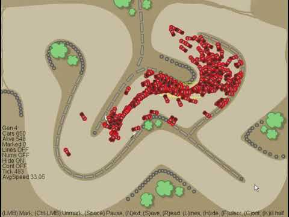

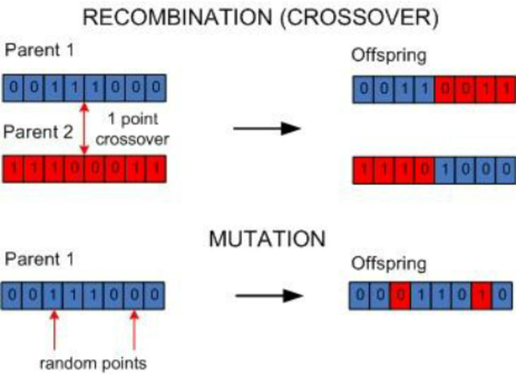

### Come funziona una Rete Neurale e cos'è il Percettrone?
Le **Reti Neurali Artificiali** si basano sul **connessionismo** e imitano i **neuroni** e le **sinapsi** del cervello umano. Nel **1958** **Frank Rosenblatt** introdusse il **percettrone**, ampliando il neurone formale di McCulloch e Pitts (1943).

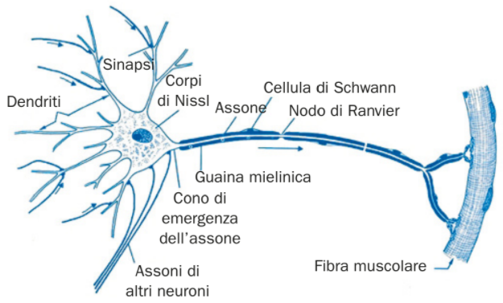

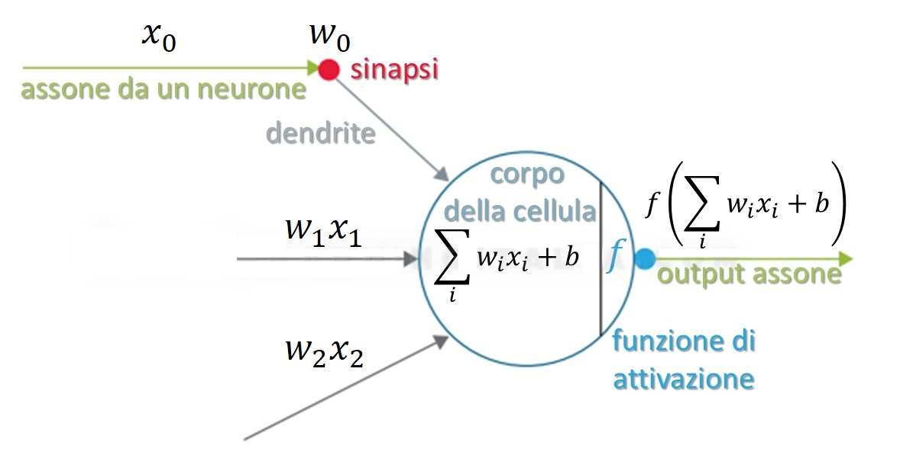

Il **percettrone** riceve degli ingressi ($x_i$), li moltiplica per dei **pesi** ($w_i$), aggiunge un **bias** ($b$) e applica una **funzione di attivazione** ($f$) per produrre l'uscita ($y$). Le funzioni di attivazione più note sono il **gradino** (*step*), la **rampa**, la **sigmoide** e la **tangente iperbolica** (`tanh`).

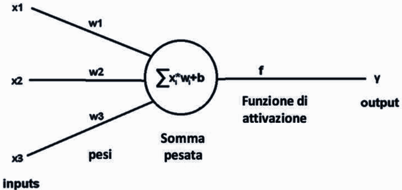

| Funzione Gradino | Funzione Rampa | Funzione Sigmoide | Tangente Iperbolica (`tanh`) |
| :---: | :---: | :---: | :---: |
| 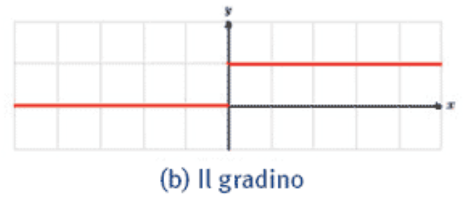 | 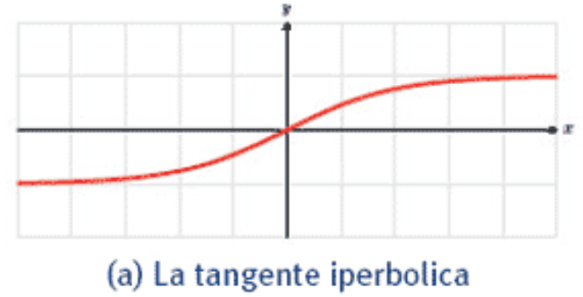 | 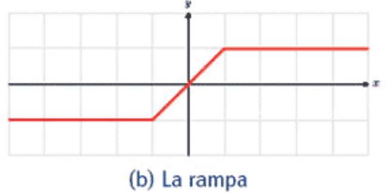 | 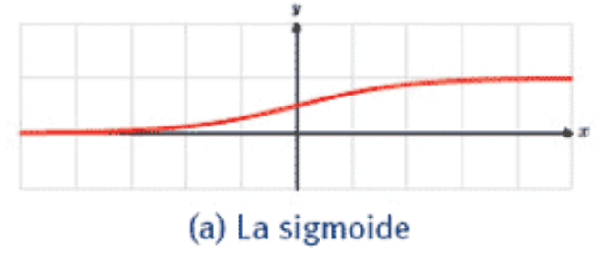 |

**Esempio applicativo `[C3]` — Addestrare un percettrone sull'operatore AND**:
* **Dati iniziali**: 2 ingressi ($x_1, x_2$), funzione a gradino $G(z)$, pesi $w_1 = 0,5$ e $w_2 = -0,5$, bias $b = 0,1$, tasso di apprendimento $\eta = 0,1$.
* **Caso 1**: $x_1 = 0, x_2 = 0$ (risultato atteso $y_{\text{desiderato}} = 0$).
* **Somma pesata**: $z = 0,5 \cdot 0 + (-0,5) \cdot 0 + 0,1 = 0,1$.
* **Uscita predetta**: $y_{\text{predetto}} = G(0,1) = 1$.
* **Errore**: $\text{Errore} = 0 - 1 = -1$.
* **Aggiornamento**: $w_1 = 0,5$, $w_2 = -0,5$, $b = 0,1 + 0,1 \cdot (-1) = 0$.
Ripetendo questi passi per molte **epoche**, i pesi si regolano finché la rete impara esattamente la tabella dell'operatore **AND**.

### Perché serve il Deep Learning e cos'è la Backpropagation?
**Minsky e Papert** dimostrarono che un singolo percettrone risolve solo problemi separabili con una retta e fallisce sulla funzione logica **XOR**. Per superare questo limite nacquero le reti multistrato (**Multilayer Perceptron — MLP**) con **strati nascosti** (**hidden layer**).

Quando gli strati nascosti diventano molti, parliamo di **Deep Learning** e di **Reti Neurali Profonde** (**Deep Neural Networks — DNN**). Ogni strato impara caratteristiche sempre più astratte, permettendo compiti complessi come la visione artificiale e la traduzione.

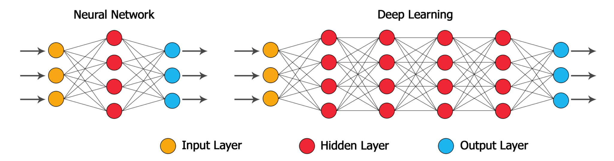

Per addestrare queste reti si usa la **retropropagazione degli errori** (**backpropagation**). Questo algoritmo sfrutta funzioni di attivazione derivabili (come **sigmoide**, **tanh** o **ReLU**) per calcolare il **gradiente dell'errore** e correggere gradualmente i pesi di tutta la rete.

---

## Parte 6 — Dove usiamo l'IA oggi e come funziona l'IA Generativa?

### In quali campi si applica oggi l'Intelligenza Artificiale?
Oggi l'IA opera in molti settori della vita quotidiana e della scienza:
* **Giochi**: **IBM Deep Blue** batté Garry Kasparov a scacchi (1996); **Google AlphaGo** batté Lee Sedol al gioco del Go (2016).
* **Domotica e assistenti virtuali**: sistemi **IoT** (*Internet of Things*) come Google Home, Amazon Alexa e Apple HomePod.
* **Matematica e programmazione**: dimostratori di teoremi (Coq, Isabelle), risolutori (Photomath, WolframAlpha) e assistenti di codice (GitHub Copilot, DeepSeek-Coder).
* **Linguaggio naturale**: assistenti vocali, traduttori (Google Translate, DeepL) e chatbot generativi.
* **Veicoli autonomi**: auto a guida autonoma (Tesla, Waymo) e droni per la logistica.
* **Medicina**: diagnostica, telemedicina, protesi intelligenti e **AlphaFold** di DeepMind per prevedere le strutture delle proteine.
* **Robotica**: robot umanoidi come **Sophia** (2017) e **Tesla Optimus** (2022). La **robotica** unisce l'elaborazione informatica ai **sensori** (percezione) e agli **attuatori** (movimento).

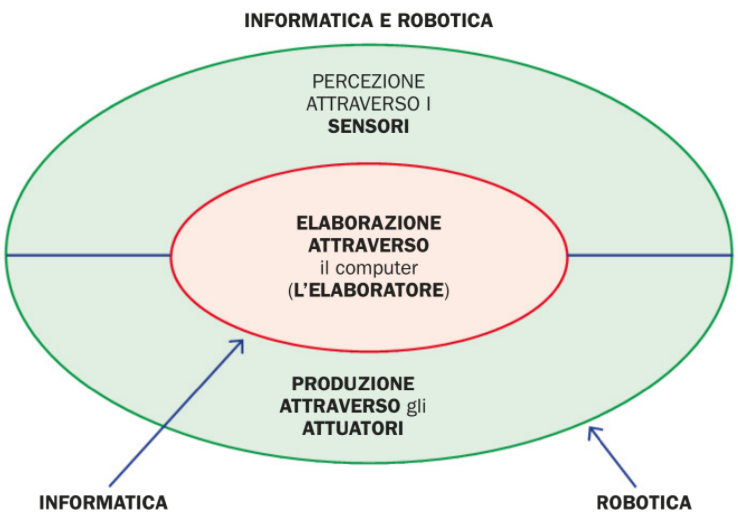

### Che cos'è l'IA Generativa e quali sono i principali Chatbot?
L'**Intelligenza Artificiale Generativa** crea nuovi contenuti originali: testi, immagini, codice o idee. I moderni **Chatbot di IA** sfruttano reti neurali profonde per dialogare in linguaggio naturale.

| Piattaforma | Azienda / Caratteristiche principali | Logo |
| :--- | :--- | :---: |
| **ChatGPT** | Creato da **OpenAI** (novembre 2022). Basato sull'architettura **GPT** (*Generative Pre-trained Transformer*). | 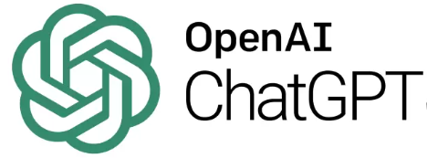 |
| **Gemini** | Assistente IA di **Google**, nato nel 2024 come evoluzione di **Bard**. |  |
| **Copilot** | Assistente IA di **Microsoft** (2024), integrato negli strumenti di produttività Microsoft 365. | 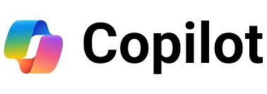 |
| **DeepSeek** | Azienda cinese (2023) che sviluppa **LLM open source** efficienti, come **DeepSeek-R1**. |  |
| **Claude** | Assistente di **Anthropic** (2021), addestrato con **Constitutional AI** per sicurezza, ragionamento e analisi di testi lunghi. | 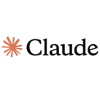 |

### Come funziona un Chatbot come ChatGPT?
Al centro di ChatGPT opera un **Large Language Model (LLM)** addestrato su miliardi di testi. Il modello genera una frase una parola alla volta, calcolando le probabilità della parola successiva in base al contesto (**n-gram** e sequenze apprese).

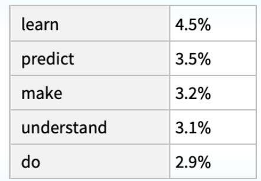

Se scegliesse sempre la parola più probabile, produrrebbe risposte sempre uguali. Per rendere il testo naturale, usa un parametro chiamato **temperatura** (ad esempio `0,8`) che introduce variabilità controllata. Inoltre mantiene la memoria della conversazione nella stessa chat (**prompt chaining**).


### Come si scrivono prompt efficaci (Prompt Engineering)?
Il **prompt** è la richiesta che scriviamo al chatbot. Il **Prompt Engineering** studia come formulare istruzioni chiare per ottenere risposte precise. Ricorda di tutelare sempre la privacy e di evitare l'inserimento di dati personali sensibili.

Per migliorare un prompt puoi indicare **registro linguistico**, **tono**, **formato** (tabella, elenco) e **ruolo** (es. giornalista, scienziato). Tre schemi pratici aiutano ad applicare subito queste regole (`[C3]`):
* **RTF (Ruolo, Task, Formato)**: *"Sei uno scienziato; scrivi un testo sul cambiamento climatico di circa 100 parole."*
* **CTF (Contesto, Task, Formato)**: *"Voglio creare il sito delle mie lezioni di storia. Inventa il nome del sito. Dammi 10 idee."*
* **RASCEF (Ruolo, Azione, Step, Contesto, Esempio, Formato)**: definisce il ruolo, l'azione, i passi, il pubblico, un esempio guida e il formato finale.

---

## Parte 7 — Allenamento Progressivo: da `[A1]` a `[C3]`

1. **Ricordare `[A1]`**: Elenca le 3 parti di un **sistema esperto** e i 3 tipi principali di **Machine Learning**.
2. **Comprendere le relazioni `[B2]`**: Spiega perché la **programmazione tradizionale** differisce dal **Machine Learning** e perché un **LLM** genera risposte probabilistiche senza possedere comprensione umana (collega **Test di Turing** e **Stanza Cinese**).
3. **Applicare `[C3]`**:
   * Classifica ciascun problema scegliendo tra **Classificazione**, **Regressione**, **Clustering** o **Rinforzo**: *(a)* prevedere il consumo elettrico di domani; *(b)* dividere i clienti di un negozio in 4 gruppi simili senza etichette; *(c)* riconoscere una mail di spam; *(d)* addestrare un robot a camminare senza cadere.
   * Scrivi un **prompt** in formato **RTF** per chiedere a un chatbot una sintesi accessibile sul **percettrone** per uno studente di scuola secondaria.

---

## Parte 8 — Tabella Glossario dei Termini Tecnici

| Termine Tecnico | Spiegazione semplice (Easy-to-Read) | Esempio pratico |
| :--- | :--- | :--- |
| **Algoritmo** | Sequenza ordinata di passi chiari per risolvere un problema. | La ricetta passo-passo per calcolare la retta di regressione. |
| **Algoritmo Genetico (GA)** | Algoritmo ispirato all'evoluzione di Darwin che migliora le soluzioni per selezioni, **crossover** e **mutazioni**. | Ottimizzare il percorso di un veicolo virtuale su un circuito. |
| **Apprendimento con Rinforzo** | Metodo in cui un agente impara provando azioni e ricevendo ricompense o punizioni. | Un software che impara a parcheggiare un'auto o giocare a Go. |
| **Apprendimento Non Supervisionato** | Metodo di ML che trova gruppi o schemi nei dati senza etichette iniziali. | L'algoritmo **K-means** che divide dati in cluster simili. |
| **Apprendimento Supervisionato** | Metodo di ML che impara da esempi già etichettati (*input* + *output* corretto). | Addestrare un modello a distinguere foto di cani e gatti. |
| **Backpropagation** | Algoritmo che calcola l'errore finale di una rete neurale e aggiorna i pesi all'indietro. | Correggere i pesi di una rete profonda per riconoscere meglio i volti. |
| **CAPTCHA** | Test di Turing inverso che verifica se l'utente di un sito è un umano o un bot. | Selezionare i riquadri con i numeri civici prima di inviare un modulo. |
| **Classificazione** | Compito di ML che assegna un dato a una categoria precisa (**output discreto**). | Smistare le e-mail tra "Posta in arrivo" e "Spam". |
| **Clustering (K-means)** | Tecnica che raggruppa dati simili attorno a punti centrali detti **centroidi**. | Dividere gli studenti o i clienti in gruppi con abitudini affini. |
| **Deep Learning** | Branca del ML che usa **reti neurali profonde** con molti strati nascosti (**DNN**). | Riconoscimento vocale, visione artificiale e traduttori moderni. |
| **Distanza Euclidea / Manhattan** | Due modi matematici per misurare la vicinanza tra punti nell'algoritmo **KNN**. | Linea retta (Euclidea) contro percorso a isolati cittadini (Manhattan). |
| **Fuzzy Logic (Logica sfumata)** | Logica che usa valori graduali tra 0 e 1 invece del solo vero/falso. | Descrivere una persona di 180 cm come "abbastanza alta". |
| **IA Debole (Narrow AI)** | Sistema progettato per svolgere bene un compito specifico, senza coscienza. | Un navigatore satellitare, un filtro spam o un chatbot attuale. |
| **IA Forte (General AI)** | Ipotesi teorica di una macchina con mente, coscienza e intelligenza pari a quella umana. | Macchine coscienti della fantascienza (oggi non esistenti). |
| **IA Generativa** | Branca dell'IA capace di creare nuovi testi, immagini, audio o codice originali. | ChatGPT, Google Gemini, Microsoft Copilot, Claude, DeepSeek. |
| **Large Language Model (LLM)** | Grande modello linguistico addestrato su miliardi di testi per prevedere e generare linguaggio. | Il motore linguistico alla base di Gemini e ChatGPT. |
| **Machine Learning (ML)** | Branca dell'IA in cui i computer imparano regole direttamente dai dati. | Un sistema che prevede i prezzi delle case dai dati storici. |
| **Naive Bayes** | Algoritmo probabilistico basato sul teorema di Bayes che assume caratteristiche indipendenti. | Filtro antispam o previsione del meteo per giocare a golf. |
| **Percettrone** | Modello matematico del singolo neurone artificiale con ingressi, pesi, bias e funzione di attivazione. | Rete minima capace di imparare l'operatore logico AND. |
| **Prompt / Prompt Engineering** | Richiesta inviata a un chatbot e tecnica per scriverla in modo chiaro ed efficace. | Usare gli schemi **RTF**, **CTF** o **RASCEF** in una chat IA. |
| **Regressione** | Compito di ML che prevede un numero continuo a partire da dati noti. | Stimare il prezzo futuro di una casa in base ai metri quadrati. |
| **Sistema Esperto** | Programma che applica regole di un settore tramite base di conoscenza e motore inferenziale. | Primi software diagnostici medici degli anni '70–'80. |
| **Stanza Cinese** | Esperimento mentale di John Searle che distingue la manipolazione di simboli (sintassi) dalla vera comprensione (semantica). | Rispondere in cinese con un manuale senza capire la lingua. |
| **Temperatura** | Parametro che regola la creatività e la variabilità delle parole scelte da un LLM. | Valore `0,8` per ottenere risposte varie e naturali in chat. |
| **Test di Turing** | Prova ideata da Alan Turing (1950) per valutare se una macchina riesce a imitare un umano in chat. | Il giudice conversa via testo e prova a capire chi è il computer. |
